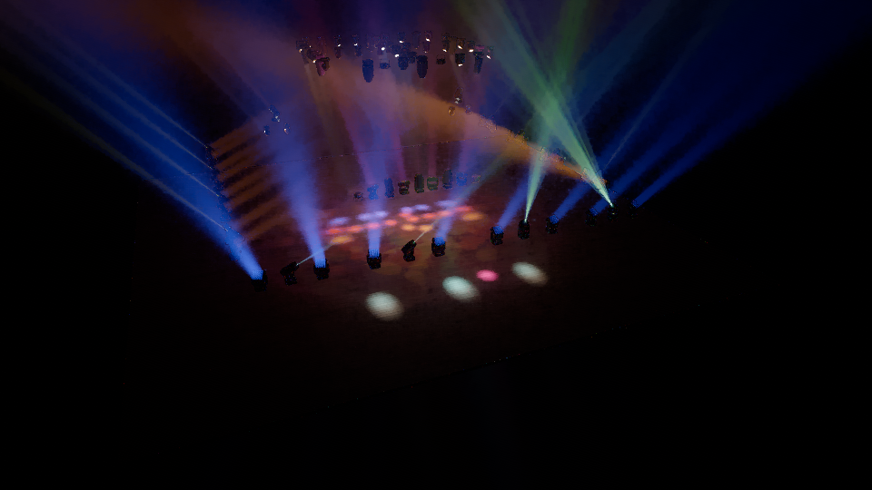

# Candela

[Русский](#русский) · [English](#english)


---

## Русский

**Candela** — визуализатор и редактор сценического света: приборы **GDTF**, сцены **MVR**, физически корректный свет
(канделы, люксы), объёмные лучи в дыму, DMX- и силовая коммутация, управление с пультов в реальном времени
(Art-Net, sACN, OSC, PSN). Написан на C# / .NET 8 и Vulkan 1.3.

> **Предварительная версия.** Редактор уже можно установить и попробовать; многое ещё дорабатывается — см.
> [ROADMAP.md](docs/ROADMAP.md).

### Установить в Windows

Скачайте `Candela-Setup-<версия>-win-x64.exe` (страница *Releases* или артефакт сборки *Windows installer* на
вкладке *Actions*) и запустите. Нужны Windows 10/11 x64 и видеокарта с драйвером Vulkan 1.3. Программа не подписана:
если SmartScreen предупредит, нажмите «Подробнее» → «Выполнить в любом случае».

**Подробная инструкция: [docs/install.md](docs/install.md)** — требования, установка, первый запуск и библиотека
приборов, брандмауэр, где хранятся файлы, удаление, что делать при проблемах.


### Что умеет

* Библиотека приборов из ваших файлов GDTF (в репозитории их ~1100) с 3D-миниатюрами; прибор перетаскивается на
  сцену и сразу патчится.
* Открытие и сохранение MVR и проектов `.candela`, автосохранение и восстановление.
* Реалтайм-рендер с объёмными лучами, гобо, призмами и дымом; финальный рендер с трассировкой путей (пока из
  командной строки: `candela render --final`).
* Кабели DMX и питания, сплиттеры, пульты, нагрузка на линии; проверка проблем сцены.
* Управление с пульта по Art-Net, sACN, OSC, PSN; запись DMX.
* Интерфейс на русском и английском, свободная раскладка панелей.



### Документация

[Редактор](docs/editor.md) · [Движок](docs/engine.md) · [Рендер](docs/rendering.md) · [GDTF](docs/gdtf.md) ·
[MVR](docs/mvr.md) · [DMX](docs/dmx.md) · [Протоколы](docs/protocols.md) · [Электрика](docs/electrical.md) ·
[Архитектура](docs/ARCHITECTURE.md) · [Требования](docs/REQUIREMENTS.ru.md) · [План](docs/ROADMAP.md)

### Сборка из исходников

```bash
dotnet build Candela.sln
dotnet run --project src/Candela.App                        # редактор
dotnet run --project src/Candela.Cli -- info stages/Фокина.mvr   # утилита командной строки
packaging/windows/build-installer.sh                        # программа установки для Windows (на Linux)
```

---

## English

**Candela** is a stage lighting visualiser and editor: **GDTF** fixtures, **MVR** scenes, physically based light
(candela, lux), volumetric beams in haze, DMX and power cabling, and live control from lighting consoles (Art-Net,
sACN, OSC, PSN). Written in C# / .NET 8 and Vulkan 1.3.

> **Preview.** The editor can be installed and tried today; much is still being worked on — see
> [ROADMAP.md](docs/ROADMAP.md).

### Install on Windows

Download `Candela-Setup-<version>-win-x64.exe` (the *Releases* page, or the artifact of a *Windows installer* run on
the *Actions* tab) and run it. You need Windows 10/11 x64 and a graphics card with a Vulkan 1.3 driver. The build is
not code-signed: if SmartScreen warns, click **More info → Run anyway**.

**Step-by-step guide: [docs/install.md](docs/install.md)** — requirements, setup, the first start and the fixture
library, the firewall, where files are kept, uninstalling, and what to do when something goes wrong.


### What it does

* A fixture library from your GDTF files (the repository holds ~1100) with 3D thumbnails; drag a fixture onto the
  stage and it is patched.
* Opens and saves MVR and `.candela` projects, with autosave and recovery.
* Real-time rendering with volumetric beams, gobos, prisms and haze; a path-traced final render (from the command
  line for now: `candela render --final`).
* DMX and power cables, splitters, consoles, circuit loads; a scene issue checker.
* Live control from a console over Art-Net, sACN, OSC and PSN; DMX recording.
* English and Russian interface, freely dockable panels.

### Documentation

[Editor](docs/editor.md) · [Engine](docs/engine.md) · [Rendering](docs/rendering.md) · [GDTF](docs/gdtf.md) ·
[MVR](docs/mvr.md) · [DMX](docs/dmx.md) · [Protocols](docs/protocols.md) · [Electrical](docs/electrical.md) ·
[Architecture](docs/ARCHITECTURE.md) · [Requirements (RU)](docs/REQUIREMENTS.ru.md) · [Roadmap](docs/ROADMAP.md)

### Building from source

Needs the .NET 8 SDK and a Vulkan 1.3 driver (on Linux without a GPU, Mesa's lavapipe).

```bash
dotnet build Candela.sln
dotnet run --project src/Candela.App                        # the editor
dotnet run --project src/Candela.Cli -- info stages/Фокина.mvr   # the command-line tool
dotnet test tests/Candela.Engine.Tests                      # tests of one module
packaging/windows/build-installer.sh                        # the Windows installer (built on Linux)
```

See [docs/install.md](docs/install.md#building-the-installer) for the installer build (Linux, Windows, GitHub
Actions).
