# Candela editor (`Candela.App`)

The desktop editor of Candela: a dockable workspace around Vulkan viewports, built on GLFW, the shared
`VulkanContext` / `VulkanRenderer` of `Candela.Rendering.Vulkan` and Dear ImGui (docking + multi-viewport branch,
through the Hexa.NET bindings). The editor is a layer over the stage engine (`Candela.Engine.StageEngine`, see
[engine.md](engine.md)): the scene, selection, undo history and issue log the panels work on are the engine's, the
viewports draw the engine's render binding of the real scene, and File → New / Open / Save / Import / Export run the
engine's operations. Phase A built the shell, workspace, viewports, selection and editing tools, settings and the
headless verification mode; phase B1 connected the engine — documents, recovery, the fixture library with thumbnails and
drag-and-drop placement, walls and floors (see [Documents](#documents), [Library](#library) and
[Walls and floors](#walls-and-floors)); phase B2 the engine-backed panels; M4 cabling — devices, the Cable tool, the
cable link window and a stage that follows its cables (see [Cabling](#cabling)).

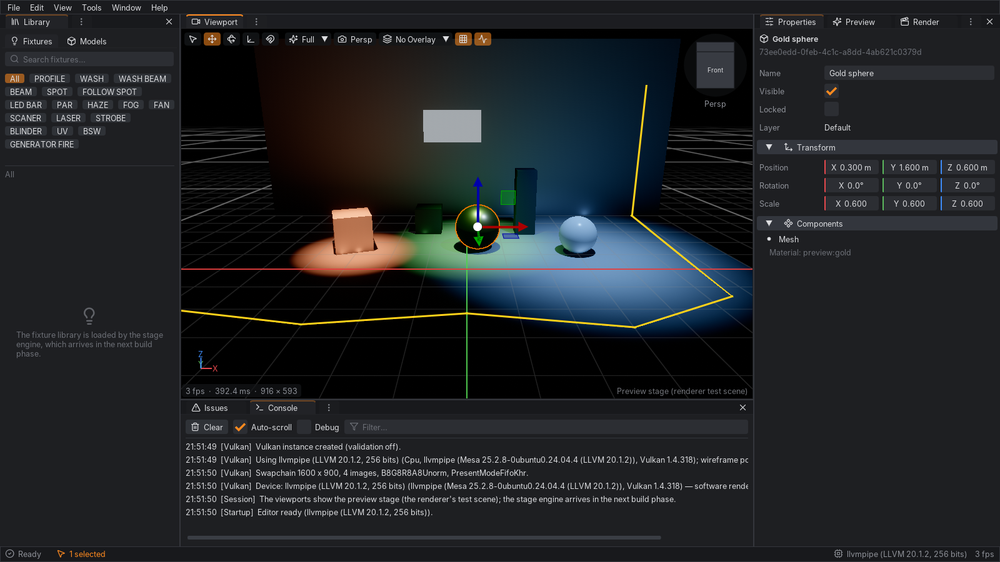

*Start-up without a scene: Library on the left (fixture thumbnails rendered in the background), an empty stage with its
floor grid in the viewport, Properties / Preview / Render on the right, Issues / Console below.*

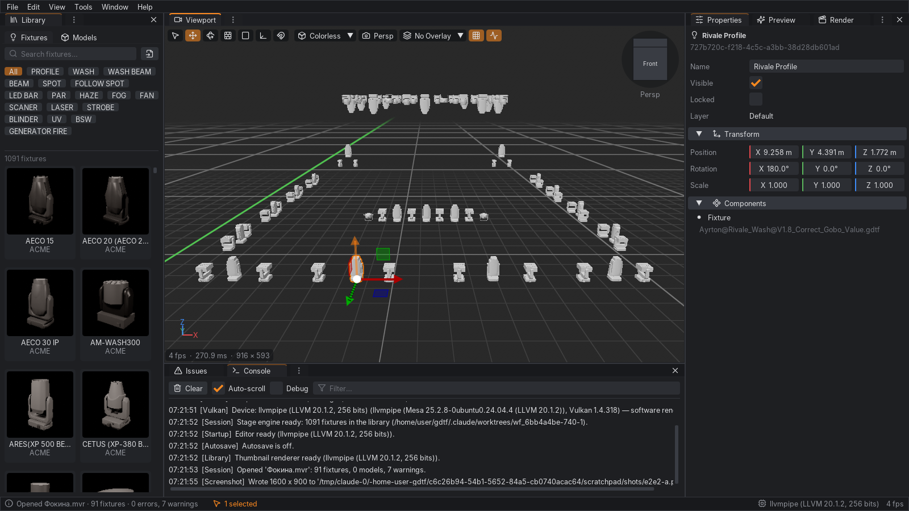

*`stages/Фокина.mvr` (91 fixtures) opened and framed; a click on a fixture selects the whole fixture (orange outline, move
gizmo) and the Properties panel shows it. Colorless shading; in Full shading the stage is lit only by its fixtures.*

## Running

```
dotnet run --project src/Candela.App -- [scene] [options]
```

The executable is `candela-app` (`candela-app.exe` on Windows). It needs a GPU with a Vulkan 1.3 driver; on Linux
without a GPU, Mesa's software driver (lavapipe, package `mesa-vulkan-drivers`) works — slowly, but completely.

| Option | Meaning |
|---|---|
| `scene` / `--open <file>` | scene or project to open at start (`.candela`, `.mvr`), behind the busy overlay of the first frame |
| `--layout <name>` | start with a layout: `default`, `viewports-4` or a saved layout name |
| `--reset-layout` | ignore the saved workspace and start with the default layout |
| `--scale <1-4>` | UI scale (1 = 100 %), overrides the setting |
| `--language <en\|ru>` | UI language, overrides the setting |
| `--device <name>` | preferred GPU (substring of the device name) |
| `--validation` | enable the Vulkan validation layer |
| `--config-dir <dir>` | folder for settings, layouts, presets and the log of this run |
| `--single-window` | keep torn-off panels inside the main window (no OS windows) |
| `--width <px>`, `--height <px>` | initial window size (default 1600 × 900, in screen coordinates scaled by the monitor's content scale; an interactive window that does not fit the monitor's work area — 2400 × 1350 pixels at 150 % — opens maximised, one that sticks out is centred) |
| `--screenshot <png>` | headless verification: render, save the last frame as PNG and exit |
| `--frames <n>` | frames rendered before the screenshot (default 12) |
| `--script <json>` | replay scripted input first (see [Scripted input](#scripted-input)) |
| `--preview-stage` | diagnostics: the viewports show the renderer's procedural test scene instead of the stage |
| `--library-setup` | open the [fixture library setup window](#library-folders-and-the-first-start) at start-up |

Exit codes: `0` ok, `1` failure, `2` usage error (bad option, unreadable script), `3` no usable Vulkan device.

On Windows `candela-app.exe` is a GUI program (no console window opens with it); `--help`, a usage error and
`--screenshot` runs attach to the console they were started from, so their output still appears there. The
executable carries the Candela icon, version information and a manifest (per-monitor DPI awareness v2, long paths).
Installing the editor on Windows: [install.md](install.md). The very first start (no settings file yet) takes the
interface language from the operating system (Russian for a Russian Windows or locale, English otherwise).

`--scale`, `--language` and `--device` apply to the current run only: the settings file keeps its values unless the
setting is changed in the editor during the run. Headless runs (`--screenshot`) never write settings, the workspace or
the model library, do not autosave, show no recovery prompt and load fixture models before the first frame instead of
in the background (deterministic screenshots).

Per-user files live in the Candela config folder (`%APPDATA%\Candela`, `~/.config/Candela`,
`~/Library/Application Support/Candela`; `CANDELA_CONFIG_DIR` or `--config-dir` override it):

| File | Content |
|---|---|
| `settings.json` | all settings (Core `AppSettings`) |
| `layouts/*.layout.json` | saved layouts; `_workspace.layout.json` is the arrangement restored at the next start |
| `presets/keybindings/*.json` | named key binding presets |
| `keybindings.custom.json` | the edited ("Custom") key bindings |
| `recent-places.json` | recently used folders of the file browser |
| `model-library.json` | the files of the Library's Models tab (paths; see [Library](#library)) |
| `logs/candela-app.log` | Linux and macOS: the log of the current run (also shown in the Console panel; at most 16 MB), `candela-app.previous.log` the one before, and the crash reports `crash-*.txt` |

On Windows the log and the crash reports are machine-local, in `%LOCALAPPDATA%\Candela\logs` next to the caches
(`%LOCALAPPDATA%\Candela`), not in the roaming config folder; with `--config-dir` or `CANDELA_CONFIG_DIR` they stay
in `logs` of that folder on every platform, so a test or portable run leaves nothing in the user's folders. The first
line of the log names the version and the program folder.

## Workspace

The main window holds a menu bar, a status bar and one dock space. Every panel is a dockable window: drag a tab to
another group, to an edge of a group (split) or out of the window. Panels torn out of the main window become **real
OS windows** (Dear ImGui multi-viewport), so they can live on another monitor; `--single-window` keeps them inside.

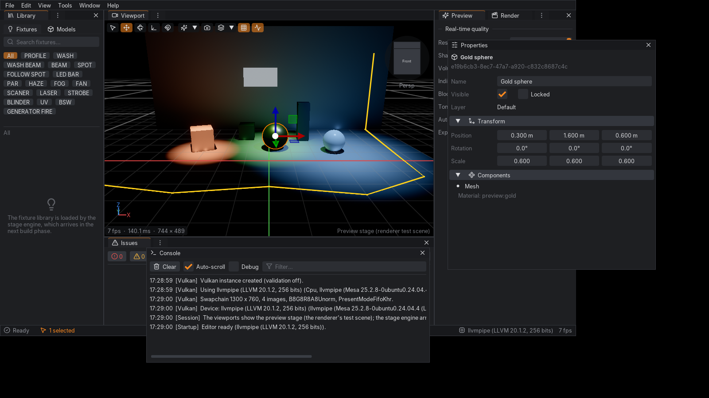

*Properties and Console torn off as their own OS windows (here on a virtual X screen without a window manager, so the
windows have no OS decorations).*

| Panel | Content |
|---|---|
| Viewport (1–16) | 3D view of the stage, see [Viewports](#viewports) |
| Library | the engine's fixture library by category with 3D thumbnails and a rotating hover preview, the user's models and images; drag into a viewport to place (see [Library](#library)) |
| Properties | name, visibility, lock, layer, numeric transform (metres or feet, Euler degrees), components, wall material |
| Preview | real-time quality settings of the viewports (shadows, volumetrics, indirect light, bloom, exposure …) |
| Render | final render settings (resolution, samples, bounces, format, frame range); *Render* asks the session |
| Issues | errors / warnings / notes with severity toggles, category filter and search; click selects and frames; the tooltip shows the whole message and the issue code |
| Console | the editor log with level filter, text filter and auto-scroll |

### Tab styles

Every panel group has two tab styles, switched from the **⋮** button at the right end of the group's tab bar:

* **Tabs on top: icon + name** — the standard tab bar.
* **Icon column on the left** — a narrow vertical column of panel icons (tooltip = name); the selected panel shows
  next to it, an accent bar marks it, dragging an icon tears the panel off.

The menu of the same button lists the panels of the group and can undock or close the current one. The style is
stored per group in the layout (and in the restored workspace).

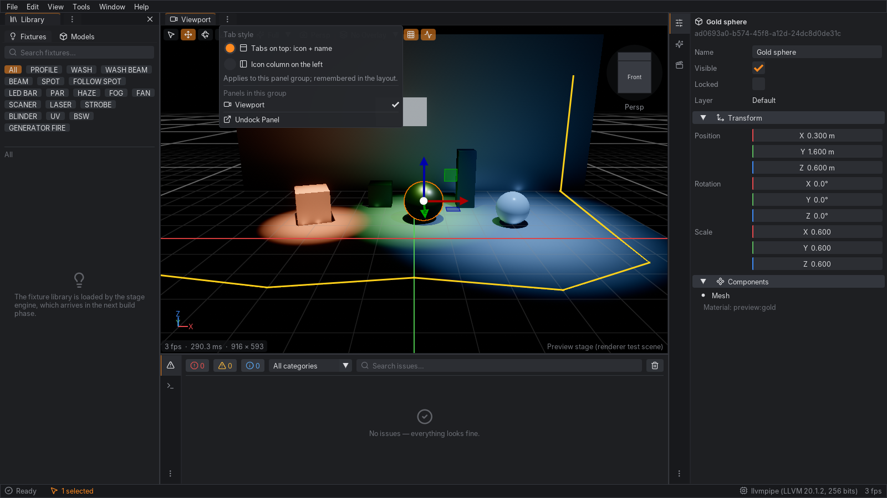

*Properties / Preview / Render (right) and Issues / Console (bottom) in the icon-column style; the tab style menu of
the viewport group is open.*

### Layouts

*Window → Layouts* applies the built-in **Default** layout or **Four Viewports** (top / front / right orthographic
colourless views and a perspective view, see below), and lists saved layouts. *Save Layout As…* stores the current
arrangement under a name (dock tree, open panels, floating windows, tab styles and the viewport settings — view,
projection, shading, overlay, grid, stats); *Delete Layout* removes one; *Reset Layout* (View menu) returns to the
default. The workspace is saved on exit and restored at the next start; a damaged layout file is reported and the
default layout is used instead. Layout files are JSON (`format: 1`) with the Dear ImGui ini text embedded, so they can be
copied between machines. The embedded dock tree is checked before Dear ImGui sees it (unique non-zero node ids, parents
before children, split nodes with exactly two children, one central leaf per tree, sizes within Dear ImGui's 16-bit
fields): Dear ImGui does not report such damage, it aborts the process — every start, since the workspace is restored
each time — so a file that fails the check is treated as damaged.

## Viewports

Each viewport renders into its own render target sized to the panel (in framebuffer pixels, so high-DPI monitors get
full resolution) and shows it as an ImGui image. *View → New Viewport* (Ctrl+Alt+N) adds more viewports (up to 16) as
tabs next to the active one — drag a tab to an edge to see them side by side; each has its own camera, shading, overlay
and grid. Shortcuts and View-menu commands act on the **active viewport**: the one last clicked, or whose tab was
selected (a new viewport becomes active at once). With several viewports on screen it has an orange frame. A viewport
hidden behind another tab of its group is never the target — the commands then go to a visible one.

**What the viewports show** is the open document: `EngineViewportContent` binds the engine's render synchronisation
(`RenderSync`) to the shared render world, so every viewport draws the same scene, each into its own target with its
own camera. Fixture models load in the background; meanwhile the bottom-right corner says *Loading fixture models…
(n)*. Opening a scene frames its content tightly (stage, set and fixtures — not the empty ground around them), and
frames it again once the models have arrived, unless the camera was moved in between. Clicking any part of a fixture
(base, yoke, head, lens) selects the fixture itself; the members of a selected group are outlined with it
(`RenderSync.OutlineSelectedDescendants`). Box selection, framing and the surface under a dragged library item use the
bounds the render binding keeps for every drawn object (`RenderSync.TryGetWorldBounds`, `IncludeWorldBounds`,
`VisibleWorldBounds`, `CollectVisibleCorners` — fixture models, walls, models, cables and devices alike), so the editor
keeps no second copy of the render world.

**Work light.** In *Full* shading the stage is lit by its fixtures. While none of them emits — an MVR fresh from the
designer, an un-programmed rig such as Фокина — the preview adds a dim **work light** (a soft key from above the stage
and its bounce), so the stage is never just black. *Preview → Stage → Work light* and *View → Work Light* switch it
between **Off**, **Auto** (default: only while no fixture emits) and **On**; the choice is stored in the project's view
settings (`ViewSettings.WorkLight`) and applied to the render binding at once. A viewport showing the *Illuminance*
overlay leaves it out (the lux values are the fixtures' own), and final renders never use it unless the Render panel
asks for it. The work light is deliberately dim — about a tenth of a lit stage (40 lx key), so at the viewport's
default EV 8 the set reads as a dark room; *Preview → Meter* or a lower EV brightens the picture. *Off* gives the view
without it: only the fixtures (and the *Ambient light* of the stage) light the set. *Tools → Open White* (one undo step)
brings every fixture up in open white with the moving heads aimed at the stage. The command line option `--preview-stage` shows the renderer's procedural test stage instead of the document
(the phase-A behaviour, kept for tests that need a fixed picture).

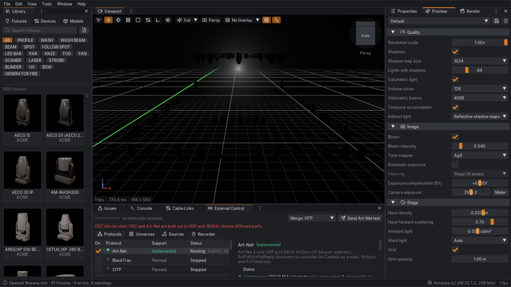

*Фокина opened in Full shading: no fixture is programmed, so the Auto work light shows the rig (with Off the view would be
black); Preview → Stage → Work light is the switch.*

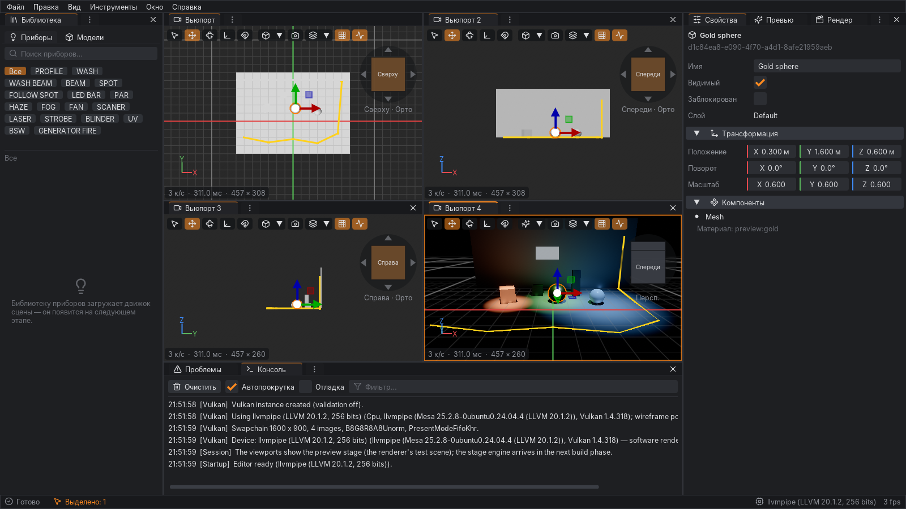

*Four Viewports layout in Russian: top, front and right orthographic views (colourless) plus perspective, all showing
the selection and the gizmo; the perspective view is the active one (orange frame). The view cube of each orthographic
view shows the snapped face, the arrows to its neighbours and the caption.*

**Toolbar** (top left; compact icons when the viewport is narrow): select / move / rotate tool, local / world space,
snapping, shading (Wireframe, Colorless, Full — the menu's last entry, *Viewport Settings…*, opens the Preview panel
with the real-time quality settings of the Full mode), projection (perspective / orthographic), overlay (None, Lux,
Noise, Cables), grid, statistics. When even the compact toolbar is wider than the view (four views at a large UI
scale), the view options move to a second row, so every button stays reachable.

**View cube** (top right, beside the toolbar when there is room, otherwise below it; it shrinks in small views
instead of disappearing): the cube turned like the scene; clicking a face snaps the camera to that orthographic view
(Top, Bottom, Front = from the audience, Back, Left, Right). Looking straight at a face, the cube shows only that face,
so four arrows around it lead to the neighbouring views (from Top: up = Back, down = Front, left / right = Left /
Right) — every view is one or two clicks away without orbiting. The caption under it names the current view.
Orbiting leaves the snapped view.

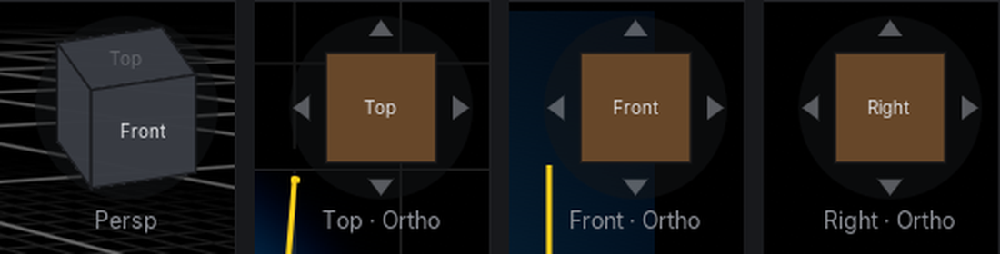

*The view cube in a perspective view, and snapped to Top, Front and Right with the neighbour arrows.*

**Statistics** (bottom left): frames per second, frame time and target size; the world axis triad above it. When the
renderer cannot list every light of the view (more lights in the scene than its clustered-light limit of 65 536), a
warning line in the warning colour sits below the statistics, also when they are hidden — *"N of M lights are not
drawn (the renderer lists at most K): light and lux read too low here"* — and the log gets the renderer's warning
(see [rendering.md](rendering.md#frame-and-pass-sequence); `CANDELA_MAX_CLUSTERED_LIGHTS=1` shows it on the preview stage).

**Navigation** follows *Settings → Viewport → Navigation style*. The left button without modifiers always selects.

| Style | Orbit | Pan | Zoom | Fly (W/A/S/D, Q/E down/up, Shift faster) |
|---|---|---|---|---|
| Candela (default) | MMB, Alt+LMB | Shift+MMB, Alt+Shift+LMB | wheel (towards the cursor), Ctrl+MMB drag | RMB |
| Blender | MMB | Shift+MMB | wheel, Ctrl+MMB drag | Shift+RMB |
| Maya | Alt+LMB | MMB, Alt+MMB | wheel, Alt+RMB drag | RMB |

Double-click focuses the camera on the point under the cursor; *F* frames the selection by its real bounds (with
nothing selected, the whole scene, as tightly as on opening); an object without geometry (a light, an empty group) is
framed as a 1 m box around its origin.
The camera works in metres with Z up; orthographic views keep the apparent size when switching projection, also when fly
mode (which needs a perspective eye) starts from an orthographic view. The far plane follows the zoom-out limit, so the
stage never disappears when zooming far out. A navigation, box selection or gizmo drag ends when its viewport stops being
drawn (its tab covered, the panel closed) — fly mode suspends the shortcuts, and they would otherwise stay off.

## Selection and editing

* **Click** selects the object under the cursor (through the renderer's pick buffer; any part of a fixture selects
  the fixture), a click on the background clears the selection; **Shift+click** adds or removes; **drag** draws a selection box (Shift adds) that selects the objects
  lying *entirely* inside it (by the bounds of their rendered geometry, fixture models included) — a box drawn around
  props does not also pick up the floor or the walls behind them.
  Hidden and locked objects, and objects on hidden or locked layers, are never selected.
* **Gizmos** (ImGuizmo): *Move* (W) and *Rotate* (E) in world or local space; with several objects selected they move
  rigidly around the primary (last selected) object. An object selected together with its parent moves once, with the
  parent; a selected child of a locked parent moves on its own. Locked objects and objects on locked layers have no
  gizmo, and their transform fields in the Properties panel are read-only. **Snapping** (toolbar or Alt+S, Ctrl inverts
  it while dragging) uses half the scene grid spacing for moves and 15° for rotations. Each viewport has its own gizmo
  id, so a drag in one of several views showing the same selection moves it once. The rotation fields keep the Euler
  angles as entered (a Y of 95° stays 95° instead of flipping to the equivalent −170° / 85° / −160°, and a drag on Y
  continues past ±90°) until the rotation is changed elsewhere.
* **Undo**: every edit goes through Core's `UndoStack`. A whole gizmo drag, or a whole drag on a numeric field, is
  *one* undo step (consecutive transform commands merge until the drag ends); Undo and Redo wait until a drag in a
  viewport is finished (the drag would re-apply its transform at once and the redo history would be lost). Delete,
  Duplicate, Cut, Copy and Paste work on the top-level selected objects (children follow their parents) and are single
  steps too.
* **Duplicate, Copy, Paste** use Core's copying (`DuplicateEntitiesCommand`, `EntityCloner`, see [core.md](core.md)):
  copies get new ids, references among the copied objects point at the copies (a duplicated truss keeps its fixtures
  mounted on the copy), references to other objects are kept by Duplicate and kept by Paste only when the scene still
  has their target. The clipboard holds copies taken at Copy time; every Paste gives fresh ids. Copied fixtures keep
  their DMX address, or are patched to the next free addresses, as *Settings → Editing* says (see
  [Copies and Escape](#copies-and-escape)); an overlap that stays is listed in the Issues panel.

## Documents

`EditorSession` owns one `StageEngine` for the whole run (`EditorSession.Engine`, never null while the editor runs);
New / Open replace the engine's project, so panels keep their references to the engine and its `Scene`, `Selection`,
`Undo` and `Issues` and only re-read when `SceneReplaced` is raised.

| Operation | Behaviour |
|---|---|
| **New** (Ctrl+N) | An empty stage named *Untitled*: no objects, the floor grid, the camera back over the stage origin. |
| **Open** (Ctrl+O, Open Recent, `--open`, a dropped file) | `.candela` projects and `.mvr` scenes. An MVR opens as a new, unsaved project (no file yet: Save asks for one). An MVR without a floor (exports often hold only the rig — Фокина) gets a wooden **stage floor** under all of its content, 3 m wider on every side, as the first step of the undo history: the status line says *added a stage floor (Undo removes it)*, and Undo takes it away. It is the engine's `StageFloor`, the same floor as `candela render --floor auto` (docs/engine.md); an MVR with a floor of its own, or a venue model on the ground, gets none, and a project opens as it was saved. Every open viewport frames the new stage tightly (each side of the picture touches the outermost object), and again once the fixture models have loaded — unless the camera was moved in between. A recent file that no longer exists is removed from the list. |
| **Save / Save As** (Ctrl+S / Ctrl+Shift+S) | Atomic `.candela` write through the engine (scene, assets, copies of the GDTF files used, `engine`/`view` settings). The active viewport's camera is stored with it and comes back when the project is opened. A scene still called *Untitled* takes the file's name. The file goes to the top of the recent list. |
| **Import** (Ctrl+I, File → Import) | Another Candela project or an MVR (merged under a new group, one undo step), a 3D model (OBJ, FBX, DAE, 3DS, glTF/GLB, STL, PLY — native formats in the engine's isolated import worker), an image (a reference drawing; the popup that follows makes it a poster), a GDTF file (read completely and added to the fixture library; the Library panel comes forward with its tile selected — see [Library](#library); a file the engine refuses says why). Imported models and images are also added to the Library's Models tab. |
| **Export** | MVR 1.6 with the fixtures' GDTF files, the models as GLB, and the walls, floors and ceilings: other programs see boxes, Candela gets them back as walls with their kind, size and material (Candela's user-data block of the MVR, see [mvr.md](mvr.md)). |
| **Open White** (Tools) | Every fixture at full in open white, moving heads aimed at the stage (`StageLooks.ApplyOpenWhite`, one undo step): a quick way to see a rig that was imported dark. |
| **Pause Simulation** (Tools, Alt+P) | Freezes smoke, fire and sound (`EngineSettings.SimulationPaused`); DMX and moving lights keep running. |

* **Progress.** A file operation runs between two frames behind a **busy overlay** that names it ("Opening
  Фокина.mvr…"), so the window shows what it is doing instead of freezing silently. The result goes to the status bar
  ("Opened Фокина.mvr · 91 fixtures · 0 errors, 7 warnings"), a failure to a message box, and the operation's issues
  to the **Issues panel** (brought to the front when there are errors). Content problems never throw; an unexpected
  exception is reported as a program error and the editor goes on.
* **Unsaved changes.** New, Open, recovering a session and closing the window ask *"Save the changes to “Show”
  first?"* — **Save** (then continue; a scene without a file asks for one first; a failed save stops there),
  **Don't Save**, **Cancel**. Enter answers Save and Escape Cancel only once the question is on screen: the key press
  that asked it (Enter confirming a file in the file browser) never answers it unseen. Closing the window while another
  dialog is open (file browser, message, question) waits until that dialog is closed. Changes of the project's view
  settings count as unsaved changes and reach the autosave like edits of the stage: a Preview or Render panel value or
  preset, an overlay legend's gradient, the work light, the camera stored by a save
  (`StageEngine.MarkViewSettingsChanged`); they are not undo steps.
* **Title.** The window title is `Candela — <scene name>` with a `•` while there are unsaved changes.
* **Dropped files.** Files dragged from a file manager onto the window (GLFW drop callback) are opened or imported:
  a single `.candela`/`.mvr` opens directly when the stage is empty and unchanged, otherwise the editor asks **Open**
  (instead of the current scene) or **Import** (into it). Models and images dropped onto a viewport land on the surface
  under the cursor (a model stands on it, an image lies on it — see [Library](#library)); several files are imported
  side by side; `.gdtf` files go into the fixture library (the Library selects the last one that came in); anything
  else is reported as not importable. When some of several dropped files fail, a message lists each of them with the
  reason (a refused GDTF with the engine's), and the status bar counts the rest.
* **Engine tick.** Every frame `Update` ticks the engine (DMX input, fixture motors, smoke, fire, sound, lights, render
  binding) — also while the window is minimised (ten times a second, without drawing); the issue analysis (patch, power, rigging, assets) runs again half a second after the last edit, so a
  gizmo drag does not re-check the scene every frame. Clicking an issue selects and frames the objects it names.
* **Autosave and recovery.** The engine autosaves the open project at the interval of *Settings → Files* (only when
  something changed; a save removes the session's autosaves; a clean exit deletes them). Changing the interval, or
  turning autosave off and on, reconfigures the running autosave session (`StageEngine.ConfigureAutosave`) instead of
  starting another one (which would leave the first session's files behind as a "crashed" session). Only a clean exit — the window closed after the
  unsaved-changes question — deletes the recovery files: when the editor stops abnormally (an exception outside the
  frame loop, 120 failed frames in a row) unsaved changes are autosaved once more and the files stay for the
  recovery prompt. A *Save As* that fails leaves the scene's name as it was. At start-up the editor lists
  sessions of runs that did not end cleanly — scene, time of the last autosave, its file (or *never saved*) — with
  **Recover** (opens the newest readable autosave; Save writes back to the original file), **Delete** (asks once
  more) and **Decide Later** (they are offered again at the next start).

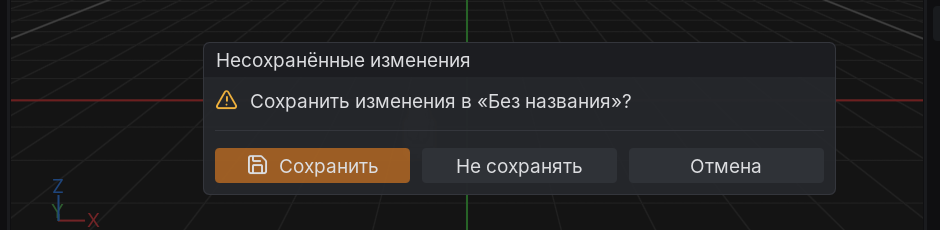

## Library

The Library panel (requirement "окно выбора устройств") has three sub-tabs: Fixtures, Devices (consoles, nodes,
splitters, mains supplies, distros and dimmers — see [Devices in the Library](#devices-in-the-library)) and Models.

**Fixtures** shows the engine's fixture library (the library folders of the settings plus GDTF files brought in by
projects and MVRs; one tile per model, its newest revision). Category chips filter by the `_specs` category — **All**,
PROFILE, WASH, WASH BEAM, BEAM, SPOT, FOLLOW SPOT, LED BAR, PAR, HAZE, FOG, FAN, SCANER, LASER, STROBE, BLINDER, UV,
BSW, GENERATOR FIRE (the tooltip of a chip gives its count) — and the search field matches model, manufacturer and
file name in any case. Each tile shows the fixture's **3D thumbnail** with its name and manufacturer under it.

**Import GDTF** (the button beside the search field, *File → Import → GDTF Fixture*, or a `.gdtf` file dropped onto the
window) hands the file to the engine, which reads it completely first: a file that is not a GDTF archive, has no
readable `description.xml` or defines no DMX mode is refused, and the message says why (*"The file was not added to
the fixture library. 'x.gdtf' is not a readable GDTF file: …"*), so the library never lists a type that cannot be
placed. An accepted file — or one the library already has, which the status bar then says instead of claiming it was
added — is **selected**: the Library panel comes forward on the Fixtures tab, a category or search that would hide it is cleared, the grid scrolls its tile into view and frames it
in orange (an older revision selects its model's tile, the newest). The panel follows the engine's
`FixtureLibraryChanged` event, so the grid, the category counts, the Devices section and the hover facts are rebuilt
whenever GDTF files reach the library — imported ones, the GDTFs embedded in an opened or imported MVR, the GDTF copies
of a project, a library folder added in the settings or the setup window — and the new tiles ask for their
thumbnails as they come into view.

An imported GDTF is **copied into the user's library folder** first (the first existing folder of the settings; with
none set, `Documents\Candela\Fixture Library` of an installed copy, created and added to the settings), so it is
still in the library at the next start even when the original — a file in Downloads — is deleted. The copy is
written aside and renamed (a library scan never sees half a file); a file of that name already in the folder is
used when identical and never overwritten when different; a copy the engine then refuses is deleted again. When
the copy fails the original is used for this session and the Issues panel says so. In a development run without
configured folders (the repository is the library) files are read where they are.

### Library folders and the first start

An installed copy ships only the four GDTF files of the sample scene (`samples/fixtures`, appended to the library
folders with the lowest priority; see [engine.md](engine.md#install-layout)). While the user has no library of their
own — no fixture type of the library comes from a library folder of the settings — the editor opens
the **Fixture Library** window over the workspace at start-up (after a recovery prompt, never in headless runs or
when a file is opened from the command line or Explorer; `--library-setup` forces it, development runs from the
repository never show it by themselves):

* what GDTF files are and that the library is a folder of them;
* **Choose Folder…** (the editor's file browser in folder mode), **Use Documents\Candela\Fixture Library**
  (created when missing), **Show in File Manager** and **Rescan** (reads the folder again: GDTF files copied into
  it since reach the library without a restart — `AddLibraryFolder` skips the files it already has);
* the chosen folder is put first in *Settings → Library*, the settings are saved at once and the engine reads the
  folder immediately (`StageEngine.AddLibraryFolder`); a background count shows how many `.gdtf` files are directly
  in it and how many more sit in subfolders (the library reads only the top level), with a time and entry limit
  so a huge or slow folder never blocks the window (the count starts when the window shows the folder, not at every
  start);
* **Open Sample Scene** (`samples/Фокина.mvr`), **Start** / **Continue Without a Library**, and the check box
  *Show this window at start-up while the library has no fixtures* (`EditorPreferences.ShowLibrarySetup`).

*Help → Fixture Library Setup…* opens the window at any time. A folder added in *Settings → Library* is also read
at once; removing one takes effect at the next start.

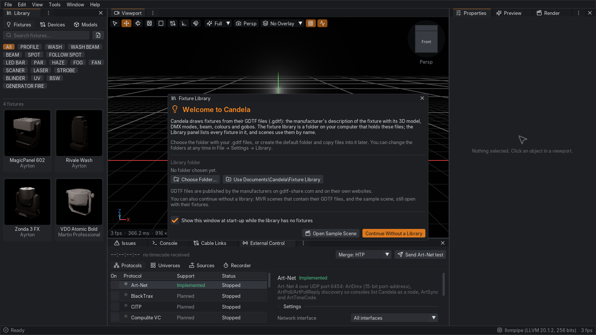

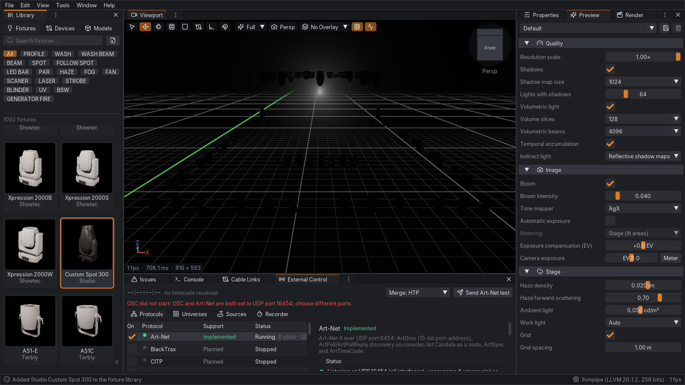

*A GDTF file dropped onto the window: the library grows to 1092 types, the new type is selected and scrolled into view,
and the status bar names it.*

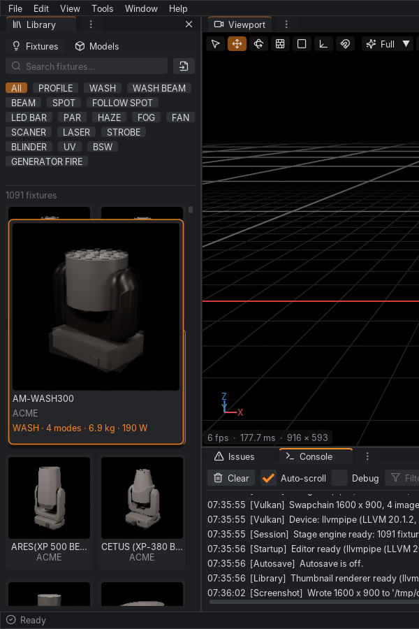

*Hovering AM-WASH300: its tile grows upward into a card with the rotating 3D preview, the category, the number of DMX
modes, weight and power.*

* **Thumbnails** are rendered by Candela.Engine's `FixtureThumbnailRenderer` on a background thread with a Vulkan
  renderer of its own (a second, window-less device on the same GPU), so drawing the panel never waits for them; still
  pictures are cached on disk in Candela.Assets' `ThumbnailStore` (keyed by the GDTF file's content), so a fixture is
  rendered once per machine. Only tiles on screen ask for pictures, newest request first; pictures arrive a few per frame
  as Dear ImGui user textures, at most 240 stay in memory (least recently drawn are released).
* **Hover preview.** Resting on a tile for a moment grows it upward (0.18 s, ease-out) into a card twice its size — it
  hangs down from the top when there is no room above — showing the fixture **turning** (24 frames around it,
  rendered coarse-to-fine in the background and cross-faded, so a whole turn is visible early) and a line of facts.
* **Drag into a viewport** places the fixture — dragged from its tile or from its grown hover card (the card is the
  drag source where it covers other tiles, so the fixture it shows is the one placed): while dragging, the viewport shows a **ghost** — the fixture's box (from
  its GDTF geometry) mounted on the surface under the cursor, a footprint ring and *"Robin T1 · Mode 1 · 38 ch · 1.001"*.
  The surface is the renderer's pick of the last frame (position and normal); where nothing is drawn, the ground
  plane; looking above the horizon, the plane through the camera's target. GDTF fixtures hang, so on a **floor** the
  fixture is turned over and stands on its base, under a **ceiling or truss** it hangs, on a **wall** its base is
  against the wall and the beam points into the room.
* **Mode and patch.** A dropped fixture gets the GDTF's first (default) DMX mode, the next free fixture id, a name
  (*model id*) and is **auto-patched**: each DMX break of the mode goes to the lowest address — universe 1 address 1
  first, after the previous break — where its whole footprint fits into one universe without overlapping any channel a
  patched fixture uses (resolved footprints; a footprint over 512 channels stays unpatched). One undo step; the fixture
  becomes the selection. When the type has several modes, a popup at the drop point lists them with their channel
  counts; choosing another mode patches the fixture again (its own old channels count as free; one more undo step).

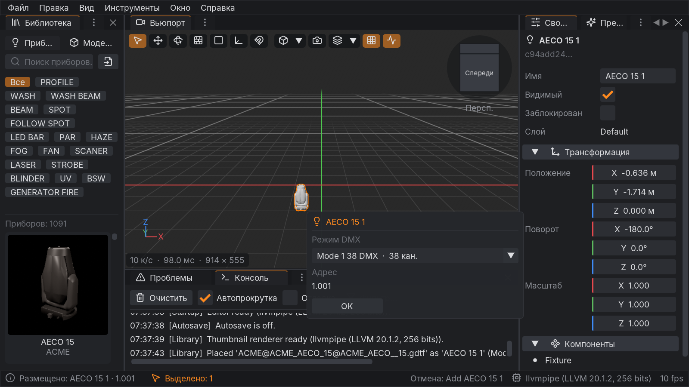

**Models** lists the user's custom 3D models and images (`model-library.json` in the config folder: paths, newest
first; a model's companion files — MTL, textures — stay next to it). **Import…** adds files; models and images imported
into a scene are added too; right-click → *Remove from Library*. Images show a downscaled picture, models a format
badge. Dragging an item into a viewport imports it there (a model stands on the surface, an image lies on it as a
reference drawing; the popup that follows switches it to a lit poster). A **reference drawing** shows its image as it
is — unlit, at its opacity (60 %), in Full and Colorless shading and in renders, whatever the light — while a
**poster** is a printed surface lit by the stage like any other (dark until light reaches it). A file that no longer
exists is marked *file missing*.

## Walls and floors

The **Wall** (B) and **Floor** (Shift+B) tools draw the requirement's "walls and floors as resizable rectangles" with
`WallComponent` (Core): with the Floor tool a left-button drag draws a rectangle, with the Wall tool a drag draws the
line a wall (3 m high, 10 cm thick, its front facing the camera) stands on. The drawing plane is the horizontal surface
under the press (a stage, an existing floor) or else the ground; Snapping (Alt+S, Ctrl inverts it) rounds the corners to
half the grid spacing. The new shape gets the built-in material of its kind (floors: *Wooden stage*, walls: *Painted
wall, white*; the Properties panel changes it), is selected and is one undo step; the tool stays active for the next
one. Navigation keeps working with the other mouse buttons, and the tool's one-line help shows at the bottom of the view.
**Escape** during the drag cancels it: nothing is added (a resize, below, goes back to the size it had).

A selected wall, floor or ceiling shows **handles** (any tool): the ends and the top of a wall, the edges and corners
of a floor. Dragging one changes the size while the opposite side stays where it is (the size follows the mouse
along the handle's axis, corners in the floor's plane; snapping rounds the size); the size is shown next to the cursor.
The whole drag is one undo step. The engine draws walls and floors with `WallMesh` and their material. They are saved
with the project and survive *File → Export → MVR* and opening that MVR again: kind, size, thickness and built-in
material travel in Candela's user-data block of the MVR, while other programs see a box per wall.

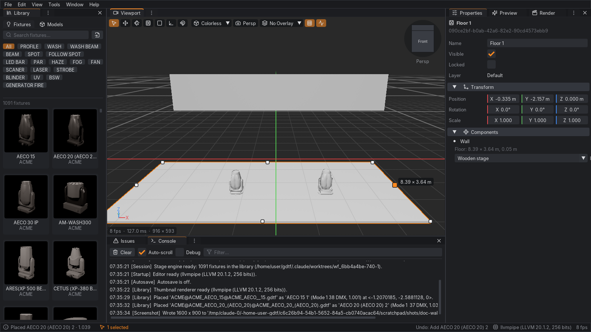

*A floor and a wall drawn with the tools and two fixtures dragged from the library (standing on the floor, patched to
1.001 and 1.039); the selected floor is being widened from its right edge.*

## Cabling

Phase M4 puts the electrical model of [electrical.md](electrical.md) into the editor: consoles, nodes, splitters, mains
supplies, distros and dimmers come from the Library, the **Cable** tool draws DMX, Ethernet, power and multicore cables
between their ports along walls, trusses and floors, and the stage follows the cables — a console drives only the
fixtures cabled to it, a distro's breakers are checked against the fixtures it feeds, and the Issues panel lists what
does not add up.

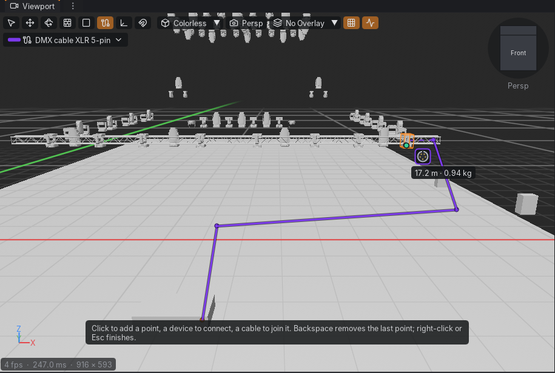

*A DMX cable from Console 1 drawn over the stage floor (two route points anchored to the floor), up to the front truss
and on to the first MagicBlade: the fixture under the cursor is outlined with its ports (green: the port the cable fits),
the dashed line shows where the next click goes, the label the length and weight so far; the cursor carries the
cable's connector.*

### Devices in the Library

The Library's **Devices** sub-tab (between Fixtures and Models) lists what cables connect, in five sections:

| Section | Devices |
|---|---|
| Consoles | DMX consoles with 2, 4 or 8 XLR 5-pin outputs (DMX A, B … on universes 1, 2 …), network consoles sending 16 universes as Art-Net or sACN over one etherCON port |
| Nodes & splitters | Art-Net / sACN nodes with 2 and 8 DMX outputs, a 19" opto splitter 1 → 6 and a truss splitter 1 → 4 (XLR 3-pin) |
| Mains | wall socket Schuko 16 A, CEE 16 A and 32 A (230 V), CEE 32 A, 63 A and 125 A three phase, Powerlock 400 A |
| Distros | 16 A → 4 × TRUE1, 32 A 3~ → 6 × Schuko or 6 × TRUE1, 63 A 3~ → 2 × Socapex + 3 × CEE 16 A, 125 A 3~, Powerlock 400 A |
| Dimmers & PSUs | a generic 4 × 10 A dimmer pack, and every GDTF in the fixture library that distributes power (dimmer packs, power supplies, distros — the `_specs` records with outlets or output channels) |

Section chips filter the list, the search field matches names, descriptions and connectors. A tile shows the device's
icon and its connector drawings (GDTF devices their 3D thumbnail) with a summary ("4 × XLR 5-pin (DMX)"); the tooltip
gives the description and every port with its connector, direction, universe or breaker. **Drag a tile into a
viewport** to place the device like a fixture (ghost, surface under the cursor, one undo step, selected): consoles and
mains supplies are boxes standing on the surface (`ConsoleComponent`, `PowerSourceComponent`), nodes, splitters and the
generic dimmer are real GDTF devices — Candela writes them into the cache folder at start-up
(`GenericDeviceLibrary`) and they travel inside saved projects like any GDTF. New devices are named after their kind
("Console 2", "Distro 1", "Splitter 1"); a dimmer pack is auto-patched like a fixture and gets the next fixture id.
Ports come from the electrical model (`PortResolver`): a console's outputs, a power source's outlets plus its *Mains
In*, a GDTF's wiring objects.

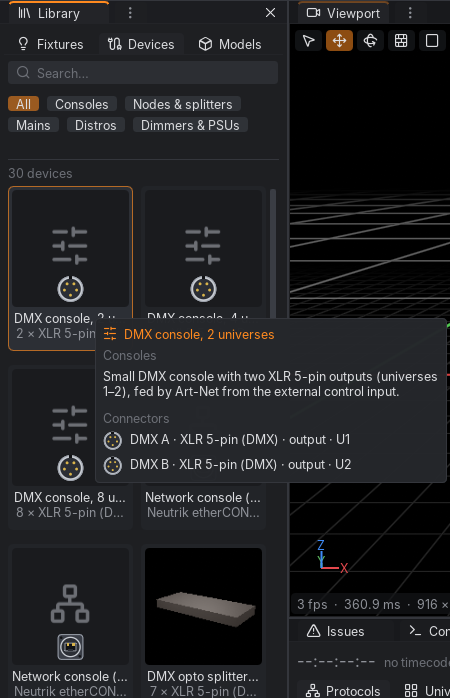
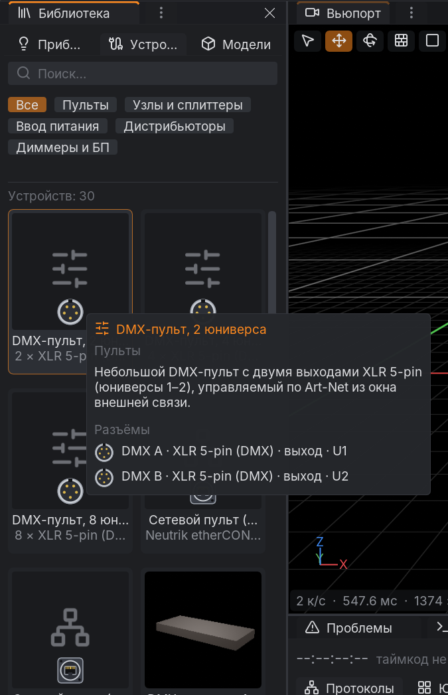

### The Cable tool

**Tools → Cable** (C, or the toolbar button) chooses the tool; the same submenu lists every cable type with its colour
(DMX XLR 3/5-pin, Ethernet, powerCON / TRUE1 / TRUE1 TOP, Schuko, IEC, CEE 16 A / 32 A single and three phase, CEE
63 A and 125 A, Powerlock, Socapex, Harting 16), and the chip at the top left of the viewport switches the type while
the tool is active (grouped Data / Power / Multicore, with the connector drawings). With the tool:

* **Click a device** to plug the cable in. When exactly one port fits — the right signal, a connector that mates (or
  mates through an adapter), free, and the right direction for the cable's other end — the cable is plugged in at once;
  otherwise the **port picker** opens (below). The first click starts the cable at a port, a later one ends it there.
* **Click a wall, truss, floor or model** to add a **route point** fixed to that object: the point keeps its place on
  it when the object is moved. A click on empty ground adds a free point.
* **Click the middle of an existing cable** (not drawing) to start a **branch** there — a Y node is inserted into the
  segment when the branch is finished, and the branch takes that cable's type; a click on a cable's free end continues
  the cable from it. While drawing, a click on another cable of the same type **joins** the drawn cable into it.
* A **daisy chain goes on by itself**: after a fixture is plugged in, the next cable starts from its DMX thru (or power
  thru) when the choice is unambiguous, so clicking fixture after fixture cables a whole line.
* **Right-click** (without dragging) or **Escape** finishes the cable: with two points or more it is added as it is
  (a free end stays free), one undo step ("Add DMX 3", "Branch cable", "Join cable"); **Backspace** removes the last
  point. Choosing another tool finishes the cable too; Undo while drawing drops the draft.

While the mouse moves, the tool shows what a click would do: a device under the cursor is outlined with its ports
coloured (green fits, amber needs an adapter, grey is in use or the wrong direction, red does not fit), a cable's
middle shows the branch point, a free end "Continue this cable". A ray that passes through a gap of a device — between a
yoke and its head, under a slim batten — still means the device, not the floor behind it. The dashed line runs to the
next point and the label under the cursor gives the length so far (routed length × the cable's slack) and its weight.
Cables are named by kind ("DMX 1", "Power 2", "Ethernet 1", "Multicore 1"), their length and weight come from the
electrical model (`CableGeometry`).

#### Port picker

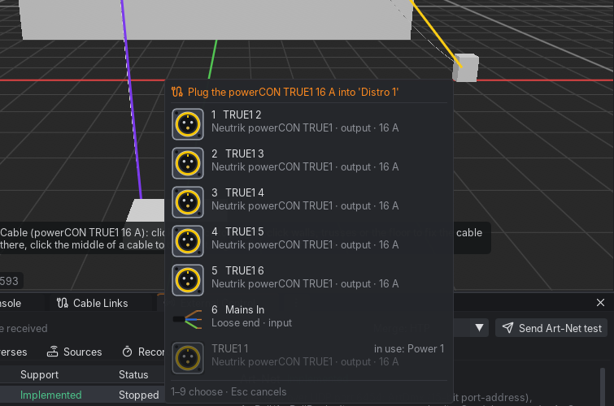

*A powerCON TRUE1 cable clicked onto Distro 1 whose first outlet is already used: the free outlets are listed first
with their connector drawings, the mains input (which takes any termination) after them, the outlet in use last, with
the cable plugged into it.*

The picker opens next to the cursor and lists every port of the device for the cable: its number (keys **1–9** choose),
connector drawing, name, connector, direction, universe or breaker, and why a port cannot be used — *in use: DMX 2*,
*does not fit: a power cable cannot be plugged into a DMX512 port*, *adapter: XLR 3-pin to 5-pin adapter needed*, *the
cable's other end is in an output too*. Usable ports come first (exact connector matches before adapters, then by the
direction the cable needs, then in device order). Escape or a click outside closes it. The picker belongs to the
viewport that was clicked (with four views open the other three leave it alone, and the cable can be finished in
another view); it opens beside the cursor towards the inside of the window and is pushed back inside when it would hang
over an edge (a device with many ports, a click low in the window, a large UI scale), so it never turns into a
separate OS window. A cable type the catalogue does not know is named in the status bar instead of starting a cable.

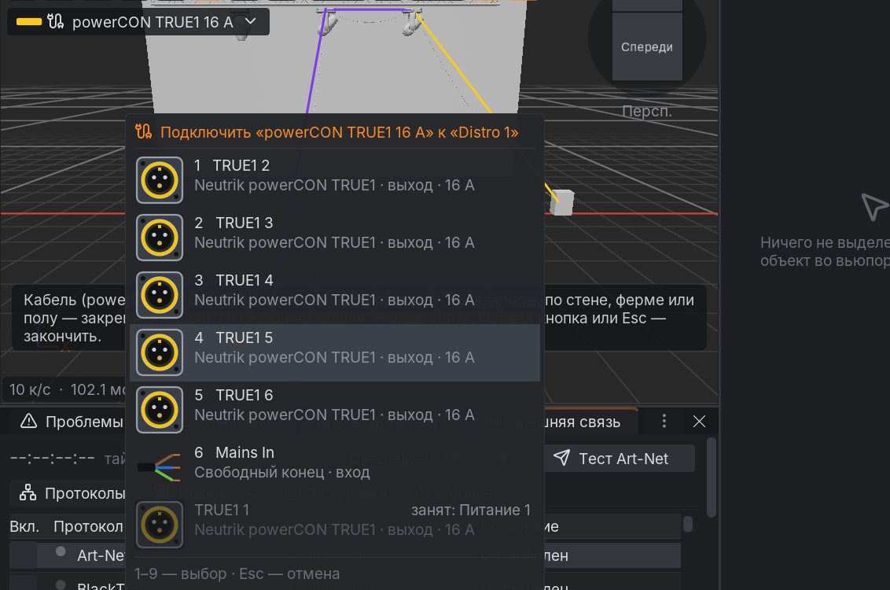

#### Cable nodes

Selecting a cable (any tool) shows its nodes as handles. A **click** selects a node — the Properties panel shows its
position, what it is fixed to, or the port it is plugged into — and the **Move gizmo** moves it along the three axes; a
**drag** on a handle moves it in the view plane (snapping rounds it like objects). A node fixed to an object keeps its
anchor and gets a new offset on it. Every move is one undo step; Escape drops the node selection, **Delete** removes the
node (a route point joins its neighbours, an end point goes with its segment and plug, a branching node stays — the
status bar says so; a cable left with one node is deleted). **Escape during a drag** puts the node back where the drag
started, without an undo step.

### Cable link window

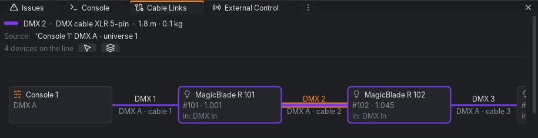

*DMX 2 selected: the line from Console 1 DMX A — the console, then each fixture in signal order with its fixture id,
address and the port the line enters, and between them the cables with their place on the line ("DMX A · cable 2").*

The **Cable Links** panel (bottom group, Window menu) shows the line a cable belongs to as a strip of cards: for a data
cable the console output it comes from (or the node, splitter, …) and every device in signal order, for a power cable
the outlet, its phase and voltage and the devices it feeds. The selected cable is highlighted, branches and free ends are
counted. A click on a **device card** selects the device and brings the Properties panel into view (it is opened when
closed and its tab brought forward — unless it shares the link window's dock group, which would hide the strip); the
window keeps the line. A click on a **cable** follows that cable; the buttons in the header select the cable itself or
show the cable overlay. The source, the device count and the buttons share one header line, the space above the cards
is kept only for the arcs of branches, and the strip scrolls in both directions when the panel is too low for it (a
large UI scale in the bottom dock).
It opens when a cable is clicked in a viewport, when *Show cable links* is pressed in a cable's properties, and when the
data or power row of a fixture's patch is clicked (`StageToolState.CableLinkRequested`); it follows the selected cable.

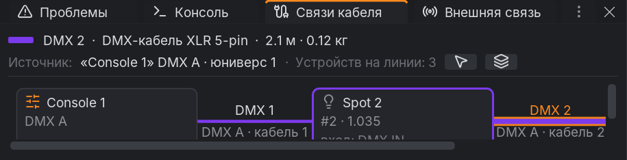

### Consoles, patch and power

* **Console-driven locking follows the cables.** A fixture is locked to a console only when a DMX line from that
  console reaches it (through thru ports, splitters and nodes); fixtures without a cable to a console stay under manual
  control even when the scene has consoles. The lock line names the source: *Locked: driven by console 'Console 1' (DMX
  A · cable 2, universe 1).* Unplugging (deleting the cable, Undo) gives the fixture back.
* The **DMX patch** of a fixture gets two rows: **Data** — *'Console 1' DMX A · cable 2 · U1*: the console, its output,
  the fixture's place on the line and the universe that arrives — and **Power** — *'Distro 1' TRUE1 1 · L1 · 230 V*.
  A click on either opens the cable link window.
* A console output on another universe than the fixture's patch is an **error in the Issues panel**
  (`data.universe-mismatch`), as are a Y-split DMX line, a DMX line without termination and too many devices on a line
  (see [electrical.md](electrical.md)).
* **Power**: a fixture is fed by the outlet its power cable chain starts at; the Issues panel lists overloaded
  breakers (*Outlet 'TRUE1 1' of 'Distro 1' is overloaded: 3 devices draw 4740 W = 20.6 A on a 16 A breaker …*),
  overloaded links, inlets, cables and dimmer channels, unbalanced phases, voltage and phase mismatches and devices
  without power. A click on an issue selects the source and the fixtures it feeds.
* **Properties** of the new objects: a **cable** shows its type (any catalogue type; the Issues panel says when it no
  longer fits a port it is plugged into), label,
  length (routed length × slack), weight, the slack (1.00–1.50), the ports its ends are plugged into (click to select
  the device) and *Show cable links*; with a node selected, its position, anchor and plug. A **console** shows its
  input protocol (Art-Net, sACN … from External Control, with a button to switch that input on), how many fixtures are
  cabled to it, and its outputs (name, signal, first universe, universe count; add / remove). A **power source** shows
  voltage, frequency, phases, the total load per phase, and its outlets (name, connector, breaker, phase; add / remove)
  with the load on each outlet against its breaker — overloaded outlets in red. **Renaming** an output or an outlet
  takes the plugs of the cables in it along (one undo step, *Rename console output* / *Rename outlet*), so the cables
  stay plugged; removing one leaves its cable hanging free.
* **Lengths follow the scene.** Cable lengths, weights and loads in the Properties panel, the cable link window, the
  connector rows and the cable legend are those of the scene as it is now: when a fixture, truss or wall that cable
  points are fixed to moves, the panels re-solve the network once for the new scene version (`CablingNetwork`, about a
  millisecond for the 91-fixture Фокина rig with a cable to every fixture) — the engine's own solution is only renewed
  when the scene's structure changes.

### Copies and Escape

* **Duplicated or pasted fixtures** keep their DMX addresses, which overlap their originals. *Settings → Editing →
  Duplicated fixtures* chooses what happens: *Ask each time* (default; a question offers *Patch to free addresses* or
  *Keep addresses*), *Patch them to the next free addresses* or *Keep their DMX addresses*. Re-patching moves every
  overlapping copy to the next free addresses (`AutoPatch`, one search over all copies, so they follow one another) as
  one undo step. The preference is stored in `editor-preferences.json` in the config folder.
* **Escape** cancels a wall or floor being drawn or resized (the shape is dropped, a resize goes back to the size it had)
  and a cable node being dragged (it goes back) without clearing the selection, finishes a cable being drawn, or drops a
  selected cable node — before it clears the selection.

## Menus

| Menu | Items |
|---|---|
| File | New, Open…, Open Recent, Save, Save As…, Import (Candela project, 3D model, MVR scene, image, GDTF fixture), Export (MVR scene), Render…, Settings…, Exit |
| Edit | Undo / Redo (with the step name), Cut, Copy, Paste, Duplicate, Delete, Select All, Deselect |
| View | Shading, Projection, Camera views, Overlay, Work Light (Off / Auto / On), Grid, Statistics, View cube, Frame selection, New viewport, Reset layout |
| Tools | Select, Move, Rotate, Wall, Floor, Cable (the tool, then every cable type with its colour), Snapping, Local/World space, Open White (all fixtures), Pause Simulation |
| Window | open/close every panel, Layouts (Default, Four Viewports, saved, Save Layout As…, Delete Layout), Reset |
| Help | Keyboard shortcuts, Documentation, About |

All file dialogs use the editor's **portable file browser** (the same on Windows, Linux and macOS): standard places
and drives, recent folders, a path bar, sortable name / size / date columns with folders first and natural number
order, type filters, hidden files toggle, and an overwrite confirmation when saving. When saving, the file name field has
the keyboard as soon as the dialog opens; the typed name is used by Enter and by the Save button alike (the
extension of the selected type is added when missing). Only the visible rows of a folder are drawn and their texts are
built once per listing, so folders with tens of thousands of files scroll as smoothly as small ones. A folder that
cannot be read says so (the previous listing stays) instead of looking empty; symbolic link loops and broken links are
listed but refused when opened; `~` in the path bar is the home folder.

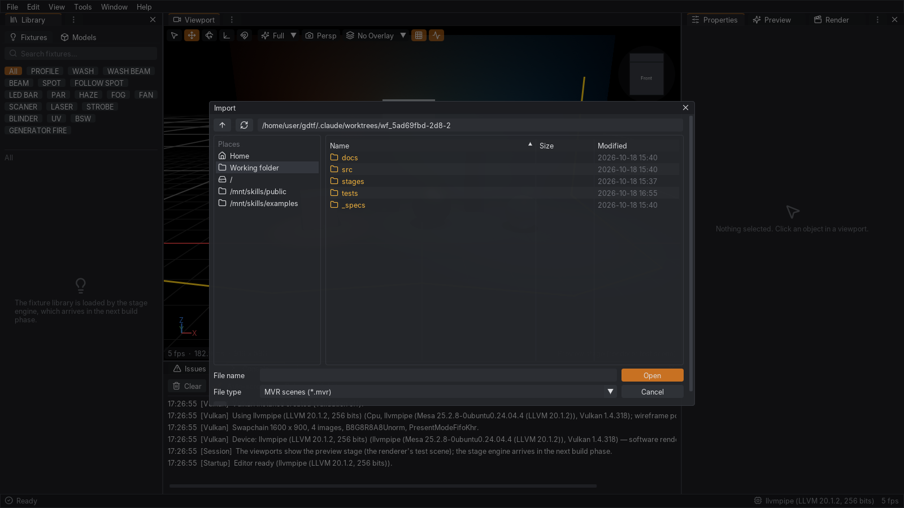

File operations go through `EditorSession`, the editor's gateway to `StageEngine` (see [Documents](#documents)).

## Keyboard shortcuts

Shortcuts are commands bound to key chords (Core `KeyBindingSet`); menus show the current chords. The defaults:

| Action | Keys | Action | Keys |
|---|---|---|---|
| New / Open / Save | Ctrl+N / Ctrl+O / Ctrl+S | Save As | Ctrl+Shift+S |
| Import | Ctrl+I | Render | F12 |
| Settings | Ctrl+, | Exit | Ctrl+Q |
| Undo | Ctrl+Z | Redo | Ctrl+Y, Ctrl+Shift+Z |
| Cut / Copy / Paste | Ctrl+X / Ctrl+C / Ctrl+V | Duplicate | Ctrl+D |
| Delete | Delete | Select all / Deselect | Ctrl+A / Escape |
| Select / Move / Rotate tool | Q / W / E | Wall / Floor / Cable tool | B / Shift+B / C |
| Snapping / Local-world space | Alt+S / Alt+X | Frame selection | F |
| Top / Front / Right view | Num 7 / 1 / 3 | Bottom / Back / Left view | Ctrl+Num 7 / 1 / 3 |
| Perspective ↔ orthographic | Num 5 | Grid | Alt+G |
| Wireframe / Colorless / Full | Alt+1 / Alt+2 / Alt+3 | Overlay None / Lux / Noise / Cables | Alt+0 / Alt+L / Alt+N / Alt+C |
| New viewport | Ctrl+Alt+N | Keyboard shortcuts | F1 |
| Pause / resume simulation | Alt+P | Import GDTF, Open White | (unbound) |

While a text field has the keyboard, plain keys type into it and the text-editing chords (Ctrl+A / C / V / X / Z /
Y, Ctrl+arrows …) edit the text — they do not select, copy, paste or undo objects; other chords with Ctrl / Alt /
Super (Ctrl+S, Ctrl+O …) still work. **Escape**
first closes whatever is open — a menu, a combo box, a dialog, the Settings / Keyboard Shortcuts / About window, a
shortcut being recorded — then cancels a wall or floor drag, finishes a cable being drawn or drops a selected cable
node — and only a press with nothing open clears the selection. With the Cable tool, **Backspace** removes the cable's
last point, **1–9** choose a port in the port picker and **Delete** removes a selected cable node. Menus and the shortcut editor show
punctuation and keypad keys as `Ctrl+,` and `Num 7` (stored in the binding files as `Ctrl+Comma`, `Numpad7`).

## Settings

*File → Settings…* (Ctrl+,) — changes apply immediately and are saved after a short delay (atomic file replace; a
damaged settings file is kept aside as `settings.json.damaged-<time>` and defaults are used).

| Section | Settings |
|---|---|
| Interface | UI scale (100–400 %, multiplied with the monitor's DPI scale), font size, language (English / Русский), theme |
| Keyboard | key binding editor: search, click a chord to record a new one (the recorded press does not run the command), add / remove chords (right-click a chord), conflict warnings; presets *Default*, saved names and *Custom* (Core `PresetLibrary` over a `FilePresetStore` in `presets/`; any edit switches to *Custom*), Save as…, Delete, Reset to default |
| Viewport | navigation style (Candela / Blender / Maya, with a summary of its mouse bindings), zoom speed, display units (metric / imperial), grid spacing (also the move-snapping step), rotation snapping step |
| Library | library folders (add with the folder browser, remove; missing folders in red) |
| Editing | duplicated fixtures: ask each time, patch them to the next free addresses, or keep their DMX addresses (`editor-preferences.json`) |
| Network | network interface for Art-Net / sACN, Art-Net universe offset (internal universe = Art-Net port-address + offset; 1 or 0, see `protocols.md`) |
| Files | autosave interval (off – 60 min), recent files count |
| GPU | current device and driver, preferred GPU, Vulkan validation (on restart) |

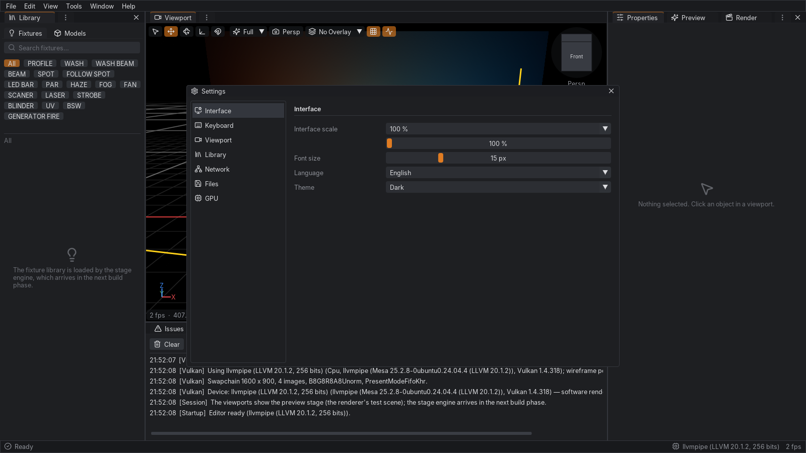
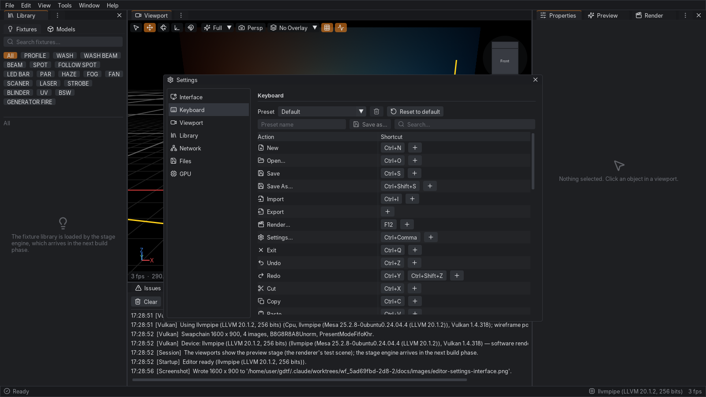

## Look and language

* Dark theme with an orange accent; panel content uses a two-column property grid (labels left, editors right) whose
  label column grows to fit the longest (translated) label. The X / Y / Z fields of the transform sit side by side and
  stack one per line when the panel is too narrow for the numbers (large UI scale, icon-column groups).
* Font: **Inter** Regular / SemiBold (Latin, Cyrillic, Greek; SIL OFL) with the **Lucide** icon font (ISC) merged in,
  embedded in the assembly; the licences are copied next to the executable (`licenses/`). Dear ImGui 1.92 rasterises
  glyphs on demand, so changing the UI scale or font size is instant and stays sharp.
* Language: English and Russian; every user-visible string is a `Str` key with both texts in `Ui/Loc.cs` (tests check
  that every key has both and that placeholders match), including the issue categories of Core. Menus and panel titles
  switch immediately.
* DPI: the UI scale is *user scale × monitor content scale*; windows moved between monitors adapt.

## Engine-backed panels

Properties, External Control, Preview, Render and the overlay legends of the viewports work on the open stage: fixture
state from the DMX engine, manufacturer data from the GDTF file and the curated `_specs` sheets, connectors and cables
from the electrical model, materials from the material library, protocols, timecode and the DMX recorder from the stage
engine. Every edit of the stage (manual values, patch, walls, models, scene settings) is one undo step — a slider drag is
one step, not one per frame. Without an open stage the panels show an empty state. The pictures show
`stages/Фокина.mvr` with a wooden stage floor added and the *Open white* look applied.

| Panel | Content |
|---|---|
| Properties | current state of a fixture, manual controls for every attribute of its mode, DMX patch, manufacturer data, connectors with the cable in each port; size and material of walls, floors and models |
| External Control | the fifteen show-control protocols with support level, settings and live status; universe activity and 512-slot view; sources; timecode; merge mode; Art-Net test show; DMX recorder |
| Preview | real-time quality of every viewport, exposure (with a light meter), haze, ambient light and grid of the stage; presets |
| Render | still frames or image sequences of a timecode range at the highest real-time quality; presets |

### Properties

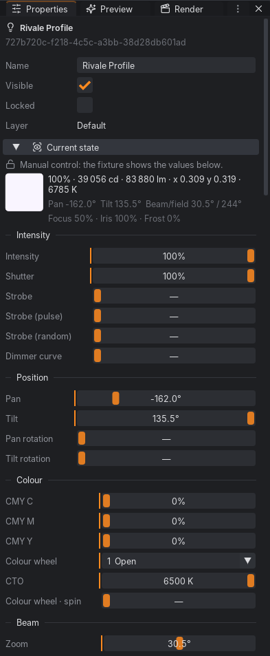
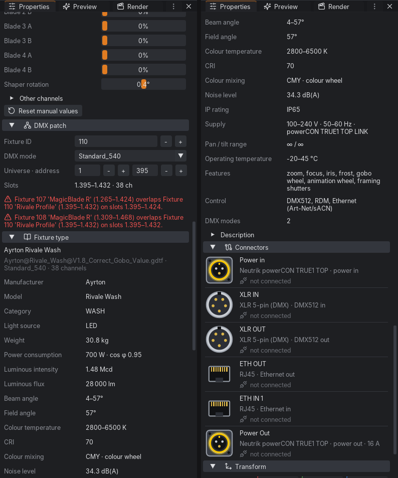

*Left: a Rivale fixture under manual control. Right (scrolled): its DMX patch — two overlapping fixtures are listed in
red —, the manufacturer data and the connectors, each drawn as the real connector.*

**Current state** sums up what the fixture emits right now: intensity (%), peak luminous intensity (cd), luminous flux
(lm), colour as a swatch with CIE 1931 *x y* and the correlated colour temperature (K), pan and tilt (°), beam and field
angles (°), focus, iris and frost (%), and — when present — strobe frequency (Hz), gobo slot, prism facets and the
fog / haze / fan output. A line above it says **who drives the fixture**:

* *Manual control* — no live DMX: the controls below set the fixture.
* *Locked: universe N receives live DMX* — an Art-Net / sACN / EntTec source sends the fixture's universe (see
  [External Control](#external-control)).
* *Locked: driven by console 'Console 1' (DMX A · cable 2, universe 1).* — a console in the scene feeds the fixture
  through DMX cables (see [Consoles, patch and power](#consoles-patch-and-power)); a console without a cable to the
  fixture does not lock it.
* *The fixture type could not be resolved* — with the reason (missing or broken GDTF file, unknown mode).

While locked, the controls are disabled and show the values the console or DMX source sets; the tooltip repeats the
reason.

The **controls** cover every attribute of the fixture's mode, grouped *Intensity, Position, Colour, Beam, Gobos and
effects, Shapers, Atmosphere* and *Other channels* (collapsed), the main attribute of each group first (dimmer, pan,
zoom …), framing blades in blade order. Values are physical: degrees for pan, tilt, zoom and rotations, % for levels,
kelvin for colour-temperature filters, Hz for strobes, the GDTF unit otherwise; wheels are drop-downs of their slots
with the slot names. A control whose channel currently runs another function shows "—". Setting a control writes a
*manual value* into the fixture (`FixtureComponent.ManualAttributes`, saved with the project); manual values carry an
orange bar at the left edge; right-click one to clear it, *Reset manual values* clears them all. A slider drag is one
undo step; every discrete change — a wheel slot, a cleared value, a mode, a fixture ID, an address, a material, the
shadow switch — is a step of its own. With several fixtures
selected, a change applies to every selected fixture that has the attribute and is not driven by a console or live DMX
(the panel says how many); the panel shows the primary fixture.

**DMX patch**: fixture ID, DMX mode, universe and address of each DMX break (± buttons step by one, typing jumps), the
resulting slot range, and the patch problems of this fixture from the Issues panel (overlaps, footprints running past
slot 512). Changing the mode re-reads the fixture; every change is one undo step.

**Fixture type**: manufacturer, model, category, light source, weight, power (with power factor), luminous intensity,
flux, beam and field angle (zoom range), colour temperature, CRI, colour mixing, noise level, IP rating, supply (voltage,
frequency, connector), pan / tilt range, operating temperature, features, control protocols and the number of DMX modes
— taken from the curated specification sheet when there is one, else from the GDTF file and the electrical profile. A
note says when a fixture was matched to a substitute type (an MVR fixture whose exact GDTF is not in the library).
Every value says where it comes from (tooltip: the GDTF file, derived from the GDTF data, the manufacturer's datasheet,
or an estimate); **estimated values** — the `_source` of the `_specs` record is `estimated`, e.g. most noise levels and
many peak intensities, or lamp power standing in for the mains draw — are shown dimmed with a leading **≈**, and the
datasheets the researched values come from are listed below the table. When an MVR fixture's GDTF is not in the
library and a similar type stands in for it, the import warning is repeated at the top of the section (the data below
is then the stand-in's).

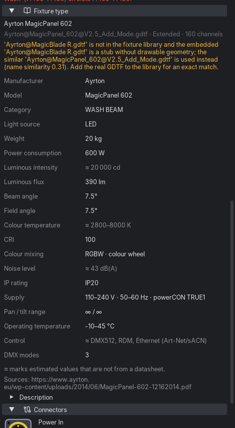

*A "MagicBlade R" of `stages/Фокина.mvr`: its GDTF is a stub, the MagicPanel 602 stands in for it; the luminous
intensity, colour temperature, noise level and control protocols of its record are estimates (≈).* The power factor is shown only when the GDTF
or the specs declare one (the 0.95 the electrical model assumes otherwise is not data). Levels are percentages whatever
unit the GDTF gives them (a GDTF `Dimmer` declares *LuminousIntensity* with physical values 0 … 1: that is 0 … 100 %,
not candela).

**Connectors**: every data and power port of the fixture with a vector drawing of its connector (powerCON / TRUE1,
XLR 3/5-pin, RJ45 / etherCON, Schuko, IEC, CEE, Socapex, Harting … — 38 drawings, a neutral socket for anything else),
signal and direction, current ratings and breakers, and the cable plugged in (label, type, length, the cable colour).
Clicking a cable opens it in the [cable link window](#cable-link-window) (`StageToolState.CableLinkRequested`; without
a listener the cable is selected). Below the patch, the **Data** and **Power** rows say where the fixture's DMX and power
come from.

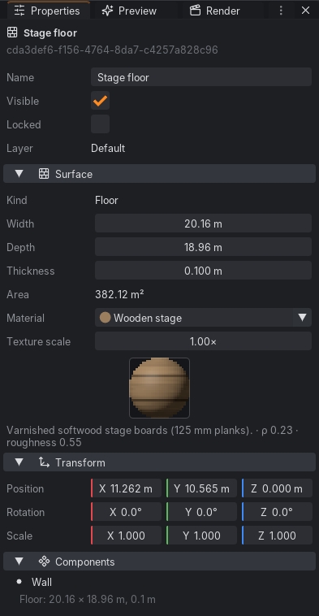

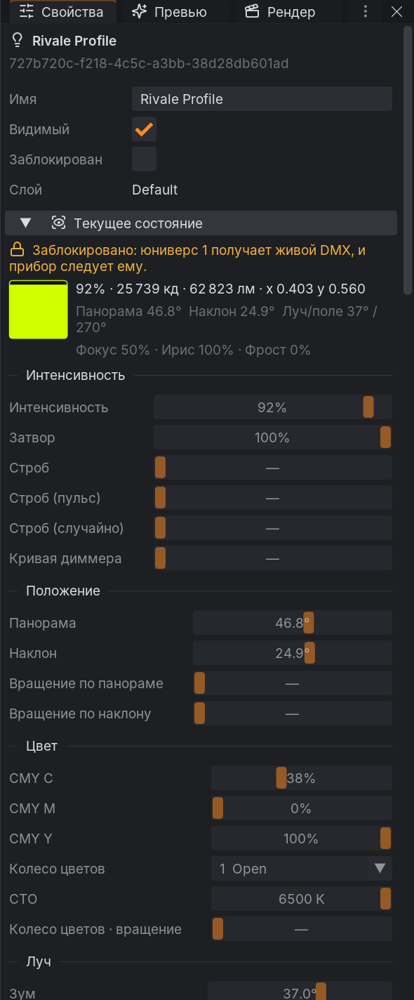

*The same panel in Russian at 150 % UI scale (unit symbols follow the language: кд, лм, Вт, дБ(А) …).*

**Walls and floors**: kind, width, height / depth, thickness, area, the material (drop-down grouped by category with
colour swatches; a lit sphere preview with the material's description, luminous reflectance ρ and roughness) and the
texture scale. **Models**: size from their bounds, a material override per material slot, shadow casting. Several
selected walls or models are edited together.

### External Control

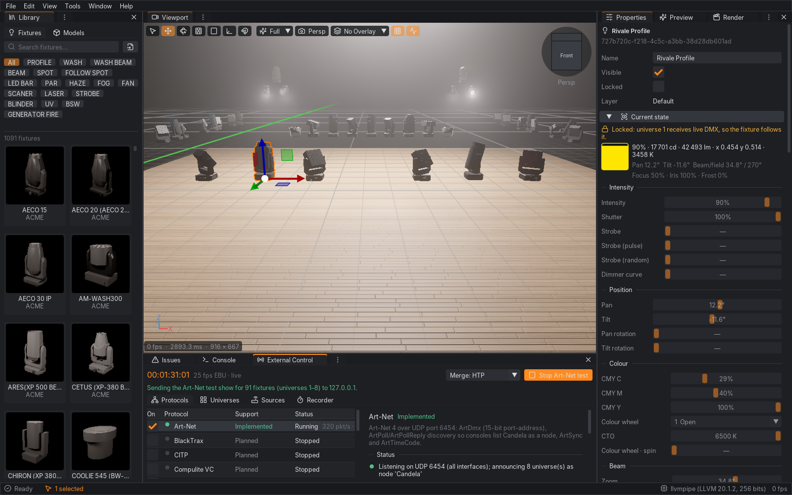

*The Art-Net test show playing to this computer: the External Control panel shows the received timecode, Art-Net
running at 320 packets/s and the status of the receiver; the selected fixture is locked to the live DMX and its current
state follows the show.*

The header shows the **last timecode** received and **who sent it** — the DMX input hub's
`LastTimecodeSample` / `LastTimecodeSource`: *Art-Net from 192.168.1.20:6454* (protocol and sender endpoint) or
*recording 'Show 1'* for a DMX recording being played —, its frame rate and *live* or how long ago, the **merge
mode** of the DMX input hub (*HTP*: highest level per slot wins; *LTP*: the latest change wins — for two consoles on one
universe) and **Send Art-Net test** (below). The tabs:

* **Protocols** — all fifteen protocols of `Candela.Protocols` with their support level and live status (packets per
  second, universes receiving; the tooltip of the status gives the message). Selecting one shows its description, why
  it has that support level, its settings and its **status**: the message, where it receives (*Receiving on
  0.0.0.0:6454*), the selected network interface and the number of universes it serves (announced by Art-Net,
  subscribed by sACN, mapped by OSC, 1 for a DMX widget), the packet counters, the last error with a hint **what to
  do** about it (one per `ProtocolErrorCode`: port in use by another program, two protocols on one port, an address or
  adapter that is missing, a serial port that cannot be opened …), the warnings and the last malformed packet;
  discovered Art-Net nodes; the Eos connection. A stopped protocol keeps its last error on screen. The tick box starts
  or stops it; protocols that are only planned or need a vendor SDK cannot be started.

  Status texts are **localised**: every `ProtocolStatus` carries its message, error and warnings as a `ProtocolText`
  (a stable key of `ProtocolMessages` with language-neutral arguments — ports, addresses, counts, names, system
  messages — and the English text). In English the text is shown as it is; in Russian the editor fills the key's
  Russian template (`ProtocolTexts`; every key of `ProtocolMessages.All` has one, with the same placeholders — a test
  checks it) with the same arguments, and an unknown key falls back to the English text. The panel's own messages
  (start failures, recorder, test show) are rebuilt when the language changes.

  | Protocol | Support | Settings |
  |---|---|---|
  | Art-Net 4 | implemented | network interface, universe offset, port (6454), ArtSync, broadcast ArtPollReply |
  | sACN (E1.31) | implemented | port (5568), multicast join, preview data, unpatched universes |
  | EntTec DMX USB Pro | implemented | serial port, universe (applied when the field is left) |
  | OSC | implemented | port (8000) |
  | PosiStageNet | implemented | port (56565) |
  | ETC Eos | partial | OSC output port (8001) |
  | BlackTrax, CITP, Compulite VC, Kinesys, LasergraphDSP, PangolinLD | planned | — |
  | MA-Net2, MA-Net3, NDI | needs the vendor's SDK | — |

* **Universes** — a tile per universe: green while it receives data (brighter = more packets per second), outlined when
  the patch uses it. Click a tile for its 512 slots with their values; patched slots are highlighted and the tooltip
  names the fixture and attribute.
* **Sources** — every sender: protocol, name (Art-Net short name, sACN source name), IP address, universes, priority,
  packets.
* **Recorder** — records the merged DMX input with the timecode **at packet rate**: the engine's `DmxRecorder` follows
  the DMX input hub's receive path and stores every change of a universe and every new timecode the moment it arrives
  (not once per editor frame), so a 44 Hz console recorded by a slow editor keeps all of its frames. The tab says so,
  and each recording shows how it was captured (*every change at packet rate · format v2*; a `.cdmx` file of format
  version 1 was sampled once per engine frame). Plays it back (the fixtures follow the recording as they would a
  console), seeks by position or by timecode, saves and loads `.cdmx` files. A recording is what the Render panel
  renders a timecode range from.

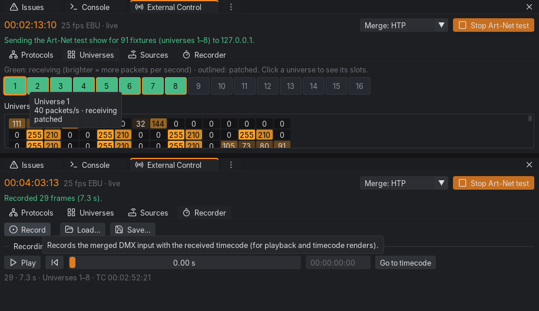

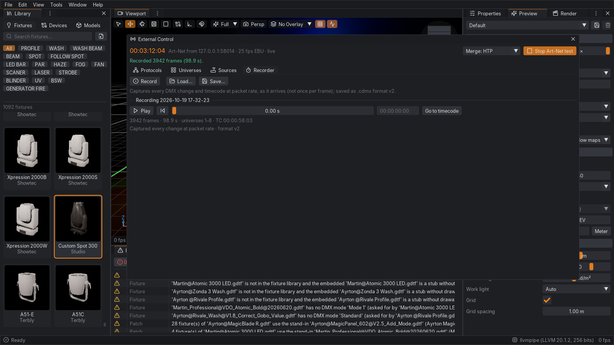

*The test show recorded for a minute and a half: 3942 frames captured at packet rate; the header names the timecode's
sender (Art-Net from 127.0.0.1).*

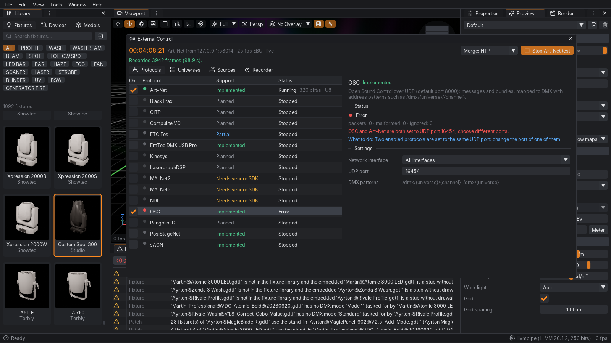
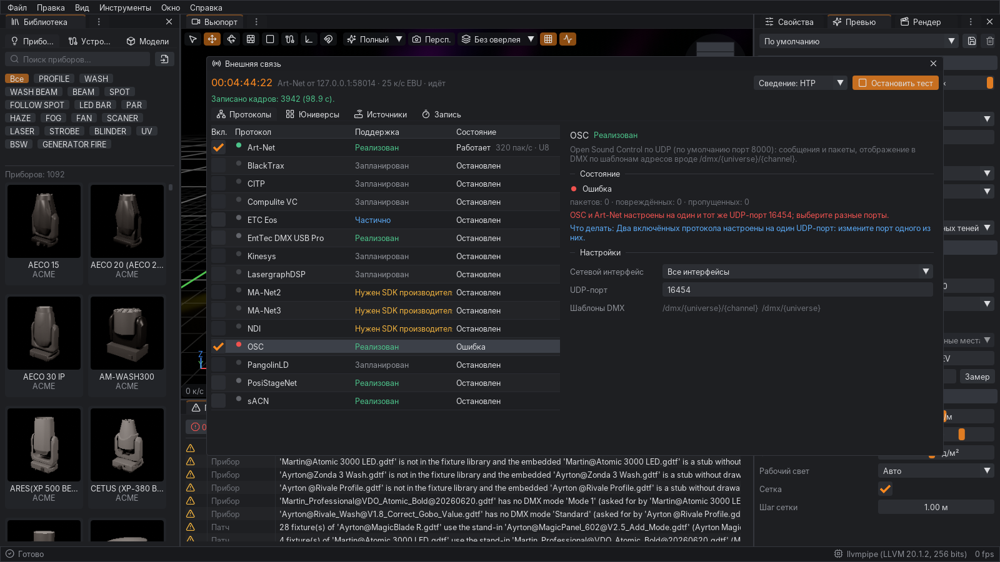

*OSC set to Art-Net's UDP port: the status gives the error and what to do about it, in English and in Russian; Art-Net
itself receives the test show (320 packets/s, 8 universes).*

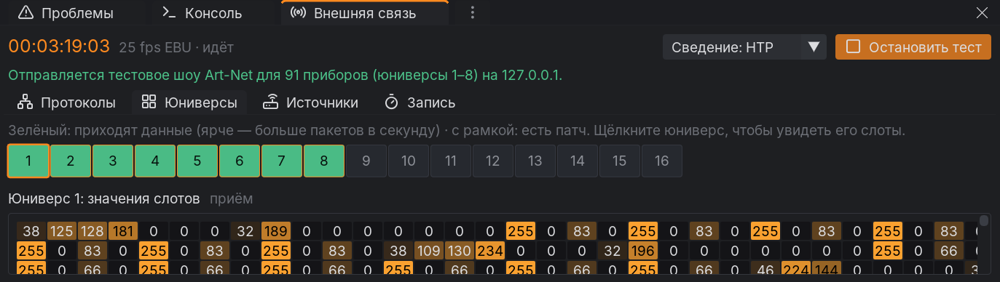

*External Control in Russian at 150 % while the test show runs: universe activity and the slot values of universe 1.*

The protocol settings are stored in `external-control.json` in the config folder (enabled protocols, ports, options,
merge mode, test target); the network interface and the Art-Net universe offset are the ones of *Settings → Network*.

#### Acceptance path: a console over Art-Net

1. **Open the stage** — *File → Open* `stages/Фокина.mvr` (or a project). The fixtures keep their MVR patch; the
   Properties panel shows each fixture's universe and address.
2. **Enable Art-Net** — *External Control → Protocols*, tick **Art-Net**. It listens on UDP 6454 on the interface of
   *Network interface* (*All interfaces* by default; pick the lighting network's adapter when there are several) and
   answers ArtPoll, so consoles list the computer as the node **Candela** with the universes the patch uses. *Art-Net
   universe offset* maps console numbering to Candela's: with offset 1, Art-Net port-address 0:0:0 is universe 1.
   Allow inbound UDP 6454 in the computer's firewall.
3. **Point the console at the computer** — on the console, output Art-Net on the universes of the patch, unicast to the
   computer's address or broadcast on its subnet (2.x.x.x / 10.x.x.x networks work the same). The **Sources** tab lists
   the console with its IP address and universes, the **Universes** tab turns green.
4. **Fixtures follow** — the console now drives every fixture on those universes: the viewports show the beams, the
   Properties panel says *Locked: universe N receives live DMX* and its current state follows the console. With two
   consoles on one universe the merge mode decides (HTP / LTP).
5. **Timecode** — when the console (or a show controller) sends ArtTimeCode, the header shows it running. Record the
   show in the **Recorder**, save it, and render a timecode range of it in the Render panel later — without the console.

Without a console, **Send Art-Net test** does the same over the network: it encodes a moving show for the stage's own
patch (pan, tilt, dimmer, colour, zoom and focus mapped onto each fixture's channel functions from its GDTF) with a
running timecode and sends it as a separate Art-Net console to the test target (127.0.0.1 = this computer; Art-Net is
switched on for it). When *Network interface* names one adapter, "this computer" is reached at that adapter's address
instead of 127.0.0.1 (a receiver bound to one adapter, as on Windows, does not see loopback datagrams). Sending to
another address feeds a second Candela or any Art-Net node. An empty stage gets a demo rig's show.

### Preview

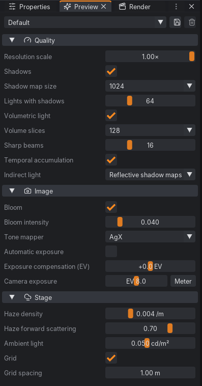

*Preview (left) and Render (right) with their preset drop-downs.*

**Quality**: resolution scale, shadows (map size, lights with shadows), volumetric light (volume slices, sharp beams),
temporal accumulation, indirect light (off / reflective shadow maps / ray traced). **Image**: bloom (intensity), tone
mapper, automatic exposure or exposure compensation (EV) and camera exposure (EV100) with **Meter**, which sets the
exposure from the engine's light meter (incident light at the stage's centre), applied to every viewport. **Stage**
(scene settings, undoable, saved with the stage): haze density (scattering coefficient, m⁻¹), haze forward scattering,
ambient light (0 … 100 cd/m²: the luminance of the venue around the stage — house lights, walls — that lights every
surface evenly in the Full view and in final renders, not the haze; a dark venue is about 0.05, a lit hall 30 or more),
**work light** (Off / Auto / On, see [Viewports](#viewports); stored in the project's view settings, not in the preset),
grid and grid spacing.

The **preset drop-down** (also in Render and in the legends) lists *Default* (read-only), *Custom* (the edited values,
shown as soon as anything differs from the chosen preset) and saved presets; the save button stores the current
values under a name, the bin deletes the chosen preset (the values in use stay; the drop-down then shows *Custom*). Presets are Core `PresetLibrary` files in
`presets/preview/`, `presets/final-render/`, `presets/lux-gradient/` and `presets/noise-gradient/` of the config folder;
the current values are saved in the project (`settings.json`, section `view`) and come back when it is opened.

### Render

**Output**: folder (default `Pictures/Candela`), file name and format (PNG; EXR needs the path tracer and is disabled
with that reason). **Quality**: resolution (with common sizes) and samples per pixel, tone mapper; the panel shows the
plan, e.g. *2× supersampling, 64 accumulated frames → 1920 × 1080 PNG*. **Frame or timecode range**: a single frame, or
start and end (timecode `HH:MM:SS:FF` or seconds) and frame rate of the DMX recording. **Work light**: Off by default —
a final render shows the fixtures' light only, whatever the preview uses —; Auto or On adds it to this render (not saved
with the preset). **Path tracer**: bounces, volume bounces and denoising, kept for the final renderer.

Final path tracing is not available yet, and the panel says so: **Render uses the real-time renderer at its highest
quality** — 2048-texel shadow maps for up to 256 lights, 256 volume slices, ray-marched beams, indirect light on — and
renders at twice the resolution in each direction (when the target stays within 8192 pixels) for `samples ÷ 4` frames
of temporal accumulation (up to 256), averages the last four frames read back and filters them down to the output
size. A **timecode range** renders an image sequence
(`name_0001.png`, …): the job takes over the engine clock (the editor stops ticking the stage with wall-clock time),
plays the recording from two seconds before the start so moving heads and fades have arrived, and for every frame seeks
the player, ticks the engine by one frame period and renders. The job runs a slice per editor frame (about 60 ms) with
a progress bar and *Cancel*, so the editor stays usable; errors (folder not writable, disk full, a GPU error such as a
lost device or a target too large for the GPU) stop it with the reason, and a cancelled or failed sequence stops the
recording playback it started.

### Overlay legends

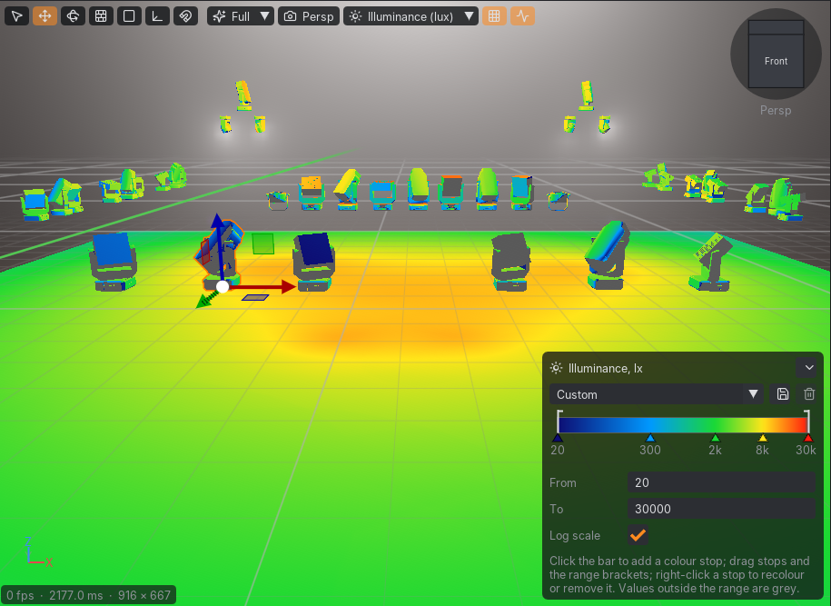

With the *Illuminance* or *Noise* overlay, the viewport shows a legend in its lower-right corner: the colour gradient
with its stops and range. Click the bar to add a stop, drag stops to move them, drag the range brackets to set the
minimum and maximum, right-click a stop to recolour or remove it; the chevron expands numeric fields (from, to,
logarithmic scale, the value of the selected stop). Values outside the range are drawn grey. Each gradient has presets
like the Preview panel, applies to every viewport and is saved in the project.

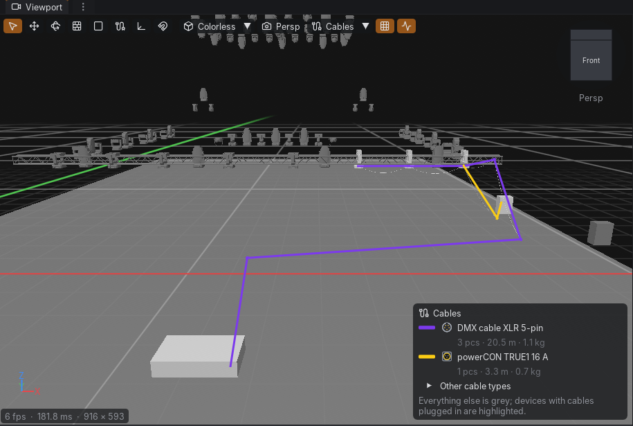

The *Cables* overlay (Alt+C) draws every cable in the colour of its type and highlights the devices with cables plugged
in; everything else is grey. Its legend lists the types **in the scene** first — colour, connector drawing, localized
name, and how many cables of the type there are with their total length and weight (*3 pcs · 20.5 m · 1.1 kg*; the
figures move under the name when they do not fit beside it) — and folds the rest of the catalogue under *Other cable
types*; while the scene has no cables, it lists the whole catalogue.

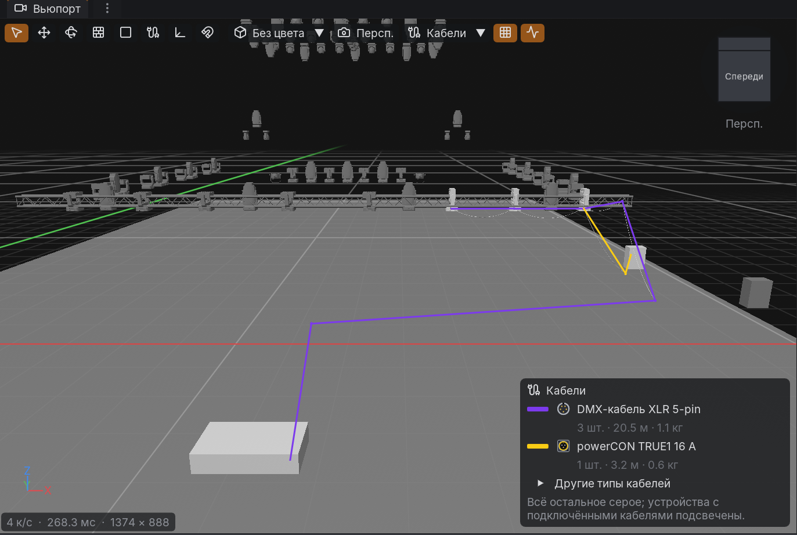

### Implementation

```
src/Candela.App/
  Session/  StageToolState (StagePanelContext: what the panels see; per-frame update of presets, external control and
            render job), PresetBinding / SettingsCopy (live settings ↔ preset library ↔ project), FixtureControls
            (attributes of a mode → controls, live state), ManualAttributeCommand, SetFieldCommand, DeviceFacts
            (manufacturer rows, ports and cables), ExternalControl (protocol settings, status polling, test show,
            recorder), RenderJob (RenderJobRunner: plan, supersampling, accumulation, timecode sequences)
  Panels/   StagePropertiesSection → FixtureInspectorView, DeviceFactsView, SurfaceInspectorView; ExternalControlPanel;
            PreviewPanel; RenderPanel
  Viewport/ OverlayLegend (legend window of a viewport)
  Ui/       StageStrings (StageStr / StageLoc: English and Russian texts of these panels), StageUnits (unit symbols in
            the UI language), StageIcons, ConnectorIcons (vector connector drawings), GradientEditor, PresetCombo,
            MaterialSwatch, AttributeLabels, LabelColumn
```

The shared shell only hosts them: `Workspace` adds the External Control panel and calls `StageToolState.Update` before
each frame, `EditorSession` exposes the engine and `EngineClockHeld`, `ViewportPanel` draws the legend, the Properties
panel calls `StagePropertiesSection`. Their steady-state frames do not allocate: texts are rebuilt when the values
behind them change (current state at most ten times a second, protocol status four times a second), labels once per
language.

Tests: `FixturePropertiesTests` (controls of a moving head in physical units, ordering, manual values and undo,
the lock by a console cable and by live DMX, multi-selection, patch changes, manufacturer rows, ports and the cable in
a port, every connector drawing), `ExternalControlTests` (the acceptance path end to end on the loopback interface — an
Art-Net console sends DMX and timecode, the source, universe activity and fixture state appear —, the test show,
recording / playback / seeking / saving, settings files, timecode parsing), `PresetsAndOverlayTests` (presets, Custom,
project adoption, gradient editing rules, legends, Preview / Render / legend drawing under a window-less ImGui context)
and `RenderJobTests` (the plan, a frame and a timecode sequence rendered on a headless Vulkan device and checked
pixel by pixel).

Limitations: final path tracing and EXR output wait for the path tracer; the issue messages of the engine (patch, MVR
import) and the operating system's messages quoted in a protocol error stay English (the protocols' own status texts
are localised); changes of the view settings count as unsaved changes but are not undo steps.

## Robustness

* No exception escapes the frame loop: a failing frame is logged and reported in the Issues panel and the next frame
  runs; after 120 consecutive failures the editor stops with exit code 1. Dear ImGui aborts the process (a native
  assertion) when a frame is left open, so the UI frame is always ended — the window, ID and style stacks are unwound
  with Dear ImGui's error recovery — before an exception reaches the loop. Every top-level part of the UI runs under
  its own guard: a failing panel shows its error with a *Retry* button instead of its content, a failing dialog
  (settings, file browser, message, about, shortcuts) closes, a failing menu or status bar only loses that frame's
  drawing, and the rest of the UI keeps working.
* An error that repeats (every frame, or every time a dialog opens) is logged in full once and then counted (at 10,
  100, 1000 … occurrences), and appears once in the Issues panel (at most 200 different program messages; the panel's
  clear button really empties the list and lets them be reported again). The log file holds the current run and stops
  at 16 MB; the previous run is kept as `candela-app.previous.log`.
* Swapchain loss, resize and minimise are handled (the loop idles while minimised, still ticking the engine for DMX
  and autosave); GPU objects of closed viewports are released after the frames that used them.
* Background work never ends the program: a fixture type whose GDTF cannot be read (for any reason) gets no modes
  and is placed unpatched; a picture the thumbnail thread cannot make (an image too large to decode included) becomes
  an icon; a failure while drawing the busy overlay lets the waiting file operation run without it instead of blocking
  every later one.
* Without a Vulkan device the editor explains what to install and exits with code 3. On Windows a message box says
  whether the Vulkan runtime (`vulkan-1.dll`) is missing or no device supports Vulkan 1.3, names the display adapter
  (from the registry) and offers to open its maker's driver page (NVIDIA, AMD, Intel); elsewhere a small OpenGL
  window shows the text (standard error in headless runs):

  > No Vulkan graphics device: Candela needs a GPU with a Vulkan 1.3 driver. Install or update the graphics driver
  > (AMD, NVIDIA, Intel), or on Linux without a GPU install Mesa's software Vulkan driver (mesa-vulkan-drivers,
  > lavapipe).

* **Crash reports.** When the editor stops because of an error — an exception that escaped everything, a start-up
  failure, a frame loop that kept failing — it writes `crash-yyyyMMdd-HHmmss.txt` into the logs folder (version,
  system, the error with inner exceptions and stack traces, the last 300 log entries; at most 20 reports are kept)
  and tells the user where it is: on Windows a message box that offers to open the folder, elsewhere a line on
  standard error. Writing a report never throws.
* Settings, layouts, presets and the recent-places list are written atomically and read defensively. A damaged
  settings file is moved aside once (`settings.json.damaged-<time>`), not copied again at every start; headless runs
  leave it untouched. Key binding files with missing tables, null or empty chords are repaired when read (a custom set
  saved by an older version also gets the newer actions' defaults). Missing library folders are detected in the
  background, so a network share that does not answer never freezes the settings window.
* **Text from users and files is drawn literally.** Dear ImGui's `Text`, `TextColored`, `TextDisabled`, `TextWrapped`,
  `BulletText`, `LabelText` and `SetTooltip` read their argument as a printf format, and the binding passes no
  arguments: a fixture, file or folder name with `%s` or `%n` in it (or a translated "17 %") would print stack garbage
  or crash the process. Every text the editor shows goes through `SafeText` (`Disabled`, `Colored`, `Wrapped`,
  `Bullet`, `Tooltip` — all `TextUnformatted`) or `TextUnformatted` itself; a test scans the sources so the format
  variants stay unused — it reads the list of format functions (every function with a `fmt` parameter, `TextAligned`
  and the two-argument `TreeNode` included) from the binding itself, so a function added by a binding update is
  checked too —, and the only format strings left are the editor's own number formats of sliders. Names in
  widget labels and combo previews (files and folders in the file browser, recent files, issue messages, DMX modes and
  channel sets, preset, recording, device, connector and network adapter names) go through `SafeText.Label`, which
  breaks a "##" with a hair space so ImGui does not cut the name off as an ID suffix (and puts one after a final '#',
  so a folder called `Music C#` does not lose its '#' to the "##id" the row appends).

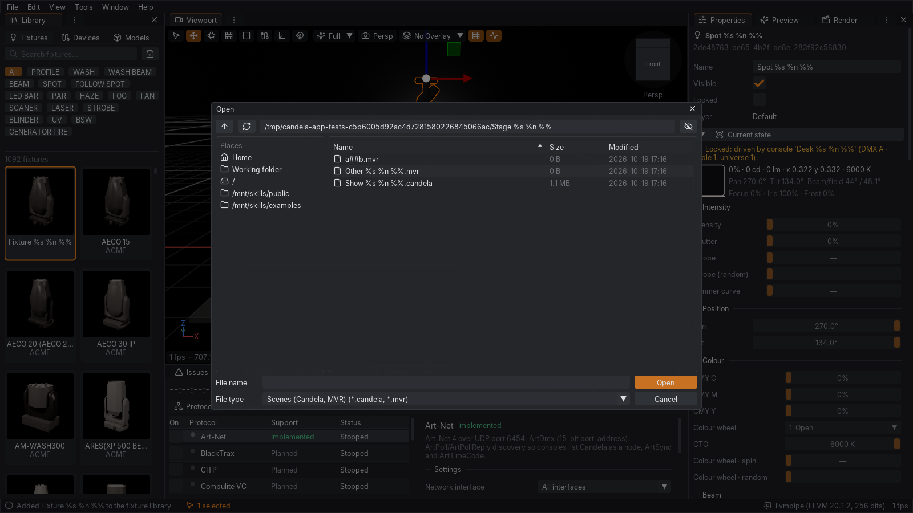

*A project in the folder `Stage %s %n %%`: names, paths and the file list are shown exactly as they are; `a##b.mvr`
keeps its name.*

* The Vulkan validation layer (`--validation`) reports no errors for start-up, a session with window resizes, panels
  torn off into OS windows and docked back, new and closed viewports and UI scale changes, and shutdown (also with OS
  windows still open); an integration test runs such a session.

## Headless verification

`--screenshot` renders the real UI (window, swapchain, ImGui backends, viewports) for `--frames` frames, copies the
last swapchain image and writes it as PNG. Under Linux without a display, run it through Xvfb:

```
xvfb-run -a -s "-screen 0 1920x1080x24" dotnet candela-app.dll --screenshot out.png --layout viewports-4 --language ru
```

With multi-viewport, panels torn off into OS windows are not part of the main swapchain image; use `--single-window`
to keep them in the screenshot, or grab the whole X screen (`import -window root`) as for the picture above.

### Scripted input

`--script <file.json>` replays input before the screenshot (and also in interactive runs). Actions run frame by frame;
mouse and key events are queued into Dear ImGui exactly like real input, so a scripted click exercises the same code as
a real one. Coordinates are pixels in the main window; `move`, `click`, `press` and `scroll` can instead aim at a
point of the stage — `"world": [x, y, z]` in metres, or `"entity": "Console 1"` (the centre of its bounds) — resolved
in the active viewport when the action runs, so a script does not depend on the window size or UI scale.

```json
{ "actions": [
    { "type": "wait", "frames": 3 },
    { "type": "click", "x": 763, "y": 365 },
    { "type": "screenshot", "path": "selected.png" },
    { "type": "drag", "x": 830, "y": 365, "toX": 950, "toY": 365, "steps": 6 },
    { "type": "key", "chord": "Ctrl+Z" },
    { "type": "menu", "path": "File/Import/MVR Scene" }
] }
```

| Type | Fields | Effect |
|---|---|---|
| `wait` | `frames` | do nothing for n frames |
| `move` | `x`, `y` (or `world` / `entity`) | move the mouse |
| `click` | `x`, `y` (or `world` / `entity`), `button` (left/right/middle), `modifiers` ("ctrl+shift"), `double` | click |
| `press` / `release` | `x`, `y` (or `world` / `entity`), `button`, `modifiers` | press a button and hold it across later actions / release it where the mouse is |
| `drag` | `x`, `y`, `toX`, `toY`, `steps`, `button`, `modifiers` | press, move in steps, release |
| `scroll` | `x`, `y` (or `world` / `entity`), `delta` | mouse wheel |
| `key` | `chord` ("Ctrl+Shift+S") | press and release a key chord |
| `text` | `text` | type text into the focused field |
| `menu` | `path` ("File/Settings", "/" or ">" separated; labels in either language, ellipsis and icons ignored) | select a main-menu item |
| `action` | `id` ("view.frameSelection") | run a command |
| `panel` | `panel`, `open` | open or close a panel |
| `undock` | `panel`, `x`, `y`, `width`, `height` | tear a panel off into a floating window |
| `tabStyle` | `panel`, `style` (TopTabs / LeftIcons) | set the tab style of the panel's group |
| `viewport` | `viewport`, `view`, `projection`, `shading`, `overlay`, `grid` | configure a viewport |
| `select` | `names` | select objects by name |
| `layout` | `name` | apply a layout |
| `setting` | `name` (uiScale, fontSize, language, navigation, settingsSection, librarySetup), `value` | change a setting; `librarySetup` drives the fixture library window: `open`, `close`, `default` (use the default folder), `rescan` (read the chosen folder again), `sample` (open the sample scene) or a folder path (as if chosen) |
| `window` | `width`, `height` (screen pixels), or `value` (minimize, restore, maximize) | resize the main window or change its state (swapchain recreation) |
| `open` | `path` | open a scene or project like *File → Open* (asks about unsaved changes) |
| `drop` | `path`, or `names` (several files), `x`, `y` | drop files onto the main window at (x, y), as a file manager does |
| `save` | `path` | save the document as a `.candela` project, like *Save As* with that file chosen |
| `screenshot` | `path` | save the current frame (in `--screenshot` runs) |
| `uiText` | `path` | append every text the windows draw in the next frame to the file (Dear ImGui's text log, as rendered) — tests read back what the user would see |

## Architecture

```
src/Candela.App/
  Program.cs, AppOptions.cs        command line, exit codes
  Shell/      EditorApplication (start-up, frame loop, shutdown), GlfwPlatform, MainWindow, GpuDevice,
              ImGuiHost (context, backends, textures), SwapchainCapture, StartupFailureScreen, FrameTimer,
              Workspace (+ .Menus: panels, commands, menus, layouts, dialogs; + .Session: document commands,
              busy operations, file drops, recovery; + .Library: library host, placement popup; + .Cables: cable
              tool host, Tools → Cable menu, editing keys, duplicate re-patch), FileDropQueue, MenuScope,
              WorkspaceContext
  Docking/    DockWorkspace (dock space, presets, tab styles, icon column), Panel, TabStyleMap, LayoutFile, LayoutStore
  Viewport/   ViewportPanel (+ .Surface: surface under the cursor, framing; + .Placement: library drops and ghost;
              + .Drawing: Wall / Floor tools and resize handles; + .Cables: cable tool input, targets, draft,
              port picker, cable node handles and gizmo), ViewportCamera, ViewCube, NavigationStyles, OverlayLegend
  Editing/    SelectionController, EditOperations, TransformMath, SceneLookup, Placement (orientation on a surface),
              WallShapes (wall / floor geometry), AutoPatch, LibraryPlacement, FixtureInfoCache, ModelLibrary,
              CableTool (the tool's model: targets, draft, port choice, commits), CablePorts (port candidates and
              positions), CableNodeEdits (moving / deleting nodes), DevicePlacement, DuplicatePatch
  Session/    EditorSession (the single gateway to StageEngine), EngineViewportContent (RenderSync → viewports,
              picking, RenderSync's bounds for box selection and framing, outline of selected descendants, work
              light), ViewSettingsEdits (work light and stored camera in the project's view settings),
              IViewportContent, PreviewStage (--preview-stage), SessionResult, CableLinkModel (the strip of the
              cable link window)
  Thumbnails/ ThumbnailWorker (background renderer for library stills and orbit frames), UiTextures (ImGui user
              textures with deferred release)
  Input/      key names, commands, KeyBindingMap / dispatcher, KeyBindingsService, InputScript, ScriptPlayer,
              SessionActions
  Files/      FileFilter, FileBrowserModel (pure logic), FileBrowserDialog (UI)
  Panels/     Library (+ .Devices; FixtureLibraryWatcher follows the engine's FixtureLibraryChanged), Properties
              (+ ConnectionInspectorView: cables, consoles, power sources), CableLinks, Issues, Console, Render, Preview
  Windows/    SettingsWindow, SessionDialogs (busy, unsaved changes, open-or-import, recovery), message boxes, About,
              Shortcuts
  Settings/   SettingsStore, EditorPreferences (editor-preferences.json)
  Ui/         Theme, FontSet, Icons, Loc / Str, Labels, PropertyGrid, UiScale, CableStrings (CableStr / CableLoc:
              texts, cable type and device names in both languages), CableTypeMenu, PortPicker, DeviceIcons,
              SafeText (literal text, tooltips and labels), ProtocolTexts (protocol status in Russian, error hints),
              WorkLightCombo
  Diagnostics/AppLog
```

**Frame order** (main thread): poll events → session update (engine `Tick`: DMX, simulation, autosave, issues) →
workspace *BeforeFrame* (pending layout ini, viewport pick queries of the last frame, queued file drops, a queued busy
operation — open, save, import, export run here, between two frames, after the busy overlay has been drawn once — and
library thumbnails finished by the worker) → scripted input → ImGui NewFrame → workspace draw (menus, status bar, dock space,
panels, dialogs, shortcut dispatch) → ImGui Render → GPU frame: viewports sync and render into their targets →
swapchain acquire → ImGui draw data → (screenshot copy) → present → platform windows.

Picking runs outside the GPU frame (the renderer's `Pick` reads the pick buffer of the last rendered frame), so a click
is answered on the next frame. The scene, selection and undo stack are Core types (`Scene`, `Selection`, `UndoStack`)
owned by the session's `StageEngine` (`EditorSession.Engine`); every panel reaches them through `EditorSession`, which
also turns engine results and exceptions into Issues-panel entries, so a failing file operation never ends the
program.

**Steady-state frames do not allocate** on the managed heap in the editor's own code: labels are built once per
language (`Labels`), status texts and statistics only when their values change (statistics at most four times a
second), commands are cached delegates, bounds come from the render binding without copying, and the Library panel
caches its tile keys, labels and filtered lists (rebuilt when the search, category or catalogue
changes). Allocations happen on user actions (edits, opening menus and dialogs, drags) and when thumbnails arrive.

## Tests

`tests/Candela.App.Tests` (xUnit, about 630 tests, about five minutes on lavapipe; the end-to-end runs whose checks do not depend
on lit pixels use Colorless shading, since on lavapipe the lit preview of a dark rig — with the Auto work light's
shadowed key — takes about twice the frame time) covers everything that does not need a window:
camera math (orthonormal basis, axis views, pan / zoom-to-cursor keeping the point under the cursor, framing, rays),
the view cube (projection, hit testing, snapping to the six views, neighbour arrows, no allocations), navigation
styles, selection rules (including box selection of enclosed objects only), edit operations and undo grouping, gizmo
drag merging, Euler angles, key binding maps / presets / dispatch and their display names (through a window-less Dear
ImGui context: Escape that closes a menu, dialog or window, and a chord just recorded, never also run a shortcut),
the choice of the active viewport, docking (default and four-viewport presets, icon-column style, layout and tab-style
round trip through a saved file, loading a layout while running), layout files and store, the file browser model and
filters, command-line and script parsing, settings robustness, localisation completeness (issue categories too),
layout rules found by exercising the UI (menus opening towards the window's inside, the property grid's label column,
transform fields stacking instead of cutting numbers, the file dialog fitting without scrolling), and the preview stage
on a real (headless) Vulkan renderer with picking.

The phase-B1 tests: `EngineSessionTests` (`EditorSession` over the real engine: Фокина opened, saved as `.candela`
and reopened unchanged; a project, an MVR, a 3D model, an image and a GDTF imported, each one undo step; MVR export
and reopening it; missing and damaged files failing with a reason in the Issues panel instead of an exception, in
English and Russian; recent files; simulation pause), `SessionFlowTests` (the unsaved-changes, busy, open-or-import
and recovery dialogs answered headlessly, recovery of an autosaved session, discarding it, file classification,
Duplicate / Copy / Paste of a truss with its fixtures — references remapped, kept or cleared), `EngineViewportTests`
(on a headless Vulkan device: the Фокина scene picked fixture by fixture — a part never comes back instead of its
fixture —, bounds for box selection, the outline of selected fixtures and groups, framing that keeps every point in
the picture; the thumbnail worker rendering stills, orbit frames and image previews in the background), `PlacementAndShapeTests` (orientation of
fixtures, models and images on floors, ceilings and walls; floors and walls from a drag, resizing with the opposite side
fixed, snapping, handles), `LibraryTests` (auto-patch to the next free address without straddling universes, placing a
fixture with its default mode and changing the mode, the model library file, image resizing, the library search and
category filter). `SessionSafetyTests` (changing or switching off the autosave interval during a run leaves no
"crashed" session behind after a clean exit; a run that does not end cleanly keeps its recovery files and they recover
the unsaved work; the engine's own frames never mark an opened rig modified and allocate nothing; a failed Save As keeps
the scene name; Enter or Escape pressed in the frame a question opens does not answer it) and `LibraryRobustnessTests`
(unreadable GDTF files give fixture types without modes that are placed unpatched instead of throwing; a model library of
thousands of entries loads in linear time). `EditorEndToEndTests` start the real editor under `xvfb-run` with scripted input: open the Фокина
scene, click a fixture, check that the Properties panel names it and that the viewport shows the orange outline, save
it as `.candela`, reopen it and compare the scene (entities, transforms, components, patch) with the original; and
build a stage — draw a floor and a wall, drag a fixture from the Library onto the floor, drop an image onto the
viewport, save — then read the saved project and check each object. `RobustnessTests.cs` tries to break the
editor: exceptions inside a UI frame and inside a modal dialog, damaged dock trees (each of which aborted or hung Dear
ImGui), repeated failures, log size and rotation, damaged settings and key binding files, gizmo drags of parent +
child, locked layers and rotations around the pivot, the far plane at the zoom limit, fly mode from an orthographic
view, pick pixels at framebuffer scales 1 / 1.25 / 2 and at the image edges, the file browser on unreadable folders,
link loops, broken links, Unicode names and a 20 000-file folder (allocation per frame measured), background folder
checks, Euler angle display and framing of objects without geometry. Integration tests start the real editor under
`xvfb-run`: the default screenshot must be a real frame, a scripted click must select an object and change the
Properties panel (and Escape must clear it), shortcuts must work after fly mode was interrupted by a tab switch, a
session with resizes, tear-offs and new viewports under `--validation` must report no validation error, and a run
without a Vulkan driver must exit with code 3. They are skipped when `xvfb-run` or a Vulkan device is missing.

The M4 cabling tests: `CableToolTests` (the tool's model on a headless engine with a console, a wall, a truss with
three spots and a distro: a route over the wall and the truss into a fixture with the console's port picker, the daisy
chain continuing from each fixture's thru, a Y branch from the middle of a segment, the picker's in-use, incompatible
and wrong-direction entries and the automatic choice when one port fits, free ends, joining, Backspace, node moves and
deletes with undo, undo while drawing), `CablingPanelTests` (console-driven locking that follows the cables — with the
lock text, the patch rows and a universe mismatch in the Issues panel —, a power overload after cabling three fixtures
to a distro outlet and the outlet load in the power source's properties, the cable link window under a window-less
Dear ImGui context: the strip, a device card selecting the device, a cable followed, Russian texts; devices of every
section placed with their ports, names and a patch for the dimmer; cables, consoles, power sources and generic GDTF
devices saved and reopened unchanged; copied fixtures re-patched in one undo step; the editor preferences file; the
cable strings complete in both languages; scripted `world` / `entity` points) and `CableEndToEndTests` (the real editor
under `xvfb-run`: the type chosen in Tools → Cable, the console clicked and DMX A taken with key 1 in the port picker, a
point on the wall, fixtures clicked one after the other, Escape, a branch from the middle of the first cable to the
third fixture ended with a right click, a power cable from a distro outlet over the floor, a floor drag cancelled with
Escape, the project saved and read back — cables, anchors, plugs and the fixtures the console drives). The Electrical
tests cover the catalogue additions (`DeviceCatalogTests`), the Engine tests `GenericDeviceLibrary`.

The engine follow-up tests: `EngineViewportTests` (box selection, framing and drop targets from `RenderSync`'s bounds,
the outline of a selected group's descendants), `ViewSettingsFollowUpTests` (the work light following the view setting,
left out under the lux overlay and of final renders unless asked for; autosave reconfigured on the running session;
Preview / Render / legend changes, the work light and the stored camera counting as unsaved changes and reaching the
autosave; the camera of a saved project restored), `LibraryImportFollowUpTests` (an imported GDTF — named with printf
conversions — comes back as the entry to select and is heard once by the Library's watcher; another file of a model
selects the tile the grid shows; a non-archive and a type without DMX modes are refused with the engine's reason in
the UI language; the GDTFs of an MVR reach the watcher with their source), `ExternalControlFollowUpTests` (every
`ProtocolMessages` key has a Russian template with the same placeholders, every error code a hint in both languages,
fallbacks for literals, unknown keys and mismatched arguments; the status details with endpoint, interface, universes
served, warnings and the last malformed packet; a real Art-Net / OSC port conflict reported in Russian with its hint and
re-rendered in English after a language switch; the recorder's capture description), the timecode test in
`PanelReviewTests` (the sender of an ArtTimeCode — 127.0.0.1 and its port — and of a playing recording by name, in both
languages), `MvrWallsFollowUpTests` (walls and floors exported to MVR and opened again with kind, size and material, no
box models), `ViewportBoundsReviewTests` (on Фокина with the heads moved by DMX, every entity's box, the scene box, the
framing points and the outline of nested groups are exactly what the renderer was sent — the bookkeeping of the former
`TrackedRenderWorld`, kept as a recording world in the test), `EditorFollowUpReviewTests` (an opened MVR or project shown
by the Preview and Render panels and the legends in both languages is not an unsaved change), `SafeTextTests` (no
printf-style ImGui call in the sources; `SafeText.Label` keeps names with "##" whole;
properties, cable links, the recorder, the file browser and the helpers render names, labels and paths with
`%s %n %%` literally, read back through Dear ImGui's text log) and `SafeTextEndToEndTests` (the real editor under
`xvfb-run`: a project in a folder `Stage %s %n %%` with such names opened, a fixture selected, a GDTF of that name
dropped and selected in the Library, the file browser listing such files and the Russian UI — the `uiText` logs
contain the names literally and nothing crashes).

The lighting baseline (`LightingBaselineTests`): after opening `stages/Фокина.mvr` the binding's work light is on
(`Binding.IsWorkLightOn`, the default Auto, the seven rig lights sent) over the added stage floor, which covers all 91
fixtures with its margin, is drawn, and goes with one Undo (and out of the render world) and comes back with Redo; a
project saved without it reopens without it and with an empty undo history; an MVR with a floor of its own gets none.
Work light *Off* sends no light at all for the dark rig, is saved with the project, survives New and reopen (and *On*
likewise, with the rig). The Ambient row's value reaches the renderer's atmosphere (30 → 30, NaN and negative → 0). On
lavapipe (headless screenshots, `lighting-baseline-*.png` in the test output): a textured OBJ (red and green halves)
imported into an empty scene is lit in Full shading by the Auto work light at the default EV 8 with both colours
visible, black with the work light Off, and lit again in its colours by 30 cd/m² of ambient light without any light; a
reference drawing shows its red and green halves in Full and Colorless shading without any light, and a poster of the
same image is dark until the work light is on, then shows its image.

The install tests: `InstallExperienceTests` (when the fixture library window opens at start-up — installed copy
without a library of the user's own, never headless, in development or with a file to open, always with
`--library-setup`; a folder counted with its subfolders, a missing one; a chosen folder put first in the settings and
read by the running engine; the default folder created on use; an imported GDTF copied into the library folder, a
refused one deleted again, read-only runs and development leaving files where they are, a different file of the same
name never replaced; the window's states drawn in English and Russian through Dear ImGui's text log, the sample scene
opened from it; the logs folder per platform and with an explicit config folder; a crash report with the error and the
last log lines, old reports pruned; the no-Vulkan message naming the cause, the card and its driver page; the first
start's language from the operating system; the window icon's sizes; every install text in both languages with the
same placeholders; the option parsed and in the usage) and `LibrarySetupEndToEndTests` (the real editor under
`xvfb-run` with `--library-setup`: a folder `Мои приборы/GDTF files` chosen through the scripted `librarySetup`
setting is counted — one file directly, one in a subfolder — and read into the library, and no crash report is
written).

## Limitations

* Walls and floors are rectangular boxes (no polygons, no openings); a floor is drawn aligned to the world axes and
  turned afterwards with the Rotate gizmo. They survive MVR export and import (other programs see boxes); a wall with
  a material made from the project's own texture comes back from an MVR with the default material, since the texture
  does not travel.
* Cables: the engine draws every span with the cable's slack as a catenary, also spans lying on a floor, which then
  sag below it (the length is right, the picture is not); the *Mains In* of consoles' and distros' power sources takes
  any connector (the component has no inlet connector field); a cable's type can be changed to any type and the
  Issues panel then reports the ports it no longer fits; generic nodes, splitters and the dimmer pack are exported to
  MVR as GDTF fixtures (other programs see them as fixtures); route points are anchored to the object under the click,
  not snapped to truss chords.
* A fixture dropped from the Library lands with its default mode (another mode is chosen in the popup that follows the
  drop, or later in the Properties panel). A fixture type whose GDTF file cannot be read is still placed, without a
  mode and unpatched (its ghost is a 1 m box), and the engine reports the file in the Issues panel.
* Thumbnails are rendered on a second (headless) Vulkan device in the background; without one (or before it has
  started) the Library shows category icons instead.
* *Render* in the Render panel still answers that final rendering is not available yet (it comes with the Render
  panel's job runner).
* File dialogs are the editor's own browser on every platform (no native OS dialogs).
* Multi-object editing in the Properties panel edits the primary object; the gizmo moves all selected objects.
