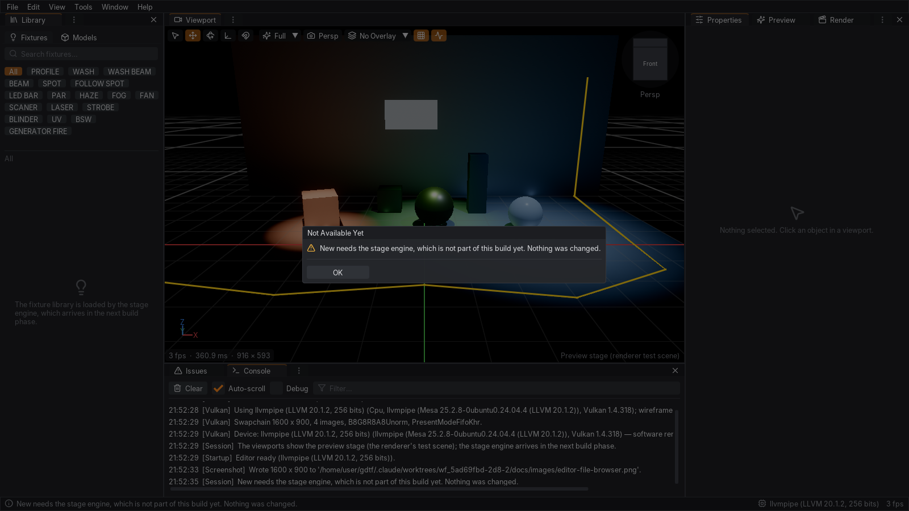

# Candela editor (`Candela.App`)

The desktop editor of Candela: a dockable workspace around Vulkan viewports, built on GLFW, the shared
`VulkanContext` / `VulkanRenderer` of `Candela.Rendering.Vulkan` and Dear ImGui (docking + multi-viewport branch,
through the Hexa.NET bindings). This document describes **phase A** — the shell, workspace, viewports, selection and
editing tools, settings and the headless verification mode. Phase B connects the stage engine (fixture library,
open/save/import/export, real stages); until then every engine operation is routed through one session class that
answers with a clear *"not available yet"* message instead of failing.


*Default layout: Library on the left, the viewport in the centre (move gizmo on the selected sphere), Properties /
Preview / Render on the right, Issues / Console below. The viewport shows the renderer's procedural test scene.*

## Running

```
dotnet run --project src/Candela.App -- [scene] [options]
```

The executable is `candela-app` (`candela-app.exe` on Windows). It needs a GPU with a Vulkan 1.3 driver; on Linux
without a GPU, Mesa's software driver (lavapipe, package `mesa-vulkan-drivers`) works — slowly, but completely.

| Option | Meaning |
|---|---|
| `scene` / `--open <file>` | scene or project to open at start (`.candela`, `.mvr`; phase B — today a "not available" message) |
| `--layout <name>` | start with a layout: `default`, `viewports-4` or a saved layout name |
| `--reset-layout` | ignore the saved workspace and start with the default layout |
| `--scale <1-4>` | UI scale (1 = 100 %), overrides the setting |
| `--language <en\|ru>` | UI language, overrides the setting |
| `--device <name>` | preferred GPU (substring of the device name) |
| `--validation` | enable the Vulkan validation layer |
| `--config-dir <dir>` | folder for settings, layouts, presets and the log of this run |
| `--single-window` | keep torn-off panels inside the main window (no OS windows) |
| `--width <px>`, `--height <px>` | initial window size (default 1600 × 900) |
| `--screenshot <png>` | headless verification: render, save the last frame as PNG and exit |
| `--frames <n>` | frames rendered before the screenshot (default 12) |
| `--script <json>` | replay scripted input first (see [Scripted input](#scripted-input)) |

Exit codes: `0` ok, `1` failure, `2` usage error (bad option, unreadable script), `3` no usable Vulkan device.

`--scale`, `--language` and `--device` apply to the current run only: the settings file keeps its values unless the
setting is changed in the editor during the run. Headless runs (`--screenshot`) never write settings or the workspace.

Per-user files live in the Candela config folder (`%APPDATA%\Candela`, `~/.config/Candela`,
`~/Library/Application Support/Candela`; `CANDELA_CONFIG_DIR` or `--config-dir` override it):

| File | Content |
|---|---|
| `settings.json` | all settings (Core `AppSettings`) |
| `layouts/*.layout.json` | saved layouts; `_workspace.layout.json` is the arrangement restored at the next start |
| `presets/keybindings/*.json` | named key binding presets |
| `keybindings.custom.json` | the edited ("Custom") key bindings |
| `recent-places.json` | recently used folders of the file browser |
| `logs/candela-app.log` | the log of the last run (also shown in the Console panel) |

## Workspace

The main window holds a menu bar, a status bar and one dock space. Every panel is a dockable window: drag a tab to
another group, to an edge of a group (split) or out of the window. Panels torn out of the main window become **real
OS windows** (Dear ImGui multi-viewport), so they can live on another monitor; `--single-window` keeps them inside.


*Properties and Console torn off as their own OS windows (here on a virtual X screen without a window manager, so the
windows have no OS decorations).*

| Panel | Content |
|---|---|
| Viewport (1–16) | 3D view of the stage, see [Viewports](#viewports) |
| Library | Fixtures / Models tabs, search, category chips — fills with the engine's fixture library in phase B |
| Properties | name, visibility, lock, layer, numeric transform (metres or feet, Euler degrees), components, wall material |
| Preview | real-time quality settings of the viewports (shadows, volumetrics, indirect light, bloom, exposure …) |
| Render | final render settings (resolution, samples, bounces, format, frame range); *Render* asks the session |
| Issues | errors / warnings / notes with severity toggles, category filter and search; click selects and frames; the tooltip shows the whole message and the issue code |
| Console | the editor log with level filter, text filter and auto-scroll |

### Tab styles

Every panel group has two tab styles, switched from the **⋮** button at the right end of the group's tab bar:

* **Tabs on top: icon + name** — the standard tab bar.
* **Icon column on the left** — a narrow vertical column of panel icons (tooltip = name); the selected panel shows
  next to it, an accent bar marks it, dragging an icon tears the panel off.

The menu of the same button lists the panels of the group and can undock or close the current one. The style is
stored per group in the layout (and in the restored workspace).


*Properties / Preview / Render (right) and Issues / Console (bottom) in the icon-column style; the tab style menu of
the viewport group is open.*

### Layouts

*Window → Layouts* applies the built-in **Default** layout or **Four Viewports** (top / front / right orthographic
colourless views and a perspective view, see below), and lists saved layouts. *Save Layout As…* stores the current
arrangement under a name (dock tree, open panels, floating windows, tab styles and the viewport settings — view,
projection, shading, overlay, grid, stats); *Delete Layout* removes one; *Reset Layout* (View menu) returns to the
default. The workspace is saved on exit and restored at the next start; a damaged layout file is reported and the
default layout is used instead. Layout files are JSON (`format: 1`) with the Dear ImGui ini text embedded, so they can be
copied between machines.

## Viewports

Each viewport renders into its own render target sized to the panel (in framebuffer pixels, so high-DPI monitors get
full resolution) and shows it as an ImGui image. *View → New Viewport* (Ctrl+Alt+N) adds more viewports (up to 16) as
tabs next to the active one — drag a tab to an edge to see them side by side; each has its own camera, shading, overlay
and grid. Shortcuts and View-menu commands act on the **active viewport**: the one last clicked, or whose tab was
selected (a new viewport becomes active at once). With several viewports on screen it has an orange frame. A viewport
hidden behind another tab of its group is never the target — the commands then go to a visible one.


*Four Viewports layout in Russian: top, front and right orthographic views (colourless) plus perspective, all showing
the selection and the gizmo; the perspective view is the active one (orange frame). The view cube of each orthographic
view shows the snapped face, the arrows to its neighbours and the caption.*

**Toolbar** (top left; compact icons when the viewport is narrow): select / move / rotate tool, local / world space,
snapping, shading (Wireframe, Colorless, Full — the menu's last entry, *Viewport Settings…*, opens the Preview panel
with the real-time quality settings of the Full mode), projection (perspective / orthographic), overlay (None, Lux,
Noise, Cables), grid, statistics. When even the compact toolbar is wider than the view (four views at a large UI
scale), the view options move to a second row, so every button stays reachable.

**View cube** (top right, beside the toolbar when there is room, otherwise below it; it shrinks in small views
instead of disappearing): the cube turned like the scene; clicking a face snaps the camera to that orthographic view
(Top, Bottom, Front = from the audience, Back, Left, Right). Looking straight at a face, the cube shows only that face,
so four arrows around it lead to the neighbouring views (from Top: up = Back, down = Front, left / right = Left /
Right) — every view is one or two clicks away without orbiting. The caption under it names the current view.
Orbiting leaves the snapped view.


*The view cube in a perspective view, and snapped to Top, Front and Right with the neighbour arrows.*

**Statistics** (bottom left): frames per second, frame time and target size; the world axis triad above it.

**Navigation** follows *Settings → Viewport → Navigation style*. The left button without modifiers always selects.

| Style | Orbit | Pan | Zoom | Fly (W/A/S/D, Q/E down/up, Shift faster) |
|---|---|---|---|---|
| Candela (default) | MMB, Alt+LMB | Shift+MMB, Alt+Shift+LMB | wheel (towards the cursor), Ctrl+MMB drag | RMB |
| Blender | MMB | Shift+MMB | wheel, Ctrl+MMB drag | Shift+RMB |
| Maya | Alt+LMB | MMB, Alt+MMB | wheel, Alt+RMB drag | RMB |

Double-click focuses the camera on the point under the cursor; *F* frames the selection (or the whole stage).
The camera works in metres with Z up; orthographic views keep the apparent size when switching projection.

## Selection and editing

* **Click** selects the object under the cursor (through the renderer's pick buffer), a click on the background clears
  the selection; **Shift+click** adds or removes; **drag** draws a selection box (Shift adds) that selects the objects
  lying *entirely* inside it — a box drawn around props does not also pick up the floor or the walls behind them.
  Hidden and locked objects, and objects on hidden or locked layers, are never selected.
* **Gizmos** (ImGuizmo): *Move* (W) and *Rotate* (E) in world or local space; with several objects selected they move
  rigidly around the primary (last selected) object. **Snapping** (toolbar or Alt+S, Ctrl inverts it while dragging)
  uses half the scene grid spacing for moves and 15° for rotations.
* **Undo**: every edit goes through Core's `UndoStack`. A whole gizmo drag, or a whole drag on a numeric field, is
  *one* undo step (consecutive transform commands merge until the drag ends). Delete, Duplicate, Cut, Copy and Paste
  work on the top-level selected objects (children follow their parents) and are single steps too.

## Menus

| Menu | Items |
|---|---|
| File | New, Open…, Open Recent, Save, Save As…, Import (Candela project, 3D model, MVR scene, image), Export (MVR scene), Render…, Settings…, Exit |
| Edit | Undo / Redo (with the step name), Cut, Copy, Paste, Duplicate, Delete, Select All, Deselect |
| View | Shading, Projection, Camera views, Overlay, Grid, Statistics, View cube, Frame selection, New viewport, Reset layout |
| Tools | Select, Move, Rotate, Wall, Floor, Cable (the drawing tools arrive with the engine), Snapping, Local/World space |
| Window | open/close every panel, Layouts (Default, Four Viewports, saved, Save Layout As…, Delete Layout), Reset |
| Help | Keyboard shortcuts, Documentation, About |

All file dialogs use the editor's **portable file browser** (the same on Windows, Linux and macOS): standard places
and drives, recent folders, a path bar, sortable name / size / date columns with folders first and natural number
order, type filters, hidden files toggle, and an overwrite confirmation when saving.


File operations that need the stage engine go through `EditorSession`, the only class that will talk to
`StageEngine` in phase B. Today they change nothing and say so — in a message box, the status bar, the log and as a
note in the Issues panel:



## Keyboard shortcuts

Shortcuts are commands bound to key chords (Core `KeyBindingSet`); menus show the current chords. The defaults:

| Action | Keys | Action | Keys |
|---|---|---|---|
| New / Open / Save | Ctrl+N / Ctrl+O / Ctrl+S | Save As | Ctrl+Shift+S |
| Import | Ctrl+I | Render | F12 |
| Settings | Ctrl+, | Exit | Ctrl+Q |
| Undo | Ctrl+Z | Redo | Ctrl+Y, Ctrl+Shift+Z |
| Cut / Copy / Paste | Ctrl+X / Ctrl+C / Ctrl+V | Duplicate | Ctrl+D |
| Delete | Delete | Select all / Deselect | Ctrl+A / Escape |
| Select / Move / Rotate tool | Q / W / E | Wall / Floor / Cable tool | B / Shift+B / C |
| Snapping / Local-world space | Alt+S / Alt+X | Frame selection | F |
| Top / Front / Right view | Num 7 / 1 / 3 | Bottom / Back / Left view | Ctrl+Num 7 / 1 / 3 |
| Perspective ↔ orthographic | Num 5 | Grid | Alt+G |
| Wireframe / Colorless / Full | Alt+1 / Alt+2 / Alt+3 | Overlay None / Lux / Noise / Cables | Alt+0 / Alt+L / Alt+N / Alt+C |
| New viewport | Ctrl+Alt+N | Keyboard shortcuts | F1 |

While a text field has the keyboard, plain keys type into it and the text-editing chords (Ctrl+A / C / V / X / Z /
Y, Ctrl+arrows …) edit the text — they do not select, copy, paste or undo objects; other chords with Ctrl / Alt /
Super (Ctrl+S, Ctrl+O …) still work. **Escape**
first closes whatever is open — a menu, a combo box, a dialog, the Settings / Keyboard Shortcuts / About window, a
shortcut being recorded — and only a press with nothing open clears the selection. Menus and the shortcut editor show
punctuation and keypad keys as `Ctrl+,` and `Num 7` (stored in the binding files as `Ctrl+Comma`, `Numpad7`).

## Settings

*File → Settings…* (Ctrl+,) — changes apply immediately and are saved after a short delay (atomic file replace; a
damaged settings file is kept aside as `settings.json.damaged-<time>` and defaults are used).

| Section | Settings |
|---|---|
| Interface | UI scale (100–400 %, multiplied with the monitor's DPI scale), font size, language (English / Русский), theme |
| Keyboard | key binding editor: search, click a chord to record a new one (the recorded press does not run the command), add / remove chords (right-click a chord), conflict warnings; presets *Default*, saved names and *Custom* (Core `PresetLibrary` over a `FilePresetStore` in `presets/`; any edit switches to *Custom*), Save as…, Delete, Reset to default |
| Viewport | navigation style (Candela / Blender / Maya, with a summary of its mouse bindings), zoom speed, display units (metric / imperial), grid spacing (also the move-snapping step), rotation snapping step |
| Library | library folders (add with the folder browser, remove; missing folders in red) |
| Network | network interface for Art-Net / sACN, Art-Net universe offset (internal universe = Art-Net port-address + offset; 1 or 0, see `protocols.md`) |
| Files | autosave interval (off – 60 min), recent files count |
| GPU | current device and driver, preferred GPU, Vulkan validation (on restart) |


## Look and language

* Dark theme with an orange accent; panel content uses a two-column property grid (labels left, editors right) whose
  label column grows to fit the longest (translated) label. The X / Y / Z fields of the transform sit side by side and
  stack one per line when the panel is too narrow for the numbers (large UI scale, icon-column groups).
* Font: **Inter** Regular / SemiBold (Latin, Cyrillic, Greek; SIL OFL) with the **Lucide** icon font (ISC) merged in,
  embedded in the assembly; the licences are copied next to the executable (`licenses/`). Dear ImGui 1.92 rasterises
  glyphs on demand, so changing the UI scale or font size is instant and stays sharp.
* Language: English and Russian; every user-visible string is a `Str` key with both texts in `Ui/Loc.cs` (tests check
  that every key has both and that placeholders match), including the issue categories of Core. Menus and panel titles
  switch immediately.
* DPI: the UI scale is *user scale × monitor content scale*; windows moved between monitors adapt.

## Robustness

* No exception escapes the frame loop: a failing frame is logged and reported in the Issues panel and the next frame
  runs; after 120 consecutive failures the editor stops with exit code 1. A failing panel shows its error with a
  *Retry* button instead of its content, and Dear ImGui's state is recovered so the rest of the UI keeps working.
* Swapchain loss, resize and minimise are handled (the loop idles while minimised); GPU objects of closed viewports
  are released after the frames that used them.
* Without a Vulkan device the editor explains what to install, in a small OpenGL window (or on standard error in
  headless runs) and exits with code 3:

  > No Vulkan graphics device: Candela needs a GPU with a Vulkan 1.3 driver. Install or update the graphics driver
  > (AMD, NVIDIA, Intel), or on Linux without a GPU install Mesa's software Vulkan driver (mesa-vulkan-drivers,
  > lavapipe).

* Settings, layouts, presets and the recent-places list are written atomically and read defensively.

## Headless verification

`--screenshot` renders the real UI (window, swapchain, ImGui backends, viewports) for `--frames` frames, copies the
last swapchain image and writes it as PNG. Under Linux without a display, run it through Xvfb:

```
xvfb-run -a -s "-screen 0 1920x1080x24" dotnet candela-app.dll --screenshot out.png --layout viewports-4 --language ru
```

With multi-viewport, panels torn off into OS windows are not part of the main swapchain image; use `--single-window`
to keep them in the screenshot, or grab the whole X screen (`import -window root`) as for the picture above.

### Scripted input

`--script <file.json>` replays input before the screenshot (and also in interactive runs). Actions run frame by frame;
mouse and key events are queued into Dear ImGui exactly like real input, so a scripted click exercises the same code as
a real one. Coordinates are pixels in the main window.

```json
{ "actions": [
    { "type": "wait", "frames": 3 },
    { "type": "click", "x": 763, "y": 365 },
    { "type": "screenshot", "path": "selected.png" },
    { "type": "drag", "x": 830, "y": 365, "toX": 950, "toY": 365, "steps": 6 },
    { "type": "key", "chord": "Ctrl+Z" },
    { "type": "menu", "path": "File/Import/MVR Scene" }
] }
```

| Type | Fields | Effect |
|---|---|---|
| `wait` | `frames` | do nothing for n frames |
| `move` | `x`, `y` | move the mouse |
| `click` | `x`, `y`, `button` (left/right/middle), `modifiers` ("ctrl+shift"), `double` | click |
| `drag` | `x`, `y`, `toX`, `toY`, `steps`, `button`, `modifiers` | press, move in steps, release |
| `scroll` | `x`, `y`, `delta` | mouse wheel |
| `key` | `chord` ("Ctrl+Shift+S") | press and release a key chord |
| `text` | `text` | type text into the focused field |
| `menu` | `path` ("File/Settings", "/" or ">" separated; labels in either language, ellipsis and icons ignored) | select a main-menu item |
| `action` | `id` ("view.frameSelection") | run a command |
| `panel` | `panel`, `open` | open or close a panel |
| `undock` | `panel`, `x`, `y`, `width`, `height` | tear a panel off into a floating window |
| `tabStyle` | `panel`, `style` (TopTabs / LeftIcons) | set the tab style of the panel's group |
| `viewport` | `viewport`, `view`, `projection`, `shading`, `overlay`, `grid` | configure a viewport |
| `select` | `names` | select objects by name |
| `layout` | `name` | apply a layout |
| `setting` | `name` (uiScale, fontSize, language, navigation, settingsSection), `value` | change a setting |
| `screenshot` | `path` | save the current frame (in `--screenshot` runs) |

## Architecture

```
src/Candela.App/
  Program.cs, AppOptions.cs        command line, exit codes
  Shell/      EditorApplication (start-up, frame loop, shutdown), GlfwPlatform, MainWindow, GpuDevice,
              ImGuiHost (context, backends, textures), SwapchainCapture, StartupFailureScreen, FrameTimer,
              Workspace (+ .Menus: panels, commands, menus, layouts, dialogs), MenuScope, WorkspaceContext
  Docking/    DockWorkspace (dock space, presets, tab styles, icon column), Panel, TabStyleMap, LayoutFile, LayoutStore
  Viewport/   ViewportPanel, ViewportCamera, ViewCube, NavigationStyles
  Editing/    SelectionController, EditOperations, TransformMath, SceneLookup
  Session/    EditorSession (the single gateway to the engine), PreviewStage, SessionResult
  Input/      key names, commands, KeyBindingMap / dispatcher, KeyBindingsService, InputScript, ScriptPlayer
  Files/      FileFilter, FileBrowserModel (pure logic), FileBrowserDialog (UI)
  Panels/     Library, Properties, Issues, Console, Render, Preview
  Windows/    SettingsWindow, message boxes, About, Shortcuts
  Settings/   SettingsStore
  Ui/         Theme, FontSet, Icons, Loc / Str, Labels, PropertyGrid, UiScale
  Diagnostics/AppLog
```

**Frame order** (main thread): poll events → session update → workspace *BeforeFrame* (pending layout ini, viewport
pick queries of the last frame) → scripted input → ImGui NewFrame → workspace draw (menus, status bar, dock space,
panels, dialogs, shortcut dispatch) → ImGui Render → GPU frame: viewports sync and render into their targets →
swapchain acquire → ImGui draw data → (screenshot copy) → present → platform windows.

Picking runs outside the GPU frame (the renderer's `Pick` reads the pick buffer of the last rendered frame), so a click
is answered on the next frame. The scene, selection and undo stack are Core types (`Scene`, `Selection`, `UndoStack`)
owned by `EditorSession`; in phase B the session takes them from `StageEngine` instead and `PreviewStage` gives way to
the engine's render synchronisation.

**Steady-state frames do not allocate** on the managed heap in the editor's own code: labels are built once per
language (`Labels`), status texts and statistics only when their values change (statistics at most four times a
second), commands are cached delegates, and the preview stage re-derives instance flags without LINQ. Allocations
happen on user actions (edits, opening menus and dialogs).

## Tests

`tests/Candela.App.Tests` (xUnit, about 330 tests, under a minute) covers everything that does not need a window:
camera math (orthonormal basis, axis views, pan / zoom-to-cursor keeping the point under the cursor, framing, rays),
the view cube (projection, hit testing, snapping to the six views, neighbour arrows, no allocations), navigation
styles, selection rules (including box selection of enclosed objects only), edit operations and undo grouping, gizmo
drag merging, Euler angles, key binding maps / presets / dispatch and their display names (through a window-less Dear
ImGui context: Escape that closes a menu, dialog or window, and a chord just recorded, never also run a shortcut),
the choice of the active viewport, docking (default and four-viewport presets, icon-column style, layout and tab-style
round trip through a saved file, loading a layout while running), layout files and store, the file browser model and
filters, command-line and script parsing, settings robustness, localisation completeness (issue categories too),
layout rules found by exercising the UI (menus opening towards the window's inside, the property grid's label column,
transform fields stacking instead of cutting numbers, the file dialog fitting without scrolling), the editor session,
and the preview stage on a real (headless) Vulkan renderer with picking. Integration tests start the real editor under
`xvfb-run`: the default screenshot must be a real frame, a scripted click must select an object and change the
Properties panel (and Escape must clear it), and a run without a Vulkan driver must exit with code 3. They are skipped
when `xvfb-run` or a Vulkan device is missing.

## Limitations of phase A

* No stage engine yet: the Library is empty, New / Open / Save / Import / Export / Render only report that they need
  the engine, the drawing tools (wall, floor, cable) are disabled, and the viewports show the renderer's procedural
  test scene as a stand-in stage (its objects can be selected, moved, rotated, duplicated and deleted).
* File dialogs are the editor's own browser on every platform (no native OS dialogs).
* Multi-object editing in the Properties panel edits the primary object; the gizmo moves all selected objects.
* Autosave is configurable but saves nothing until the engine can write projects.
