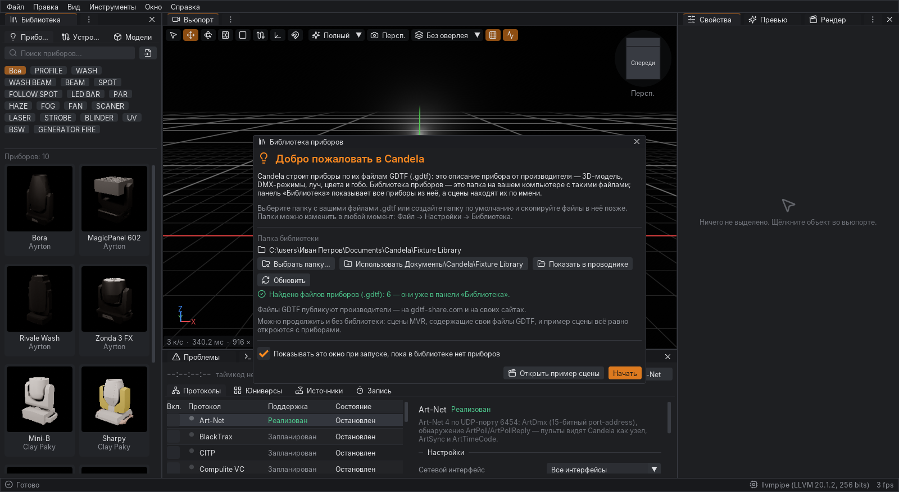

# Установка Candela в Windows · Installing Candela on Windows

[Русский](#русский) · [English](#english) · [Building the installer](#building-the-installer)

---

## Русский

Candela — визуализатор и редактор сценического света. Эта страница описывает предварительную версию для Windows:
как её установить, что происходит при первом запуске, где программа хранит файлы и как её удалить.

### Системные требования

| | |
|---|---|
| Система | Windows 10 или Windows 11, 64-бит (x64). Windows на ARM не поддерживается. |
| Видеокарта | драйвер с поддержкой **Vulkan 1.3**: NVIDIA GeForce GTX 900 и новее, AMD Radeon RX 400 и новее, Intel UHD/Iris Xe (11-е поколение) или Arc. Нужен свежий драйвер с сайта производителя — драйвер, который ставит сама Windows, часто не содержит Vulkan. |
| Финальный рендер | видеокарта с аппаратной трассировкой лучей (NVIDIA RTX, AMD RX 6000 и новее, Intel Arc); остальное работает и без неё. |
| Память | 8 ГБ, рекомендуется 16 ГБ. |
| Диск | около 160 МБ для программы, плюс место для кэша (миниатюры приборов, до нескольких сотен МБ). |
| Права | для установки «для всех пользователей» — права администратора; установка «только для меня» обходится без них. |

### Установка

1. Скачайте `Candela-Setup-<версия>-win-x64.exe` (например, `Candela-Setup-0.1.0-preview.1-win-x64.exe`): со
   страницы *Releases* репозитория или из артефактов сборки *Windows installer* на вкладке *Actions*. Рядом лежит
   файл `.sha256`; проверить файл можно в PowerShell:
   ```powershell
   Get-FileHash .\Candela-Setup-0.1.0-preview.1-win-x64.exe -Algorithm SHA256
   ```
2. Запустите программу установки. **Эта версия не подписана**, поэтому Windows SmartScreen может показать окно
   «Система Windows защитила ваш компьютер». Нажмите **«Подробнее»**, затем **«Выполнить в любом случае»**.
3. Выберите язык установки (русский или английский) и прочитайте страницу «Прочтите».
4. Выберите, для кого устанавливать:
   * **Установить для всех пользователей** — в `C:\Program Files\Candela`, Windows спросит разрешение
     администратора;
   * **Установить только для текущего пользователя** — в `%LOCALAPPDATA%\Programs\Candela`, без прав
     администратора.
5. Компоненты: программа (обязательно), ярлык на рабочем столе, открытие проектов `.candela` в Candela,
   пункт «Открыть с помощью Candela» для сцен `.mvr` (если `.mvr` уже открывает другая программа, она остаётся
   программой по умолчанию).
6. Папку установки можно изменить; пути с русскими буквами и пробелами поддерживаются.
7. Страница **«Управление с пульта»** — правило брандмауэра (см. [Брандмауэр](#брандмауэр)).
8. Программа установки копирует файлы, при необходимости ставит среду **Microsoft Visual C++ 2015–2022 (x64)**
   (она входит в установщик, интернет не нужен) и создаёт ярлыки. На последней странице можно сразу запустить Candela.

Ярлыки в меню «Пуск» → **Candela**: *Candela* (редактор), *Командная строка Candela* (утилита `candela` для
командной строки), *Прочтите*, *Документация*, *Удалить Candela*.

**Обновление.** Новую версию ставьте поверх старой — запустите её программу установки: старые файлы удаляются,
настройки, раскладки окон, проекты и библиотека приборов остаются.

**Тихая установка** (для администраторов):

```bat
Candela-Setup-0.1.0-preview.1-win-x64.exe /S /AllUsers
Candela-Setup-0.1.0-preview.1-win-x64.exe /S /CurrentUser /D=D:\Программы\Candela
```

`/D=` должен быть последним параметром и без кавычек, даже если в пути есть пробелы. В тихом режиме
добавляются ярлык на рабочем столе, ассоциации файлов и (если программа установки работает с правами
администратора) правило брандмауэра.

### Первый запуск: библиотека приборов

Candela строит приборы по их файлам **GDTF** (`.gdtf`) — описаниям приборов от производителей с 3D-моделью,
DMX-режимами, лучом, цветами и гобо. Полная библиотека (около 1100 приборов, 1,8 ГБ) в установку не входит; в неё
входят только четыре прибора, нужные примеру сцены.



*Первый запуск установленной копии (пользователь «Иван Петров», папка программы `C:\Program Files\Свет Тест\Candela`):
в окне «Библиотека приборов» выбрана папка `Документы\Candela\Fixture Library` с шестью файлами GDTF — они сразу
появились в панели «Библиотека» рядом с четырьмя приборами примера сцены (всего 10).*

При первом запуске (пока в библиотеке нет ваших приборов) Candela показывает окно **«Библиотека приборов»**:

* **Выбрать папку…** — укажите папку, в которой лежат ваши файлы `.gdtf`. Candela сразу считает файлы и добавит их
  в панель «Библиотека». Библиотека читает файлы, лежащие прямо в папке; если файлы во вложенных папках, окно
  скажет, сколько их, — выберите вложенную папку или перенесите файлы выше.
* **Использовать Документы\Candela\Fixture Library** — создаёт эту папку; скопируйте в неё файлы GDTF позже.
* **Показать в проводнике** — открывает выбранную папку.
* **Обновить** — читает папку снова: файлы GDTF, которые вы скопировали в неё в проводнике, появятся в панели
  «Библиотека» без перезапуска Candela.
* **Открыть пример сцены** — открывает `Фокина.mvr` (театральная световая партитура на 91 прибор).
* **Продолжить без библиотеки** — сцены MVR, в которых есть свои файлы GDTF, и пример сцены открываются и так.

Выбранная папка запоминается в настройках. Окно больше не появляется, когда в библиотеке есть приборы или когда
снят флажок «Показывать это окно при запуске…». Открыть его снова: **Справка → Настройка библиотеки приборов…**
Папки можно менять в **Файл → Настройки → Библиотека**: добавленная папка читается сразу, удаление вступает в силу
после перезапуска.

**Файл → Импорт → Прибор GDTF** (или файл `.gdtf`, перетащенный в окно) копирует файл в папку библиотеки — первую
существующую папку из настроек, а если папок нет, в `Документы\Candela\Fixture Library`. Так прибор остаётся в
библиотеке и после перезапуска, даже если исходный файл (например, из «Загрузок») удалён. Файл с тем же именем, но
другим содержимым не перезаписывается.

Файлы GDTF публикуют производители — на [gdtf-share.com](https://gdtf-share.com) и на своих сайтах.

Язык интерфейса при первом запуске выбирается по языку Windows (русский или английский); его можно изменить в
**Файл → Настройки → Интерфейс**.

### Брандмауэр

Candela может следовать за пультом (grandMA, ETC, ChamSys, Avolites …) в реальном времени: пульт передаёт DMX по
сети как **Art-Net** (UDP 6454) или **sACN** (UDP 5568), данные позиций и шоу — как **PSN** (UDP 56565) и **OSC**
(UDP 8000, для ETC Eos 8001). Брандмауэр Windows блокирует такие входящие данные, пока их не разрешит правило.

* Когда программа установки работает с правами администратора (любая установка «для всех пользователей», а также
  установка «только для себя» пользователем-администратором), страница «Управление с пульта» предлагает добавить
  входящее правило **«Candela (Art-Net, sACN, OSC, PSN)»**: только для `candela-app.exe`, только UDP, только для
  **частных и доменных** сетей (не для общественных, например Wi-Fi в кафе). Флажок включён по умолчанию; его
  можно снять.
* Обычный пользователь без прав администратора правило добавить не может. Когда Candela впервые получит данные из
  сети, Windows спросит, разрешить ли доступ, — разрешите для частных сетей.
* Проверить или удалить правило: «Брандмауэр Защитника Windows» → «Дополнительные параметры» → «Правила для
  входящих подключений», или в командной строке администратора:
  ```bat
  netsh advfirewall firewall show rule name="Candela (Art-Net, sACN, OSC, PSN)"
  ```
  При удалении Candela правило удаляется тоже.
* Сеть, к которой подключён пульт, должна быть отмечена в Windows как **частная** («Параметры → Сеть и Интернет →
  свойства сети → Частная сеть»). Внимание: сеть, в которой нет выхода в интернет (ноутбук подключён кабелем прямо к
  пульту или к сплиттеру), Windows часто считает «неопознанной» и **общественной** — правило на неё не действует.
  Если Candela не видит пульт, проверьте тип сети или разрешите Candela и в общественных сетях, когда Windows спросит.

### Где хранятся файлы

| Что | Где |
|---|---|
| Программа | `C:\Program Files\Candela` или `%LOCALAPPDATA%\Programs\Candela` |
| Пример сцены и его приборы | `samples` в папке программы (`samples\Фокина.mvr`, `samples\fixtures`) |
| Документация | `docs` в папке программы (меню «Пуск» → Candela → Документация) |
| Настройки, раскладки окон, сочетания клавиш | `%APPDATA%\Candela` |
| Кэш (миниатюры, 3D-модели, разобранные GDTF) и автосохранения | `%LOCALAPPDATA%\Candela` |
| Журнал и отчёты об ошибках | `%LOCALAPPDATA%\Candela\logs` (`candela-app.log`, `candela-app.previous.log`, `crash-*.txt`) |
| Библиотека приборов | папки из настроек; по умолчанию `Документы\Candela\Fixture Library` |
| Ваши проекты | там, где вы их сохраняете |

Чтобы открыть папку, вставьте путь, например `%LOCALAPPDATA%\Candela\logs`, в адресную строку проводника или в
окно «Выполнить» (Win+R).

### Командная строка

Меню «Пуск» → Candela → **Командная строка Candela** открывает консоль, в которой работает утилита `candela`:

```bat
candela info "%USERPROFILE%\Documents\Шоу\сцена.mvr"
candela render "%USERPROFILE%\Documents\Шоу\сцена.mvr" --out картинка.png --look demo
candela validate "%USERPROFILE%\Documents\Шоу\спектакль.candela"
candela info сцена.mvr --library "D:\GDTF"
```

Утилита использует те же папки библиотеки, что и редактор (из настроек); `--library` задаёт другие на один запуск.
Редактор тоже принимает параметры (`candela-app.exe --help`), например `--language ru`, `--scale 1.5`,
`--device NVIDIA` (выбор видеокарты на ноутбуке с двумя видеокартами), `--library-setup` (открыть окно библиотеки).

### Удаление

«Параметры → Приложения → Установленные приложения → Candela → Удалить», или меню «Пуск» → Candela → Удалить Candela.

Программа удаления убирает файлы программы, ярлыки, ассоциации файлов и правило брандмауэра. Настройки, кэш и журналы
удаляются, только если отметить пункт **«Удалить также мои настройки, кэш и журналы»** (он выключен по умолчанию).
Ваши проекты и папка библиотеки приборов **никогда не удаляются**. Среда Visual C++ остаётся: она общая для многих
программ. Тихое удаление: `"C:\Program Files\Candela\Uninstall Candela.exe" /S`.

### Если что-то не так

* **«Candela не может запуститься … нужна видеокарта с драйвером Vulkan 1.3»** — установите свежий драйвер с сайта
  производителя видеокарты (сообщение называет вашу видеокарту и предлагает открыть страницу загрузки драйвера) и
  запустите Candela снова. На компьютере без подходящей видеокарты (например, в виртуальной машине) Candela не
  работает.
* **«Не найдена среда выполнения Microsoft Visual C++ 2015-2022 (x64)»** — программа установки ставит её сама, но
  не если запрос прав администратора был отклонён или её собственная установка не удалась. Установите её с сайта
  Microsoft (<https://aka.ms/vs/17/release/vc_redist.x64.exe>; сообщение предлагает скачать её) и запустите Candela
  снова.
* **«Candela остановлена из-за ошибки»** — редактор записал отчёт `crash-<дата>-<время>.txt` в
  `%LOCALAPPDATA%\Candela\logs` и предлагает открыть эту папку. Несохранённая работа, сохранённая автосохранением
  (каждые 5 минут), будет предложена к восстановлению при следующем запуске.
* **Антивирус** может задержать первый запуск или программу установки (неподписанные файлы); добавьте папку
  программы в исключения, если он её блокирует.
* **Сообщить о проблеме:** [github.com/nikitasa228/gdtf/issues](https://github.com/nikitasa228/gdtf/issues).
  Опишите, что вы делали, и приложите журнал `%LOCALAPPDATA%\Candela\logs\candela-app.log` (после перезапуска
  журнал прошлого запуска — `candela-app.previous.log`) или отчёт `crash-*.txt`. Версия программы — в
  **Справка → О программе Candela** и в начале журнала.

### Ограничения предварительной версии

* Программа установки и программа **не подписаны** — отсюда предупреждение SmartScreen.
* Автоматического обновления нет: новую версию нужно скачать и установить поверх.
* Полная библиотека приборов не входит в установку (только приборы примера сцены).
* Правило брандмауэра — только для UDP и только когда программа установки работает с правами администратора.
* Несколько копий редактора могут работать одновременно (второго запуска Candela не запрещает): например, двойной
  щелчок по проекту при открытом редакторе откроет второе окно. Настройки у копий общие; раскладку окон сохраняет
  копия, закрытая последней.
* Интерфейс — на русском и английском; сообщения движка о проблемах сцены (патч, импорт MVR) и тексты ошибок
  операционной системы пока только на английском.
* Финальный рендер с трассировкой путей требует видеокарты с трассировкой лучей; см. также раздел
  «Limitations» в [editor.md](editor.md#limitations).

---

## English

Candela is a stage lighting visualiser and editor. This page covers the Windows preview: installing it, what happens
on the first start, where it keeps its files, and how to remove it.

### System requirements

| | |
|---|---|
| System | Windows 10 or Windows 11, 64-bit (x64). Windows on ARM is not supported. |
| Graphics | a driver with **Vulkan 1.3**: NVIDIA GeForce GTX 900 or newer, AMD Radeon RX 400 or newer, Intel UHD/Iris Xe (11th generation) or Arc. Install a current driver from the GPU maker — the driver Windows installs by itself often lacks Vulkan. |
| Final render | a GPU with hardware ray tracing (NVIDIA RTX, AMD RX 6000 or newer, Intel Arc); everything else works without it. |
| Memory | 8 GB, 16 GB recommended. |
| Disk | about 160 MB for the program, plus room for the cache (fixture thumbnails, up to a few hundred MB). |
| Rights | an all-users install needs administrator rights; a just-for-me install does not. |

### Installing

1. Download `Candela-Setup-<version>-win-x64.exe` (e.g. `Candela-Setup-0.1.0-preview.1-win-x64.exe`) from the
   repository's *Releases* page or from the artifacts of a *Windows installer* run on the *Actions* tab. A `.sha256`
   file comes with it; check the download in PowerShell:
   ```powershell
   Get-FileHash .\Candela-Setup-0.1.0-preview.1-win-x64.exe -Algorithm SHA256
   ```
2. Run it. **This preview is not code-signed**, so Windows SmartScreen may say "Windows protected your PC". Click
   **More info**, then **Run anyway**.
3. Choose the setup language (English or Russian) and read the Read Me page.
4. Choose who Candela is for:
   * **Install for anyone using this computer** — into `C:\Program Files\Candela`; Windows asks for administrator
     approval;
   * **Install just for me** — into `%LOCALAPPDATA%\Programs\Candela`; no administrator rights needed.
5. Components: the program (required), a desktop shortcut, opening `.candela` projects with Candela, and an
   "Open with Candela" entry for `.mvr` scenes (a program that already opens `.mvr` files stays the default).
6. The install folder can be changed; folders with spaces or non-Latin letters are fine.
7. The **Control from a Lighting Console** page offers the firewall rule (see [Firewall](#firewall)).
8. Setup copies the files, installs the **Microsoft Visual C++ 2015–2022 (x64) runtime** when it is missing (it is
   inside the installer, no internet needed) and creates the shortcuts. The last page can start Candela.

Start menu → **Candela**: *Candela* (the editor), *Candela Command Prompt* (for the `candela` command-line tool),
*Read Me*, *Documentation*, *Uninstall Candela*.

**Upgrading.** Run the new version's setup over the old one: the old files are removed; settings, window layouts,
projects and the fixture library stay.

**Silent install** (for administrators):

```bat
Candela-Setup-0.1.0-preview.1-win-x64.exe /S /AllUsers
Candela-Setup-0.1.0-preview.1-win-x64.exe /S /CurrentUser /D=D:\Apps\Candela
```

`/D=` must come last and must not be quoted, even when the path has spaces. A silent install adds the desktop
shortcut, the file associations and (when Setup runs with administrator rights) the firewall rule.

### First start: the fixture library

Candela builds fixtures from their **GDTF** files (`.gdtf`) — the manufacturers' descriptions with the 3D model, DMX
modes, beam, colours and gobos. The full library (about 1100 fixtures, 1.8 GB) is not part of the installer; only the
four fixtures the sample scene uses are.


*First start of an installed copy (user "Иван Петров", program folder `C:\Program Files\Свет Тест\Candela`): the
Fixture Library window with `Documents\Candela\Fixture Library` chosen — its six GDTF files joined the sample scene's
four fixtures in the Library panel at once (10 in all).*

On the first start (while the library holds none of your fixtures) Candela opens the **Fixture Library** window:

* **Choose Folder…** — pick the folder with your `.gdtf` files. Candela counts them and adds them to the Library
  panel at once. The library reads the files directly in the folder; when the files are in subfolders the window says
  how many — choose the subfolder or move them up.
* **Use Documents\Candela\Fixture Library** — creates that folder; copy GDTF files into it later.
* **Show in File Manager** — opens the chosen folder in Explorer.
* **Rescan** — reads the folder again: GDTF files you copied into it in Explorer are added to the Library panel
  without restarting Candela.
* **Open Sample Scene** — opens `Фокина.mvr` (a theatre lighting rig with 91 fixtures).
* **Continue Without a Library** — MVR scenes that contain their GDTF files, and the sample scene, open anyway.

The chosen folder is saved in the settings. The window does not come back once the library has fixtures, or when
"Show this window at start-up…" is cleared; **Help → Fixture Library Setup…** opens it again. **File → Settings →
Library** changes the folders: an added folder is read at once, a removed one is dropped at the next start.

**File → Import → GDTF Fixture** (or a `.gdtf` file dropped onto the window) copies the file into the library folder —
the first existing folder of the settings, or `Documents\Candela\Fixture Library` when none is set — so the fixture is
still there after a restart even if the original (say, in Downloads) is deleted. A different file with the same name
is never overwritten.

Manufacturers publish GDTF files on [gdtf-share.com](https://gdtf-share.com) and on their own websites.

The first start picks the interface language from Windows (English or Russian); change it in **File → Settings →
Interface**.

### Firewall

Candela can follow a lighting console (grandMA, ETC, ChamSys, Avolites …) live: the console sends DMX over the network
as **Art-Net** (UDP 6454) or **sACN** (UDP 5568), position and show data as **PSN** (UDP 56565) and **OSC** (UDP 8000,
ETC Eos 8001). Windows Firewall blocks such incoming data until a rule allows it.

* When Setup runs with administrator rights (every all-users install, and a just-for-me install by an administrator)
  the **Control from a Lighting Console** page offers an inbound rule **"Candela (Art-Net, sACN, OSC, PSN)"**: for
  `candela-app.exe` only, UDP only, on **private and domain** networks only (not on public networks such as a café
  Wi-Fi). It is ticked by default and can be cleared.
* A standard user without administrator rights cannot add a rule. The first time Candela receives network data
  Windows asks whether to allow it — allow it for private networks.
* To check or remove the rule: Windows Defender Firewall → Advanced settings → Inbound Rules, or in an administrator
  command prompt:
  ```bat
  netsh advfirewall firewall show rule name="Candela (Art-Net, sACN, OSC, PSN)"
  ```
  Uninstalling Candela removes it.
* The network the console is on must be a **private** network in Windows (Settings → Network & Internet → the
  network's properties → Private network). Note: a network without internet access (a laptop cabled straight to the
  console or a node) is often an "unidentified network", which Windows treats as **public** — the rule does not apply
  there. If Candela does not see the console, check the network type, or allow Candela on public networks too when
  Windows asks.

### Where your files are

| What | Where |
|---|---|
| Program | `C:\Program Files\Candela` or `%LOCALAPPDATA%\Programs\Candela` |
| Sample scene and its fixtures | `samples` in the program folder (`samples\Фокина.mvr`, `samples\fixtures`) |
| Documentation | `docs` in the program folder (Start menu → Candela → Documentation) |
| Settings, window layouts, key bindings | `%APPDATA%\Candela` |
| Cache (thumbnails, 3D models, parsed GDTF) and autosaves | `%LOCALAPPDATA%\Candela` |
| Log and crash reports | `%LOCALAPPDATA%\Candela\logs` (`candela-app.log`, `candela-app.previous.log`, `crash-*.txt`) |
| Fixture library | the folders of the settings; by default `Documents\Candela\Fixture Library` |
| Your projects | wherever you save them |

Paste a path such as `%LOCALAPPDATA%\Candela\logs` into Explorer's address bar or the Run box (Win+R) to open it.

### Command line

Start menu → Candela → **Candela Command Prompt** opens a console where the `candela` tool runs:

```bat
candela info "%USERPROFILE%\Documents\Shows\scene.mvr"
candela render "%USERPROFILE%\Documents\Shows\scene.mvr" --out picture.png --look demo
candela validate "%USERPROFILE%\Documents\Shows\show.candela"
candela info scene.mvr --library "D:\GDTF"
```

The tool uses the editor's library folders (from the settings); `--library` gives other folders for one run. The
editor takes options too (`candela-app.exe --help`), e.g. `--language en`, `--scale 1.5`, `--device NVIDIA` (pick the
GPU on a laptop with two), `--library-setup` (open the Fixture Library window).

### Uninstalling

Settings → Apps → Installed apps → Candela → Uninstall, or Start menu → Candela → Uninstall Candela.

The uninstaller removes the program files, shortcuts, file associations and the firewall rule. Settings, caches and
logs go only when **"Also remove my settings, caches and logs"** is ticked (it is off by default). Your projects and
the fixture library folder are **never** removed. The Visual C++ runtime stays (other programs share it). Silent:
`"C:\Program Files\Candela\Uninstall Candela.exe" /S`.

### When something goes wrong

* **"Candela cannot start … needs a graphics card with a Vulkan 1.3 driver"** — install a current driver from the
  GPU maker (the message names your graphics card and offers to open the driver download page) and start Candela
  again. Without a suitable GPU (in a virtual machine, for example) Candela does not run.
* **"The Microsoft Visual C++ 2015-2022 runtime (x64) is missing"** — Setup installs it, but not when its
  administrator prompt was declined or its own setup failed. Install it from Microsoft
  (<https://aka.ms/vs/17/release/vc_redist.x64.exe>; the message offers to download it) and start Candela again.
* **"Candela stopped because of an error"** — the editor wrote `crash-<date>-<time>.txt` into
  `%LOCALAPPDATA%\Candela\logs` and offers to open the folder. Work kept by the autosave (every 5 minutes) is offered
  for recovery at the next start.
* **Antivirus** software may hold up the first start or the setup (unsigned files); add the program folder to its
  exclusions if it blocks it.
* **Reporting a problem:** [github.com/nikitasa228/gdtf/issues](https://github.com/nikitasa228/gdtf/issues). Say what
  you were doing and attach `%LOCALAPPDATA%\Candela\logs\candela-app.log` (after a restart the previous run's log is
  `candela-app.previous.log`) or the `crash-*.txt` report. The version is in **Help → About Candela** and at the
  start of the log.

### Known limitations of the preview

* Setup and program are **not code-signed** — hence the SmartScreen warning.
* No automatic updates: download the new version and install it over the old one.
* The full fixture library is not included (only the sample scene's fixtures).
* The firewall rule covers UDP only and is added only when Setup runs with administrator rights.
* Several copies of the editor can run at once (Candela does not stop a second start): double-clicking a project while
  the editor is open opens a second window. The copies share the settings; the window layout of the one closed last
  is kept.
* The interface is English and Russian; the engine's scene messages (patch, MVR import) and operating-system error
  texts are English only for now.
* The final path-traced render needs a ray-tracing GPU; see also "Limitations" in [editor.md](editor.md#limitations).

---

## Building the installer

For developers. The version is set in one place, `Directory.Build.props` (`CandelaVersion` 0.1.0, `CandelaPreview` 1
→ `0.1.0-preview.1`, file version 0.1.0.1; an empty `CandelaPreview` is the release `0.1.0`, file version 0.1.0.1000,
so a release sorts after its previews in the installer's upgrade and downgrade checks); every assembly, the Windows
version resources, the installer and its file name follow it.

**On Linux** (needs the .NET 8 SDK, python3, `makensis` from the `nsis` package, `osslsigncode` and `curl`):

```bash
packaging/windows/build-installer.sh            # → artifacts/windows/Candela-Setup-<version>-win-x64.exe (+ .sha256)
packaging/windows/build-installer.sh --help     # --out DIR, --no-ready-to-run, --redist FILE, --no-redist
```

**On Windows** (needs the .NET 8 SDK, Python 3 and NSIS 3):

```powershell
powershell -ExecutionPolicy Bypass -File packaging\windows\build-installer.ps1
```

**On GitHub** the workflow [`.github/workflows/windows-installer.yml`](../.github/workflows/windows-installer.yml)
runs on `windows-latest` for pushes to `main`, pull requests, `v*` tags and on demand: restore, build, the tests that need no
GPU, the installer, and an artifact `Candela-Setup-<version>-win-x64`; on a `v*` tag (which must match the version of
`Directory.Build.props`) the installer is attached to the GitHub release.

What the scripts do:

1. `dotnet publish` of `src/Candela.App` (`candela-app.exe`) and `src/Candela.Cli` (`candela.exe`) for `win-x64`,
   self-contained, into **one** folder (`artifacts/windows/publish`): no trimming (the editor uses reflection and JSON
   serialisation), ReadyToRun for a faster start. Both executables carry the icon, the version resource and their
   manifests (per-monitor DPI v2 for the editor, long paths); the editor is a GUI program (no console window) that
   attaches to the parent console for `--help`.
2. `packaging/windows/winpack.py stage` completes the folder into the **installed layout** (below): `data/specs`, the
   sample scene with its four GDTF files, `docs`, licences, read-me files, the icon, `candela-prompt.cmd`.
3. `winpack.py check` reads the import tables of every native DLL: all must be x64, and each import must be shipped
   in the folder, part of Windows, or an expected external component — the Visual C++ runtime
   (`VCRUNTIME140.dll`, `VCRUNTIME140_1.dll`, needed by cimgui, cimguizmo, GLFW and the ImGui backends) and the
   Vulkan loader `vulkan-1.dll` (installed with the graphics driver).
4. Microsoft's `vc_redist.x64.exe` is downloaded into a new empty temporary folder and its Authenticode signature is
   checked with `osslsigncode` against Microsoft Root Certificate Authority 2011 (pinned SHA-256 fingerprint); the
   installer runs it with `/install /quiet /norestart` only when the runtime is missing or older (registry
   `VC\Runtimes\x64` and `vcruntime140_1.dll`).
5. `makensis -INPUTCHARSET UTF8 packaging/windows/installer.nsi` (run under a UTF-8 locale, for the Cyrillic file
   name of the sample) writes the installer and a SHA-256 file. The uninstaller's file list is generated from the
   staged folder, so the uninstaller removes exactly what was installed.

### Installed layout

```
Candela\
  candela-app.exe          the editor
  candela.exe              the command-line tool (also the editor's import worker)
  *.dll                    .NET runtime, Candela, native libraries (GLFW, cimgui, shaderc, assimp, …)
  data\specs\fixtures_index.json   manufacturer data (power, weight, connectors) of the fixture types
  samples\Фокина.mvr       the sample scene
  samples\fixtures\*.gdtf  the four fixture types the sample uses (the library's lowest-priority folder)
  docs\                    this documentation
  licenses\                font licences (Inter, Lucide)
  candela.ico, README.txt, README-ru.txt, THIRD-PARTY-NOTICES.txt, candela-prompt.cmd
  Uninstall Candela.exe
```

The program finds its files relative to its own folder (`AppContext.BaseDirectory`), never the working directory, so
it runs from any folder and from shortcuts. `Candela.Engine.InstallLayout` decides between the two layouts and the
lookup order (see [engine.md](engine.md#install-layout)):

* **Installed** — `data/specs/fixtures_index.json` exists next to the executables. Library folders: the folders of
  the settings (or `--library`), then `samples/fixtures`. Specs index: a `_specs/fixtures_index.json` in or above a
  library folder, then `data/specs`. The import worker is `candela.exe` next to the editor.
* **Development** (`dotnet run`, tests) — no `data/specs`; the repository root is found upwards from the executable.
  Library folders: the folders of the settings, or the repository root (its ~1100 GDTF files) when none are set.
  Specs index: `_specs/fixtures_index.json` near a library folder, then the repository's.

Settings live in `%APPDATA%\Candela` (`CANDELA_CONFIG_DIR` or `--config-dir` override it), caches and autosaves in
`%LOCALAPPDATA%\Candela` (`CANDELA_CACHE_DIR`), the editor's log and crash reports in `%LOCALAPPDATA%\Candela\logs`
(inside the config folder when that is overridden, so test and portable runs leave nothing behind).

### Verification under Wine

The published build and the installer were checked on Linux under Wine 9 (64-bit prefix, `winevulkan` over Mesa's
lavapipe in a virtual X server): `candela.exe --help`, `candela.exe info samples\Фокина.mvr` with and without
`--library` (91 fixtures resolved from the starter fixtures), `candela.exe render-test` and a render of the sample,
`candela-app.exe --screenshot` of the first start (the Fixture Library window above), the sample scene opened from that
window, the per-user folders (`%LOCALAPPDATA%\Candela\cache`, `logs`), the crash report without a display, the
no-Vulkan message (exit code 3), a silent install into `C:\Program Files\Свет Тест\Candela` (registry entries,
shortcuts, associations), an upgrade in place and a silent uninstall that leaves nothing behind. The review repeated
this in a prefix whose user is "Иван Петров" (Cyrillic letters and a space in every per-user folder): a per-user
upgrade in place that keeps a file the user put into the program folder, an uninstall that leaves only that file and
the settings, the first-run window's Default folder → files copied in Explorer → **Rescan** → sample scene flow from
`C:\Program Files\Свет Тест\Candela`, the CLI's import worker (assimp) on a Cyrillic file name, and the message for a
missing Visual C++ runtime (`WINEDLLOVERRIDES="vcruntime140=d;vcruntime140_1=d"`). Not covered by Wine:
the Visual C++ redistributable's own setup (a 32-bit bootstrapper; a 64-bit-only prefix cannot run it), Windows
Firewall, SmartScreen and real GPU drivers.
