# Real-time renderer (`Candela.Rendering.Vulkan`)

The Vulkan 1.3 implementation of the `Candela.Rendering` contracts (`IRenderer`, `IRenderWorld`, `IRenderTarget`).
**Stage 1** is the foundation and physically correct *direct* light: a shared Vulkan context, run-time GLSL
compilation, a retained GPU scene with bindless textures, a small pass graph, clustered photometric spot lights, tone
mapping, the Colorless and Wireframe views, the ground grid, lines and picking. **Stage 2** adds a cached shadow atlas
with PCSS soft shadows, light cookies (gobo, iris, framing blades, prism, frost) on surfaces and in the air,
volumetric light in haze, smoke and flames (per-pixel single scattering of every beam, froxels with temporal
reprojection for the rest — see [Volumetric beams](#volumetric-beams)), lens glow,
indirect light (reflective shadow maps, or ray-traced GI with ray query), bloom, auto exposure, the resolution scale,
the selection and beam outlines, reference drawings and the lux, noise and cable overlays. Stage 3 adds the path
tracer (see [Stage 3](#stage-3)). Everything stays in cd/m² (pre-exposed in the HDR image) and agrees with the CPU
photometry of `Candela.Photometry` (`LightMeter`, `Acoustics`, `BlackbodyRadiator`).

| Full view, haze 0.05 1/m, ray-traced GI | Lux overlay | Noise overlay |
|---|---|---|
| 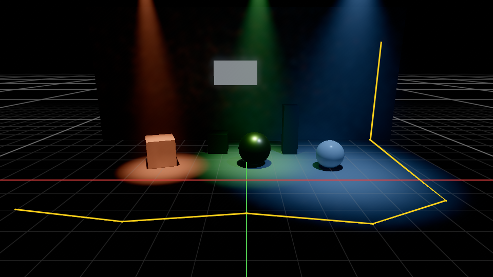 | 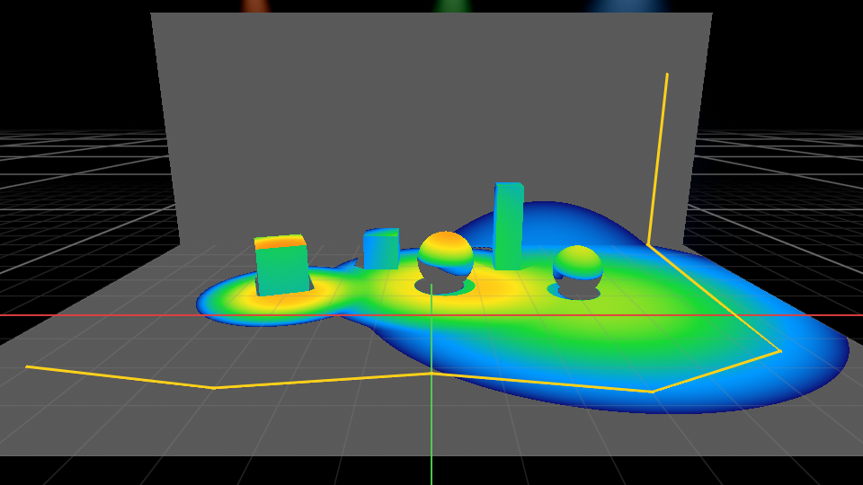 | 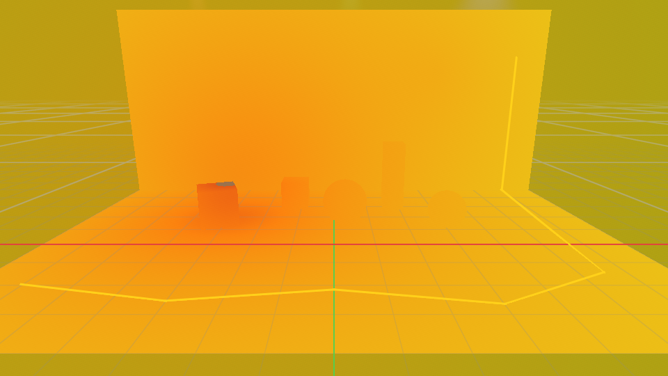 |

`candela render-test --width 960 --height 540 --haze 0.05 --indirect raytraced --overlays` on lavapipe (software
Vulkan), the built-in procedural test scene ([before the volumetric beams](images/beams-procedural-before.png)).

```
src/Candela.Rendering.Vulkan
  Core/         VulkanContext (+ options, device selection, capabilities), VulkanSwapchain, FrameScheduler,
                DeferredDeletionQueue, PipelineCacheStore, DebugMessenger, VkUtil
  Memory/       DeviceMemoryAllocator, GpuBuffer, GpuImage, UploadRing
  Graph/        RenderPass / PassSequence / RenderStage, resource-state tracking and batched barriers
  Scene/        VulkanRenderWorld, SceneBuffer<T>, TextureStore, MeshProcessor, LightPacker, MaterialPacker, handles,
                AtmosphereResources (smoke / flame / noise volumes), RayTracingScene (BLAS per mesh, TLAS per frame)
  Rendering/    VulkanRenderer, VulkanRenderTarget, PipelineLibrary, DrawList, ReverseZ, ShadowAtlas, LightPlanner,
                RendererResources, DescriptorWriter, the passes (Passes, LightingPasses, EffectPasses)
  Shaders/      GLSL 460 sources (embedded) + ShaderCompiler, ShaderLibrary, GpuStructs, ShaderConstants
  Diagnostics/  ProceduralTestScene, ProceduralMeshes, ImageFiles (CLI, tests, golden images; opaque PNGs as RGB)
src/Candela.Cli            candela render-test
tests/Candela.Rendering.Vulkan.Tests
```

## Conventions and units

| | |
|---|---|
| World | SI units, metres, right-handed, **Z up** |
| Matrices | `System.Numerics` row-vector convention (`v' = v · M`), uploaded verbatim; GLSL reads them transposed, so `M * v` in GLSL equals `v * M` in C# |
| Camera | `RenderCamera.View` looks down −Z with +Y up; the renderer builds the projection |
| Depth | **reverse-Z**, `D32_SFLOAT`, near → 1, far → 0, compare `GREATER`; perspective has an **infinite far plane** (`depth = near / −z_view`), orthographic is a finite linear range |
| Working colour space | **linear Rec.2020** everywhere in the HDR pipeline |
| Light colour | chromaticity as linear Rec.2020 normalised to luminance Y = 1 (`LightColor`), magnitude separate (`PeakCandela`) |
| Material colours | `MaterialData` colours are linear Rec.709 and are converted to Rec.2020 on the CPU; colour textures are sampled through `_SRGB` formats (decoded to linear Rec.709 by the sampler) and converted in the shader |
| Scene luminance | cd/m²; the HDR image stores **luminance × exposure** (pre-exposed) in `RGBA16F` |
| Display image | `RGBA8_UNORM` holding sRGB-encoded values, top row first |

## Architecture

### Vulkan context (`VulkanContext`, public)

One context per GPU, shared by the renderer, the editor's swapchain and the Dear ImGui backend.

* **Instance**: API 1.3, application "Candela". Instance extensions come from the caller
  (`VulkanContextOptions.InstanceExtensions`, e.g. `glfwGetRequiredInstanceExtensions`); `VK_EXT_debug_utils` is added
  when available (object names and pass labels show up in RenderDoc / Nsight).
* **Validation**: `VK_LAYER_KHRONOS_validation` with a debug-utils messenger when `EnableValidation` is true, or when
  it is null and `CANDELA_VK_VALIDATION=1` is set. Messages go to `VulkanContextOptions.Log`; errors are counted
  (`ValidationErrorCount`, `ValidationErrors`) so tests can assert zero. The messenger is also chained into
  `VkInstanceCreateInfo`, so leaks reported at `vkDestroyInstance` are caught. `SynchronizationValidation` adds the
  layer's hazard detection (on in all tests).
* **Device selection** (`DeviceSelector`, unit-tested): only devices with everything required are eligible; a device
  whose name contains `PreferredDeviceName` (`AppSettings.PreferredGpu`, CLI `--device`) wins, otherwise
  discrete > integrated > virtual > CPU, then more device-local memory.

  | Required | Optional (detected → `RendererInfo` / `DeviceCapabilities`) |
  |---|---|
  | Vulkan 1.3, `dynamicRendering`, `synchronization2` | `fillModeNonSolid` → polygon-mode wireframe (`SupportsWireframe`) |
  | `runtimeDescriptorArray`, `shaderSampledImageArrayNonUniformIndexing`, `descriptorBindingPartiallyBound`, `descriptorBindingVariableDescriptorCount`, `descriptorBindingSampledImageUpdateAfterBind` | `wideLines` |
  | `timelineSemaphore`, `scalarBlockLayout` | `rayQuery` + `accelerationStructure` + `bufferDeviceAddress` → `SupportsRayTracing` (ray-traced GI; stage 3) |
  | one graphics+compute queue (that can present, when a surface is given); `D32_SFLOAT` sampled + copyable | `samplerAnisotropy`, timestamps |
  | descriptor limits of the pipeline layout (sets 1 + 2 per stage: 20 sampled images, 11 storage buffers, 3 storage images; 3 bound sets), compute work groups of 256 invocations | |

  The descriptor limits are checked when the device is chosen (a device below them is not eligible instead of
  failing later); the bindless texture array is sized so that it plus sets 1 and 2 fit the update-after-bind limits
  (which count every set of the layout).

* **Frames in flight**: 2 (`FramesInFlight`). Each slot has a command pool, one primary command buffer, a fence and a
  timestamp query pool. `BeginFrame` waits only for the fence of the slot's previous use. GPU time per pass is
  reported in `LastGpuTimings`.
* **Memory** (`DeviceMemoryAllocator`): blocks per memory type (64 MiB device-local, 16 MiB host-visible, at most 1/8
  of small heaps) carved with a first-fit, coalescing free list; per-request alignment; `bufferImageGranularity`
  honoured by keeping linear resources and optimal-tiled images in separate blocks when it is > 1; dedicated
  allocations for requests larger than half a block, images ≥ 16 MiB, images the driver prefers dedicated and render
  targets; host-visible memory is persistently mapped; flush/invalidate for non-coherent memory by
  `nonCoherentAtomSize`.
* **Uploads** (`UploadRing`): one persistently mapped staging ring (8 MiB, doubles when needed); the tail advances when a
  frame's fence has been waited for. Oversized requests use a temporary buffer retired with the frame.
* **Deferred destruction** (`DeferDispose`, `DeferDestroy`): an object retired during frame N is destroyed when frame
  N + 3 begins, i.e. after every frame that may reference it (including descriptor sets of the other slot).
* **Pipeline cache**: persisted under `ConfigPaths.CacheDir` as `pipeline-<vendor>-<device>-<uuid>.bin`, wrapped in an
  envelope (magic, length, SHA-256) and written atomically (unique temporary file + rename); damaged files and caches of
  other devices/drivers are ignored.
* **Immediate submissions** (readbacks, `Pick`, `ReadPixels`) use a separate command buffer and fence and are not
  allowed while a frame is being recorded.

### Shaders

GLSL 460 sources in `src/Candela.Rendering.Vulkan/Shaders`, embedded as resources and compiled at run time with
Silk.NET.Shaderc (`ShaderCompiler`): `#include` resolution through a callback over the embedded files, macro variants
(`ShaderVariant`, e.g. `forward.frag` + `TRANSPARENT`), target Vulkan 1.3 / SPIR-V 1.6, performance optimisation. The
SPIR-V is cached by a SHA-256 of the source, its include closure and the defines under `<CacheDir>/shaders` (atomic
writes). `generated.glsl` is produced from `ShaderConstants`/`ColorSpaces` so binding numbers, flags and colour
matrices have one source of truth; struct sizes are asserted against `GpuStructs` by a test.

| File | Purpose |
|---|---|
| `common.glsl` | constants, GPU structs (`Material`, `Instance`, `Light`, `LightView`, `ShadowSlot`, `Vpl`, `FrameData`), push constants, hashes, octahedral normals |
| `scene.glsl`, `view.glsl` | set 0 / set 1 declarations, cluster indexing, depth ↔ world reconstruction |
| `photometry.glsl` | beam profile (GPU twin of `BeamDistribution.Relative`), range window, Henyey–Greenstein phase |
| `lighting.glsl` | cookies (gobo, blades, prism), light intensity towards a point, haze transmittance, shadow lookups (hard, PCSS) |
| `volume.glsl` | froxel depth mapping, haze + smoke scattering, flame emission (blackbody LUT), sound level, overlay gradient |
| `brdf.glsl` | GGX / height-correlated Smith / Schlick specular + energy-weighted Lambert |
| `color.glsl`, `tonemap.glsl` | sRGB transfer, Rec.709 ↔ Rec.2020, AgX / ACES / Neutral |
| `mesh.vert`, `prepass.frag`, `forward.frag`, `colorless.frag`, `wire.frag`, `lines.vert` / `lines.frag`, `fullscreen.vert`, `tonemap.frag`, `grid.frag`, `cluster.comp` | stage-1 passes |
| `shadow.vert` / `shadow.frag` (`ALPHA_MASK`, `RSM`), `vpl.comp`, `gather.comp`, `rt_gi.comp`, `gi_filter.comp`, `analysis.frag` | shadows and indirect light, analysis overlays |
| `froxel_inject.comp`, `froxel_integrate.comp`, `volumetric.frag` | volumetrics (froxels, composite with the beams' depth-aware upsampling) |
| `beam.glsl`, `beam_cull.comp`, `beam_scatter.comp`, `beam_temporal.comp` | volumetric beams: cone geometry and tile masks, tile culling, single scattering, temporal accumulation |
| `bloom_down.comp` (`FIRST`), `bloom_up.comp`, `histogram.comp`, `exposure.comp`, `depth_upsample.frag`, `selection.frag`, `outline.frag` | post and editor visuals |

The test `ShaderTests.EveryShaderVariantCompilesAndValidates` compiles every variant and runs `spirv-val
--target-env vulkan1.3 --scalar-block-layout` on the output when the tool is on `PATH`.

### Retained scene (`VulkanRenderWorld : IRenderWorld`)

Handles (`MeshHandle`, …) are generation-checked indices: they stay valid across unrelated creations/destructions,
stale handles are rejected (`ArgumentException`) and double destruction is a no-op.

* **Meshes**: one device-local buffer per mesh holding interleaved vertices (position, normal, uv, tangent with the
  bitangent sign in w — 48 bytes) followed by 32-bit indices. Missing normals are generated (area-weighted), missing
  tangents from UV derivatives (Gram–Schmidt against the normal). A bounding sphere drives frustum culling; on devices
  without `fillModeNonSolid` a unique edge list is built for the edge-shader wireframe.
* **Textures**: `RGBA8` → `R8G8B8A8_SRGB` (colour) or `_UNORM` (data), float → `RGBA16F`; full mip chains generated
  with `vkCmdBlitImage` (box-filtered on the CPU when the format cannot be blitted linearly). All textures live in **one
  bindless array**. Slots 0, 1, 2 are the default white, black and flat-normal textures; a destroyed slot points at
  white until reused. Material textures are loaded through `IImageSource` and shared per (key, sRGB); unknown keys use
  the defaults (a warning is logged once per key).
* **Materials** (`MaterialPacker` → SSBO): base colour factor (Rec.709 → Rec.2020; the Rec.709 factor is kept to
  multiply sRGB texture samples before conversion), metallic/roughness, IOR-derived dielectric F0 (IOR 1 → no
  specular), emissive = `EmissiveColor` (Rec.709) × `EmissiveLuminance` cd/m² → Rec.2020, alpha mode (opaque / mask with
  cutoff / blend), double-sided, transmission (approximated, see below), UV scale, texture slots. Index 0 is the default
  material; a destroyed material that instances still use falls back to it.
* **Instances** (SSBO): world matrix, normal matrix, flags, pick id, offset of the instance's material slots (a second
  SSBO maps slot → material index, so meshes with several sub-meshes share one instance record), and an additive
  emission (`SetInstanceEmission`, the lens glow): luminance in cd/m² (Rec.2020), uniform or directional — seen along
  an axis and falling off as 2^−(θ/θ½)², θ½ = half the beam angle, so a lens glares only for eyes in its beam. The
  forward pass adds it to the material's emission; the ray-traced GI ignores it (the light itself is the spot light).
* **Lights** (SSBO, replaced per frame by `SetLights`): `LightPacker` converts each `SpotLight`; see the photometric
  model below. **Lines** (`SetLines`) go to a vertex buffer of `LineVertex`.
* **Atmosphere** (`SetAtmosphere`): the smoke density and noise level grids (`VolumeGrid`) are uploaded as `R16F` 3D
  textures (trilinear, clamped to the box) when set; every flame grid (`FlameTemperature` and the list
  `FlameTemperatures`, at most 64, each with its own box and resolution) is packed into one `R16F` atlas (grids stacked
  along z, a record per grid with its box and atlas offset; where boxes overlap the hottest grid wins); the blackbody luminance table of
  `BlackbodyRadiator` (Rec.2020 colour × cd/m², 500 K steps up to 12 000 K) is a static buffer. `SetNoiseSources` fills a
  buffer of (position, dB at 1 m).
* **Shadow casters**: creating, moving or destroying an instance with `CastShadow`, or changing its materials, records
  its old and new bounding spheres (`ShadowCasterChanges`); the shadow atlas re-renders only the tiles whose frusta
  they touch. Mesh or material edits invalidate every tile.
* **Ray tracing** (`RayTracingScene`, devices with ray query, only while ray-traced GI is in use): one BLAS per mesh
  (a geometry per sub-mesh, built from the mesh's own vertex/index buffer), a TLAS rebuilt once per frame from the
  visible-or-not instances (custom index = instance slot), and a geometry table (buffer device addresses of vertices
  and indices, sub-mesh ranges and material slots) for hit shading.
* **Uploads**: every container keeps a CPU mirror and a dirty range; once per frame the dirty ranges are copied through
  the staging ring after one batched write-after-read barrier against earlier frames' reads. Growing a buffer replaces
  it (old one deferred) and bumps a version so the per-slot descriptor sets are rewritten. Mesh and texture data is
  staged when created and copied by the next `Render`; whatever is still staged when a frame is submitted (objects
  created after the viewports rendered, or frames that render no viewport) is recorded by a submit hook into that
  frame, so staging memory is always consumed by the frame it was reserved in. No device-wide waits.

### Descriptor layout

| Set | Binding | Content |
|---|---|---|
| 0 (scene, one set per frame slot) | 0 | materials SSBO |
| | 1 | instances SSBO |
| | 2 | instance material slots SSBO |
| | 3 | lights SSBO |
| | 4 | `sampler2D textures[]` — variable count (≤ min(device limit, 16384)), `UPDATE_AFTER_BIND`, `PARTIALLY_BOUND`, indexed with `nonuniformEXT` |
| 1 (per render target) | 0 | `FrameData` UBO (matrices, previous view-projection, camera, exposure, cluster and froxel parameters, media, feature bits, overlay range, selection colour, …) |
| | 1, 2, 3 | clusters SSBO (`uvec2 offset, count` per cluster), cluster light-index list, light-list counter |
| | 4 | HDR image |
| | 5, 6 | per-view light records (`LightView`: shadow slot, flags, VPL range), shadow slots (`ShadowSlot`: matrices, atlas rectangle, frustum) |
| | 7, 8 | shadow atlas with a comparison sampler (hardware PCF) and as raw depth (PCSS blocker search, VPLs) |
| | 9, 10, 11 | reflective shadow map reflectance and normals, virtual point lights |
| | 12 | indirect irradiance (half resolution, alpha = view depth) |
| | 13 | integrated froxel volume (in-scattering, transmittance) |
| | 14, 15, 16, 17, 18 | smoke density, flame temperature and noise level volumes, blackbody table, noise sources |
| | 19 | overlay gradient table (256 × 1) |
| | 20, 21, 22 | scene depth, normals, instance indices of the pre-pass |
| | 23, 24 | bloom level 0, analysis image (lx or dB) |
| | 25 | per-view light lists (the volumetric beams, then RSM or GI lights) |
| | 26, 27 | selection mask, exposure histogram buffer |
| 2 (per pass) | 0–7 | three storage images, three sampled images, the TLAS and a storage buffer (compute passes; the beam passes keep their tile masks in the buffer) |
| push constants | | instance index, material index, draw mode, line width, colour (all stages) |

All storage blocks use the scalar block layout. Bindings without a resource (feature not in use) point at 1 × 1
placeholders, so every pipeline is valid in every frame; set 1 is rewritten only when one of its resources changes
(`DescriptorSignature`).

### Render targets (`VulkanRenderTarget : IRenderTarget`)

Per viewport, at the internal resolution (`ResolutionScale` × size): depth (`D32_SFLOAT`), pick ids and instance
indices (`R32_UINT`), octahedral normals (`RG16F`), HDR (`RGBA16F`); at the display size: the display image
(`RGBA8_UNORM`). While a feature is in use the target also owns its images and buffers: froxel volumes, indirect
light and its history, VPLs, bloom pyramid, exposure buffers, analysis image, gradient table, selection mask, display
depth, and for the volumetric beams the half-resolution scattering, envelope, resolved and two history images
(`RGBA16F`), the tile-mask buffer and a host-visible statistics buffer per frame slot. A feature's resources are kept for 60 renders after its last use, so switching view modes does not reallocate,
and then released. Any number of targets share one world (and its shadow atlas). `Resize` recreates the images (old
ones are deferred), increments `DisplayVersion`, drops temporal history and invalidates the last frame (Pick returns
null until the next render). Sizes are clamped to 1 … `maxImageDimension2D`.

### Frame and pass sequence

`IRenderer.Render` records into the open frame when the caller has begun one (`VulkanContext.BeginFrame`, the editor);
otherwise it begins and submits a frame of its own (CLI, tests, thumbnails). Passes (`RenderPass`) declare their
resource uses; `PassSequence` turns them into one batched synchronization2 barrier per pass from the tracked states,
wraps each pass in a debug label and GPU timestamps, and runs passes in `RenderStage` order:

| Stage | Pass | Views | Work |
|---|---|---|---|
| 100 `ShadowAtlas` | shadow atlas | Full, Lux | (re-)renders the atlas tiles that changed; RSM variant also writes reflectance + normal |
| 200 `DepthPrepass` | depth pre-pass | all | reverse-Z depth, pick ids (`R32_UINT`, 0 = none / `NotPickable`), instance indices, normals; alpha-mask variant discards |
| 300 `LightAssignment` | light assignment | Full, Lux | `cluster.comp`, one work group per cluster |
| 350 `Indirect` | virtual point lights, indirect gather / ray-traced GI (+ filter) | Full | half-resolution indirect irradiance |
| 400 `Opaque` | forward opaque / colorless / wireframe | one per view | depth test `EQUAL` against the pre-pass (no overdraw shading) |
| 450 `Analysis` | analysis overlay | Lux, Noise | lx or dB per pixel into the `R32F` analysis image |
| 500 `Volumetrics` | froxel injection, integration, beam tile culling, beam single scattering, beam temporal accumulation, volumetric composite | Full with media | in-scattering and transmittance over the opaque scene: the beams per pixel, the remaining lights in the froxels |
| 600 `Transparent` | forward transparent | Full | blended and transmissive materials, back to front, premultiplied, fogged |
| 700 `HdrPost` | bloom, auto exposure | Full | bloom pyramid; luminance histogram → exposure read back a few frames later |
| 800 `DisplayTransform` | tone mapping | all | HDR (+ bloom) → tone mapper → overlays → sRGB encode (+ ±½ LSB dither) → display |
| 850 `OverlayDepth` | overlay depth | scaled | nearest scene depth at display resolution for the overlays |
| 900 `Overlays` | grid, lines (+ beam outlines), selection mask, outline | all | over the display image, depth-tested against the scene depth |

After the last pass the display image is transitioned to `SHADER_READ_ONLY_OPTIMAL` (fragment-shader read).
Recording allocates no managed memory in steady state (draw lists, barrier batches, light plans, baked overlay
gradients and arrays are reused; verified by `LifecycleTests.SteadyStateFramesDoNotAllocateManagedMemory` and, with every stage-2 feature on
two targets, `SteadyStateFramesWithEveryFeatureDoNotAllocate`). Every synchronisation goes through the tracked
resource states (synchronization2 barriers, `discard` for full overwrites), and every test runs with synchronization
validation.

**Per-view decisions.** `Render` first decides what the view needs (shading, overlay, lights, shadows only when some
light casts shadows, media present, indirect mode — `RayTraced` falls back to reflective shadow maps without ray
query, reflective shadow maps need shadows —, bloom, auto exposure, internal resolution), then `LightPlanner` ranks
the lights by their estimated contribution to this view (flux × on-screen size of the beam / distance², zero outside
the frustum) and picks the shadowed lights and their tile sizes, the volumetric beams and their quality, the RSM
lights with their VPL budgets or the GI lights, and the beam outlines — without allocating.

**Clustered light assignment.** 16 × 9 screen tiles × 24 depth slices, logarithmic in view depth between near and far
(`slice = log(z) · 24 / log(far/near) − 24 · log(near) / log(far/near)`). For each cluster the compute shader tests
every light's cone (cut-off angle, range from the range window below) against the cluster's view-space bounds
(bounding sphere vs cone, plus a box vs range sphere test), writes the indices in light order (deterministic) into a
compact list with one atomic per cluster, at most 512 lights per cluster. The index buffer is sized so it cannot
overflow (`clusters × min(lights, 512)`); an overflow counter is kept for diagnostics. 1000+ lights are covered by
`ManyLightsTests` (validation-clean, and the shaded luminance equals the CPU sum over all 1000 lights within 3 %).

**Picking.** `Pick(x, y)` copies a 3 × 3 block of depth and pick ids of the last frame: the centre gives the pick id
and the world position (unprojected with the inverse view-projection of that frame), the neighbours on the same object
with the smaller depth step give two tangents whose cross product is the normal (turned towards the camera); `Depth`
is the distance along the view direction. Accuracy: < 1 cm in the tests (perspective and orthographic). With
`ResolutionScale` < 1 the display pixel maps to the internal pixel under it, and the point is moved along the
surface's tangent plane onto the display pixel's ray (< 1 cm at scale 0.5 in the tests).

## Photometric model

### Spot lights

For a surface point P with normal N and a light at S with axis **a**:

```
E   = I0 · profile(θ) · cookie · colour · shadow · T_haze(d) · max(N·L, 0) / d²   [lx, per Rec.2020 channel]
      d = |S − P|, θ = ∠(P − S, a)
L_o = Σ_lights BRDF(V, L) · E · window(d) + albedo/π · E_indirect + L_emissive     [cd/m²]
HDR = (L_o · T_view + L_in-scattered) · exposure
```

* **Inverse square, no artificial attenuation.** `window(d) = (1 − (d²/R²)²)²` only gives lights the finite support
  that clustered culling needs: `R² = exposure · I_max / (π · ε)` with ε = 2·10⁻⁵ (display-linear units) is where a white
  Lambertian surface lit on axis would fall below 1/50 000 of display white. Where a light contributes 100 × that
  threshold the window is 0.9998, so the inverse-square law is untouched wherever the light is visible.
  Distances are clamped to 1 cm (as `Photometrics` does).
* **Profile** — exactly `Candela.Photometry.BeamDistribution.Relative` (the parameters are taken from
  `BeamDistribution.Create(light.BeamType, BeamAngle, FieldAngle)`, never re-derived): for the GDTF beam types with a
  generalised Gaussian (Wash, the default, Spot, Fresnel, …) `exp(−ln2 · (θ/θ_b)^p)` with θ_b half the beam angle and
  p fitted so the profile is 10 % at half the field angle, multiplied beyond the half field angle by a smoothstep
  window that reaches 0 at the cut-off (`BeamDistribution.CutoffAngle`); the other shapes (e.g. Glow) as
  `BeamDistribution` defines them. Unknown beam types fall back to Wash.
* **Iris** (fraction of the field angle, 1 = open, ≤ 0 = unset = open): a gate stop at `θ_iris = iris · θ_field/2` of the
  unfrosted beam with a soft edge (10 %, wider with focus blur and frost); the centre keeps its intensity. Clamped to
  2 %.
* **Frost** (0..1): the beam is convolved with a Gaussian diffusion kernel of σ = 10° · frost; half-angles grow in
  quadrature (`θ₅₀² + (1.1774σ)²`, `θ₁₀² + (2.1460σ)²`) and the peak drops so the flux (solid-angle integral of the
  profile) is conserved — wider and softer. Frost also blurs the cookie (see [Cookies](#cookies)).
* Shadows, cookies (gobo, framing blades, prism) and haze extinction multiply this, see the stage-2 sections.

### BRDF (energy-conserving, single scattering)

```
f = (1 − F) · (1 − metallic) · albedo / π                         Lambert diffuse
  + D_GGX(h) · V_SmithGGX-correlated(v, l) · F_Schlick(v·h)        specular, α = roughness²
F0 = mix(((IOR − 1)/(IOR + 1))², albedo, metallic),  F90 = saturate(50 · avg(F0))
```

The (1 − F) weight keeps diffuse + specular ≤ 1 for every direction; multiple-scattering compensation for very rough
metals is not applied. A material with IOR 1 and metallic 0 is exactly Lambertian (`albedo/π`) — the configuration the
photometric tests use. Roughness is clamped to [0.02, 1] (α ≥ 0.002 keeps a point light's highlight finite).

* **Emissive**: `EmissiveColor` (Rec.709, white = 1) × `EmissiveLuminance` cd/m², optionally × emissive texture.
* **Transparency**: blend materials and `Transmission > 0` are drawn after the opaque pass, premultiplied:
  coverage = alpha · (1 − transmission) scales diffuse and emission, specular reflection is added in full (glass keeps
  its highlights). Tinted transmission and refraction are left to the path tracer.
* **Unlit materials**: base colour shown display-referred. **`InstanceFlags.Reference`** (imported drawings, ghost
  geometry): unlit, base colour display-referred, drawn with the transparent pass at 50 % opacity (no shadows cast,
  not in the indirect light).
* **Background**: `ViewOptions.BackgroundLuminance` cd/m² (a dark venue: 0.02).
* **Indirect light** (stage 2): `albedo/π · E_indirect` is added to the diffuse term, see
  [Indirect light](#indirect-light).

### Exposure and display transform

`exposure = Units.ExposureFromEv100(EV − settings.ExposureCompensation)` = 1 / (1.2 · 2^EV′) with EV = the camera's
`Ev100`, or with `AutoExposure` the adapted EV of the scene (see [Auto exposure](#auto-exposure)). The compensation is
in stops of exposure: +1 doubles the exposure (a brighter image, like photographic exposure compensation). The HDR
image stores luminance × exposure in linear Rec.2020; the display transform mixes in the bloom
([Bloom](#bloom)) and then applies:

* **AgX** (default; Troy Sobotka's, as in Blender 4 / Filament): inset matrix towards the achromatic axis, log2
  encoding over [−12.47, +4.03] stops around 0.18, 6th-order polynomial sigmoid
  `15.5x⁶ − 40.14x⁵ + 31.96x⁴ − 6.868x³ + 0.4298x² + 0.1191x − 0.00232`, outset matrix, gamma 2.2, Rec.2020 → Rec.709.
  Saturated stage colours desaturate towards white instead of skewing hue when very bright.
* **ACES** (Stephen Hill's fit of RRT + sRGB ODT): Rec.709 → AP1-ish input matrix,
  `(a(a + 0.0245786) − 0.000090537) / (a(0.983729a + 0.4329510) + 0.238081)`, output matrix.
* **Neutral** (Khronos PBR Neutral): toe offset `x − 6.25x²` below 0.08 (else 0.04), identity below 0.76, then
  `peak' = 1 − 0.24² / (peak + 0.24 − 0.76)` with desaturation 0.15.

The result is sRGB-encoded (IEC 61966-2-1) with a ±½ LSB triangular dither and stored in the `UNORM` display image.
`ToneMappingTests` checks each curve for neutral greys against CPU reference implementations.

### Colorless, Wireframe, grid and lines

* **Colorless**: neutral grey Lambert (albedo 0.62) lit by a key light from above, behind the camera's left shoulder
  (camera yaw only), a weak headlight along the view direction and a sky/ground hemisphere ambient; no materials, no
  stage lights; display-referred over a dark grey background.
* **Wireframe**: polygon mode `LINE` when `fillModeNonSolid` exists; otherwise (or with
  `VulkanRendererOptions.ForceEdgeShaderWireframe`) each mesh edge is drawn as a screen-space, anti-aliased quad. Both
  are depth-tested against the pre-pass (hidden lines removed) over the dark grey background; selected instances use
  the selection colour.
* **Grid** (`ViewOptions.ShowGrid`, all views): analytic ray/plane intersection with Z = 0 in a full-screen pass, depth
  written for the depth test, anti-aliased lines from screen-space derivatives, fades where cells get smaller than a few
  pixels and with distance (150 cells), a major line every 10 cells (`GridSpacing` = cell size), red X axis (Y = 0) and
  green Y axis (X = 0).
* **Lines** (`SetLines`): each segment is a screen-space quad of `Width` pixels with anti-aliased edges, depth-tested.

## Shadows

**Atlas** (`ShadowAtlas`, one per renderer, shared by all views): a reverse-Z `D32` image twice
`PreviewSettings.ShadowMapResolution` (R) wide, carved into square power-of-two tiles from R down to R/8 on an
occupancy grid (tiles aligned to their own size, so equal sizes never fragment), at most 256 tiles. While reflective
shadow maps are in use the atlas also has an `RGBA8` reflectance and an `RG16F` normal image of the same size. The
atlas is created with the first shadow-casting light and released when none is left.

**Which lights.** `LightPlanner` ranks the lights by their estimated contribution to the view; the
`MaxShadowedLights` best that have `SpotLight.CastShadows` get a tile, the most important one R × R and each further
one half the size for every factor of 4 its score is below the best one's (at least R/8). The tiles of a view must fit
its share of the atlas (the atlas holds four R × R tiles or 256 of R/8): while they do not, the least important of the
largest tiles is made one level smaller (so 12 equally important lights get one tile of R and 11 of R/2, 256 get R/8
each), and casters that do not fit even then stay unshadowed. Views rendered into the same frame (editor viewports)
plan within equal shares, so one view cannot take the tiles another one needs. A light keeps its tile when another
view of the same frame already used it, or while the tile is between half the wanted size and the wanted size
(hysteresis: tiles shrink at once, grow a level late); otherwise it gets a new tile where the wanted size fits,
evicting the least recently used tiles of lights the frame does not need (only when none is left is a smaller size
tried).

**Caching.** A tile is re-rendered only when its frustum changes (light moved or turned, or the cone outgrew the 10 %
margin of the frustum), when a shadow caster inside the frustum was created, destroyed, moved or got other materials
(the world records old and new bounding spheres), when meshes or materials were edited, or when RSM data is needed
and missing. Intensity, colour, gobo, blades, prism and iris changes never re-render a tile (they are applied when the
shadow map is read). Casters are instances with `InstanceFlags.CastShadow` that are not hidden and not references.

**Frustum.** Perspective with the light at the apex, the bounding cone of the beam (cut-off, iris, prism spread) + 10 %
as half-angle, clamped to 80°; near plane 0.1 m (the fixture's own lens and housing never shadow its beam), infinite
far plane, reverse-Z. Rasterised with a slope-scaled depth bias (constant −1.5, slope −2.0) and alpha-masked
materials discard.

**Lookup.** The receiver is offset along its normal by 1.5 shadow texels at its depth (× the sine of the incidence
angle, at least ¼) and 0.75 texel towards the light, then:

* **Surfaces: PCSS** soft shadows from `SpotLight.SourceRadius` R_s — a 12-tap Vogel-disk blocker search over the
  region from which the lens disk can be hidden, penumbra width `w = R_s · (z − z_blocker) / z_blocker` on the
  receiver, then a 16-tap PCF disk of that radius with hardware bilinear comparison (at most 24 texels), rotated per
  pixel by interleaved gradient noise. The filter radius is at least ¾ texel, so a point light (radius 0) still
  gets an anti-aliased edge.
* **Volumes and GI hits**: a single bilinear comparison tap.

## Cookies

Every cookie is evaluated per sample in **gate coordinates**: the direction from the light in its frame
(right = direction × `Up`, up, direction) projected onto the plane at unit distance and divided by tan(θ_field/2) of
the unfrosted beam, so the field-angle circle is the unit circle. Cookies apply to surfaces, the lux overlay, the
froxel volume, the volumetric beams and the reflective shadow maps alike, so beams in haze carry the same pattern.

* **Gobo** (`SpotLight.Gobo`, a bindless texture; **alpha = transmission**, RGB tints): the image fills the square
  around the unit circle, rotated by `GoboRotation`; outside the square the gate blocks the light. Filtered by the
  receiving pixel's footprint in gate units, plus the defocus: `GoboBlur` (0..1, 12 % of the image width at 1) and frost
  select the mip level (focus blur = level-of-detail bias).
* **Iris**: part of the beam profile (see the photometric model), with its edge softened by blur and frost.
* **Framing blades** A/B/C/D at the top, right, bottom and left of the gate (seen from behind the fixture, `Up` up),
  the module turned by `BladeRotation`; insertion 0 leaves the edge at the cut-off, 1 puts it on the axis;
  `BladeAngle` tilts each edge about the point where it crosses its axis. Each blade removes the half-plane beyond its
  edge with a soft edge of 0.004 gate units + twice the cookie blur.
* **Prism**: `PrismFacets` (≤ 16) copies of the beam, cookie included, each tilted by `PrismSpread` (≤ 60°) towards
  azimuth `PrismRotation + 2πk/N` (rotation of the light about each facet's direction), each with **1/N** of the
  intensity, so the flux is unchanged.
* **Frost** widens the beam (photometric model) and blurs every cookie by its angular spread:
  `blur = sqrt(focusBlur² + frostBlur²)` with `frostBlur = ½ · tan(min(1.1774 · σ_frost, 1.2)) / tan(θ_field/2)`.

## Volumetrics

Media (`AtmosphereState`): uniform haze `BaseScattering` σ_h (1/m), smoke density d(x) from `SmokeDensity` (3D
texture, trilinear) with σ_s = σ_h + d · `SmokeScatteringAtFullDensity`, Henyey–Greenstein phase with `Anisotropy` g,
and flames from `FlameTemperature` and `FlameTemperatures`. Haze and smoke **scatter without absorbing** (σ_t = σ_s): the scattered light
leaves both the light's path and the view path. Flames emit like a black body with absorption κ = 2 /m (Kirchhoff:
source κ · L_bb(T)); L_bb(T) comes from `BlackbodyRadiator` (Rec.2020 colour × cd/m², a 1024-entry table from 500 K to
4000 K interpolated linearly).

**Froxels** (`VolumetricSlices` ≥ 8): one froxel per 8 × 8 internal pixels × exponential depth slices
`z = near · (far/near)^(s/slices)` between max(camera near, 5 cm) and the far side of the scene (instances, and lights
with up to 30 m of beam), quantised to 25 % steps so the range stays stable, at most 500 m.

1. **Injection** (`froxel_inject.comp`, compute): at the froxel centre (jittered with a Halton (2, 3, 5) sequence over
   64 frames when temporal accumulation is on) the source term
   `S = σ_s · Σ_lights HG(g, cos θ) · I(θ) · cookie · shadow · T_light / d² + κ · L_bb(T)` (cd/m² per metre) over the
   lights of the froxel's cluster, and σ_t. The source is stored pre-exposed. With temporal accumulation the result
   is blended with the previous frame's value at the reprojected froxel position (history weight 0.8, history
   rejected when the grid or depth range changed, scaled by the exposure ratio).
2. **Integration** (`froxel_integrate.comp`): front to back along each froxel column with the energy-conserving
   analytic step `L += T · S · (1 − e^(−σ_t Δl)) / σ_t`, `T *= e^(−σ_t Δl)`, storing (L, T) at every slice.
3. **Composite** (`volumetric.frag`, internal resolution, blending `dst = src.rgb + src.a · dst`): the integrated
   in-scattering and transmittance at the pixel's depth (the far end of the volume over the background) are applied
   to the opaque scene and the background; transparent surfaces apply the same lookup at their own depth.

**Flames**: every grid of the flame atlas is sampled (`flameTemperatureAt`), so several flame devices each keep their
own resolution. The atlas holds at most 64 grids and 64 M texels in all; grids beyond that are skipped with a warning
(three tiny grids of 2047 × 1 × 1, 1 × 2048 × 1 and 1 × 1 × 2047 used to ask for an 8.6-billion-texel image).

**Haze transmittance along light paths** `T_light = e^(−σ_h · d)` multiplies all light reaching a surface, a froxel,
a beam sample, an RSM texel or a GI hit. Smoke dims the view path everywhere and, for the beams, also the light path
(Simpson's rule over the light, the midpoint and the sample); the froxels and surfaces ignore smoke on the light path
(see the limitations). The lux overlay is a clear-air light-meter reading and does not apply it.

### Volumetric beams

Every spot light whose beam reaches into the view and whose bounding cone is at most 80° wide (`LightPlanner.IsBeam`;
Lambertian emitters such as Glow beams and very wide floods stay in the froxels), up to `MaxRaymarchedBeams` (default
4096, at most 8192) in the order of their contribution, is a **volumetric beam**. (`PreviewSettings.MaxRaymarchedBeams`
and `RenderStatistics.RaymarchedBeams` keep their names from the earlier ray-marched beams for compatibility; both mean
volumetric beams now — nothing is ray marched in steps any more.) A volumetric beam: its single scattering is integrated
per pixel and it is left out of the froxel injection (`LIGHT_VIEW_BEAM`), so nothing is counted twice. The froxels
keep the other lights and the flames, and with smoke or flames they also give the beams their view-path transmittance
(`T_view` from the integrated volume); the smoke density itself is sampled per beam sample.

| Haze 0.05 1/m, five fixtures (gobo spot, blue spot, wash under a truss bar, 3-facet prism, 2° beam), 6 frames | 300 beams, 960 × 540 |
|---|---|
| 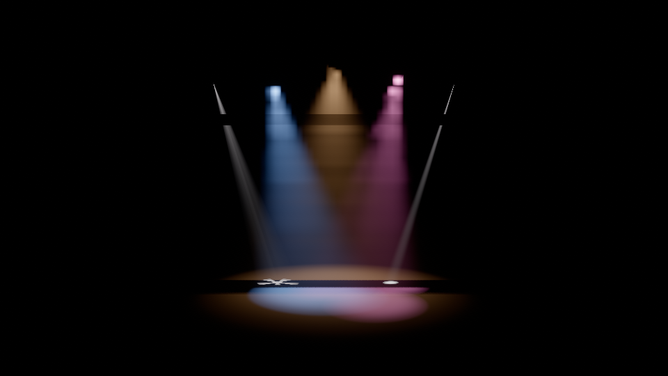 | 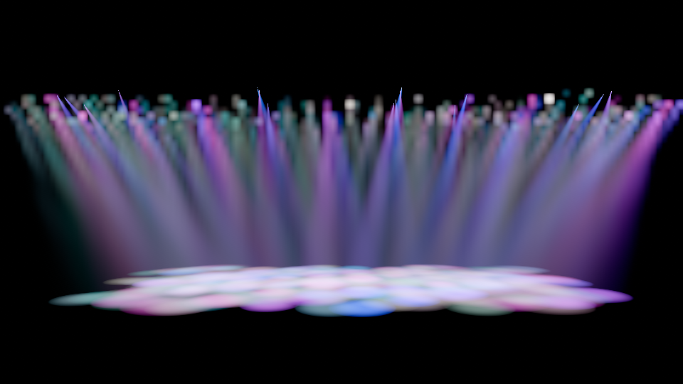 |
| 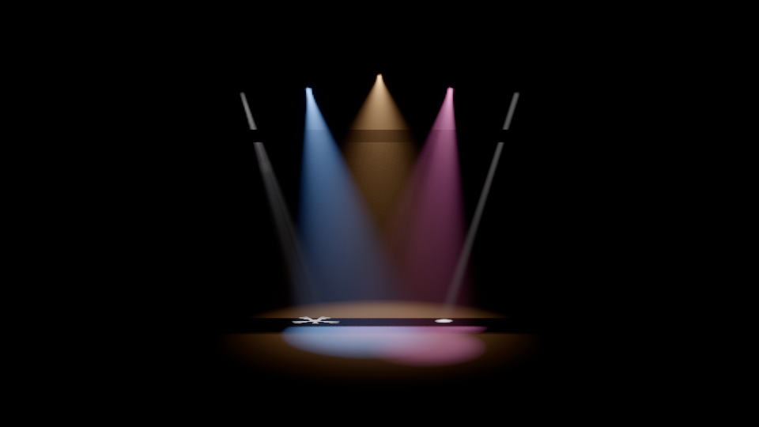 | 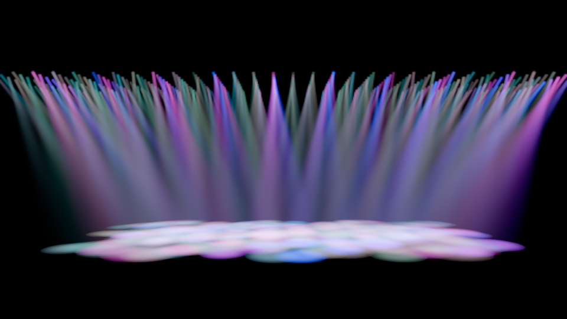 |

Top: before (48-step ray marching of the 16 most important narrow beams, the rest in 8 × 8-pixel froxels); bottom:
now. `Фокина.mvr` from a low audience position (EV 9, haze 0.05 1/m, open white; the 32 Glow emitters of the Zonda
fixtures left out, see below):

| Before | Now |
|---|---|
| 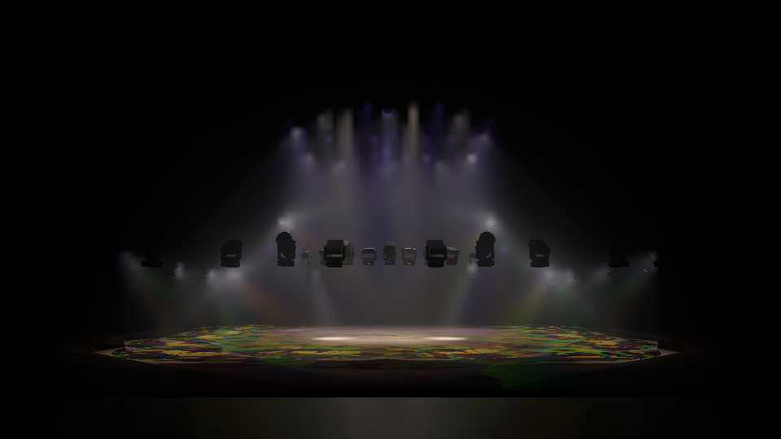 | 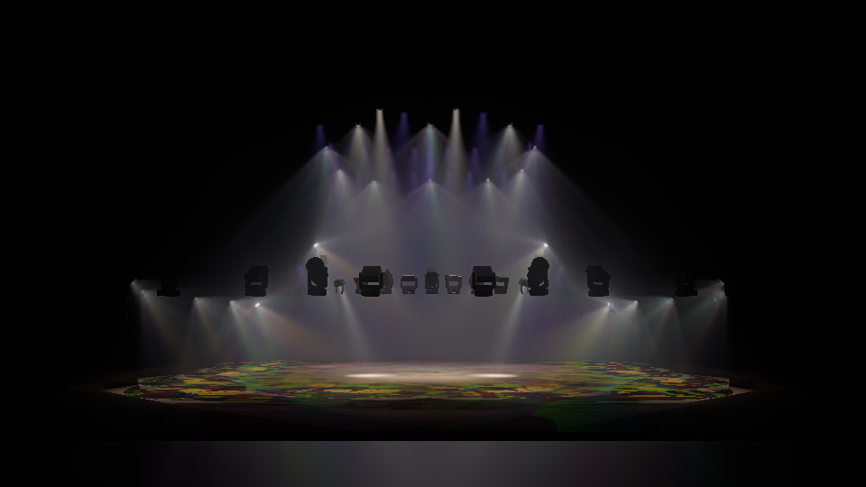 |

**Single scattering.** For a view ray through a beam (light at S, axis **a**, I(θ) its `BeamDistribution`, haze σ,
phase function HG(g)):

```
L = ∫ σ(x) · HG(g, cos θ_s) · I(θ) · cookie · shadow · T_light(d) / d² · T_view(t) dt
```

The ray is clipped analytically to the beam's cone — the truncated cone that starts at the lens disc of radius
`SourceRadius` (apex `S − a · R / tan θ_c`), up to the light's range — and to the scene depth; every prism facet is a
cone of its own (1/N of the intensity, its own axis and cookie frame).

* **Far field** (beyond `z_near = 3 · R / tan θ_c` from the lens): the light is a point source. With the closest
  approach t_c, D of the ray's line to S and the substitution `t = t_c + D · tan γ`, `dt / d² = dγ / D` — the 1/d²
  singularity disappears. The directions from S to the ray's points form a great circle; with θ_m its smallest angle to
  the axis, the spherical Pythagorean theorem in chord lengths is exact: `Θ² = Θ_m² + cos θ_m · U²` (Θ = 2 sin(θ/2),
  U = 2 sin(u/2), u the arc from the closest point), so in normalised chord coordinates the ray is a straight line at
  distance v from the beam centre and the profile along it is `f̂(W · √(v² + y²))`. Its cumulative integral
  `H(v, y) = ∫₀ʸ f̂ ds` comes from a **precomputed table** (`BeamScatteringTable`: 4 window families × 32 log-spaced
  exponents p ∈ [0.5, 64] × 64 × 64 entries, hi + lo half floats, built once in about 0.1 s; interpolated in full
  precision in v and y, by the hardware between exponents) — the generalised Gaussian of every `BeamType` with its
  cut-off window, so the soft edges follow the 50 % and 10 % angles exactly. The smooth factor
  `m(γ) = HG · T_light · T_view · range window · du/dy` is integrated against it by **product integration**: K segments
  (the same for every ray through the beam, `K = ⌈2 θ_c / 0.1⌉`, 2 … 8, so no seams), m linear on each segment
  (`∫ m f̂ = ΔH · ((1 − λ) m₀ + λ m₁)`, λ the profile's centroid in the segment by Simpson's rule) — second order, so the
  forward-peaked phase function needs no extra segments. Uniform haze without cookie, shadow or smoke is therefore
  exact and noise-free. A uniform cone (`SHAPE_UNIFORM_CONE`) has `H = min(y, √(1 − v²))`. A closed **iris** ends the
  profile at its angle; its soft edge (from `IrisSoftStart` to `IrisAngle`) gets two segments of its own on each side,
  with the iris factor in the smooth factor, so the edge in the air is as soft as on surfaces.
* **Modulation** (gobos, framing blades, prism cookies, shadow maps, smoke): stratified samples in each segment (one
  per segment with a history, two in the first frame; gobo and blade detail add samples per segment from the
  gate-plane length the ray crosses and the pixels it covers, up to 24 per beam) are placed **like the profile** within
  the segment — the target `H₀ + ξ · ΔH` is inverted on the table (a piecewise-linear first guess through the segment's
  Simpson nodes, then three bracketed Newton steps; a converged step is kept) — and measure `cookie × shadow × σ(x)`,
  weighted by `exact profile / table profile × m` (the first factor corrects the chord approximation and adds the iris).
  The segment's light is its exact integral times the **weighted mean** of these modulations (a ratio estimator), so a
  modulation that is uniform over the segment — an open gobo, a shadow map with nothing in the beam — adds no noise at
  all, and radial gobo patterns (discs, rings) in the air match the integral (within 1 %; uniform samples in y were off
  by up to 40 %). The sample positions are interleaved gradient noise over the half-resolution grid advanced by the
  golden ratio per frame (an R1 sequence per pixel), so the temporal accumulation converges evenly. The cookie is
  filtered by the larger of the segment's and the pixel's footprint in gate units (no aliasing of gobo detail far
  away).
* **Near field** (within `z_near` of the lens): the lens is an extended source. The shaft has the radius
  `(R⁴ + (z tan θ_c)⁴)^¼` (the lens radius at the lens, the point-source cone beyond, flux conserved): a point at
  distance ρ from the axis sees the profile at `atan(s ρ, z)`, `s = ζ / (R⁴ + ζ⁴)^¼`, `ζ = z tan θ_c`, with
  illuminance `I(θ) · s² / (z² + s² ρ²)`; 4-point Gauss–Legendre on 1–3 pieces of the ray gives the envelope. With
  modulation, stratified samples along the crossing (four per piece, more for gobo and blade detail; one lattice offset
  per pixel and frame, so the history converges instead of aliasing at fixed nodes) give the weighted mean modulation
  that scales the envelope. A camera inside the beam (looking up it or across it) therefore sees a finite, smooth
  result.
* **Thin beams** (`widenBeam`): the half-resolution rays are two internal pixels apart, so a beam narrower than that —
  a narrow beam seen from afar, the start of a beam at its lens, the pixel beams of LED bars — would be hit by one ray
  and missed by the next: broken, dotted, stair-stepped shafts that vanish towards the source. Per ray and facet, the
  shaft radius at the ray's closest approach to the axis (the cut-off radius; the lens near the lens) is compared with
  1.5 sample spacings there. Seen from the side, the facet is widened for that ray by the factor k that reaches it —
  every angle (beam, field, cut-off, iris, lens radius, gobo and blade gate coordinates) × k and the intensity / k² —
  which keeps the flux and so the light summed across the shaft on screen. Seen end-on (the ray runs inside the cone,
  so the beam is not thin for it), the angles stay and only the lens radius is raised to 1.5 samples at the lens's
  depth: the near field keeps the flux, the beam beyond the lens is unchanged and the lens a viewer looks into is
  spread over the samples around it (widening the whole beam for such rays lost 7–18 % of the light there). The two
  blend between the cone's half-angle and twice it. A resolved beam is untouched.

  | Seven-pixel bars (4°/6°, 2 cm lenses) seen from 22 m at 480 × 270, before | now |
  |---|---|
  | 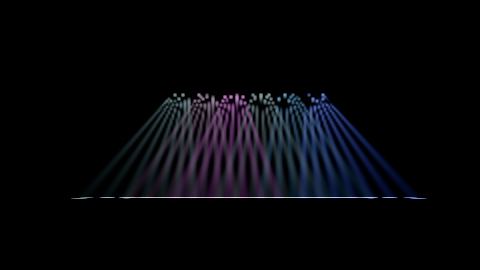 | 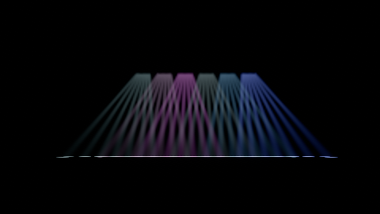 |

**Tiles** (`beam_cull.comp`): the half-resolution image is split into 16 × 16 tiles (32 × 32 internal pixels); one
256-thread work group per tile reduces the tile's farthest depth and tests every beam's cone — the convex hull of the
lens disc and the cap at the light's range (or 2 km), by its support function — against the tile's four side planes
(of the tile grown by 4 internal pixels, which covers the thin-beam widening) and its far depth, and writes one bit
per beam into the tile's mask. A 16-word header counts the tile-beam pairs, the
busiest tile and the tiles with beams; it is copied to a host-visible buffer and read when the frame slot comes round
again (no wait) for the statistics and the load balancing.

**Scattering** (`beam_scatter.comp`, half resolution): one ray per 2 × 2 block through the block centre; its depth is
the nearest pixel of the block on even and the farthest on odd blocks (checkerboard), so both sides of a depth edge
have samples. For each bit of its tile's mask the pass integrates every facet of the beam and writes **L** (the
estimate) and the noise-free envelope **B** (the same integral without modulation, with a reference σ) plus two depths:
the sample's view depth and its *validity* depth — when every beam the ray crossed ended in front of the surface, the
value holds for any surface behind that point (stored negated). Over the background a ray reaches every beam's range
(up to 2 km; the froxel volume ends at 500 m), and the depths stored in the half-float images are limited to 30 000 m
so the temporal pass can reproject the sky (a larger value would overflow to infinity).

**Temporal accumulation** (`beam_temporal.comp`, with `TemporalAccumulation`): only the **modulation ratio ρ = L / B**
is accumulated. The history is reprojected with the previous view-projection at the sample's depth (rejected when the
depth disagrees by more than 5 %), clipped to the mean ± one standard deviation of the current ratios in the 3 × 3
neighbourhood (variance clipping) and blended with weight n/(n + 1) after n frames up to 0.9. The output is `B · ρ`:
the envelope — where the beam is — always comes from the current frame, so panning beams and moving heads never
smear, while gobo patterns, shadows and smoke in the air converge within a few frames (the panning test keeps the beam
within 0.75 px of a still image).

**Composite** (`volumetric.frag`, internal resolution): joint bilateral upsampling of the four nearest half-resolution
samples — bilinear weights × `exp(−Δz / tolerance)`, Δz from the validity depth, the tolerance 2 % of the depth plus
2.5 × the surface's own depth slope (one-sided differences, so silhouettes do not widen it; floors at grazing angles
stay smooth); without any matching sample the closest one. Beams stop exactly at the silhouettes in front of them, and
a beam in front of a depth edge stays continuous across it. Added to the froxel in-scattering; the ±½ LSB dither of the
display transform hides the 8-bit quantisation of smooth beams (no banding).

**Scalability.** Cost ∝ Σ over tiles of (beams in the tile) × pixels × segments. `LightPlanner` scales the segment and
cookie-sample counts by a **quality** `clamp(48 / load, 0.25, 1)`, where load = tile-beam pairs per tile over all
tiles of the view (so it follows the total cost) from the GPU statistics (the CPU estimate of the beams' screen
coverage before the first measurement), so hundreds of overlapping beams degrade gracefully instead of stalling. `RenderStatistics` reports `RaymarchedBeams` (beams),
`FroxelLights`, `BeamCoverage` (estimated beams per pixel), `BeamQuality`, `BeamTiles`, `BeamTilePairs` and
`BeamMaxPerTile`. On lavapipe (4 cores) at 320 × 180: 300 beams take about 280–370 ms per frame (12 317 tile-beam
pairs, 300 in the busiest of 60 tiles, quality 0.25), 1000 beams about 490–590 ms (38 953 pairs); on a GPU these are a
few milliseconds. lavapipe's timestamps do not capture its asynchronous compute work, so use wall times there.

**Lens glow.** `IRenderWorld.SetInstanceEmission(instance, luminance, axis, halfAngle)` makes the lens geometry emit
the beam's peak candela / lens area along its axis (Candela.Engine's RenderSync sets it for every lit beam part);
bloom adds the glare.

**Review notes.** The adversarial review of the beams fixed: radial gobo patterns in the far field (a converged Newton
step of the profile inversion was bisected away, ±10 %; before the profile-distributed samples ±40 %); beams thinner
than a sample (vanishing towards the source, dotted pixel bars); the background depth overflowing the half-float
images (no history over the sky on GPUs that round to infinity); noise of shadowed beams with nothing in them; the
flame atlas size. The regression tests are in `BeamReviewTests`.

## Indirect light

`PreviewSettings.Indirect` (Full view):

* **`ReflectiveShadowMaps`** (default). Shadow tiles of the RSM lights also store what the light sees: diffuse
  reflectance `(1 − metallic) · base colour` and the octahedral normal. `vpl.comp` (one work group per light) splits
  the tile into 16 × 16 cells, estimates each cell's reflected flux `I(ω) · cookie · T_light · albedo · Ω_texel` from
  4 × 4 stratified texels, builds a CDF and **importance-samples** that light's VPLs by flux (stratified, fixed per
  VPL so the result is stable); each VPL carries `flux / (count · pdf)`, an unbiased estimate of everything the light
  reflects. The view's budget of 256 VPLs goes to the 32 most important shadowed lights: 8 each plus the rest in
  proportion to their scores (so the gather never evaluates more than 256 VPLs per pixel, however many lights are
  shadowed). `gather.comp` evaluates, at **half resolution**, `E = Σ Φ_k · cos θ_k · cos θ_p · T_light / (π · max(d², (0.1 m)²))`
  for the surface under each pixel (no visibility test), and the forward pass **upsamples bilaterally** (four
  nearest samples, bilinear × view-depth similarity) and adds `albedo/π · E`.
* **`RayTraced`** (devices with ray query; otherwise falls back to RSM). `rt_gi.comp` traces 4 cosine-distributed rays
  per half-resolution pixel against the TLAS; a hit is shaded with the albedo of its material, the direct light of
  the view's GI lights (its 64 highest-scoring lights; visibility from their shadow tiles where they have one), its
  emission and `T_light`; a
  miss sees the background. `E = π/N · Σ L_hit`. The estimate is blended with the reprojected history (weight 0.9,
  rejected where the depth disagrees by more than 5 %; off with `TemporalAccumulation = false`), and the accumulated,
  unfiltered result becomes the next history. Two à-trous iterations (5 × 5 B3 kernel, steps 1 and 2, depth and
  normal edge-stopping) then remove the remaining speckle before the bilateral upsampling.
* **`Off`**.

Indirect light is one bounce of diffuse light (from the shadowed lights with RSM); the tests compare both modes with a
CPU integral of the light a red wall reflects onto a white floor.

**Numeric range.** The light images are half floats: HDR and froxel volumes hold pre-exposed luminance, the indirect
images irradiance in lux. Every writer clamps to 30 000 (15 stops above display white, so a blend of two clamped
values still fits) and turns NaN into 0, and the readers of the HDR image (bloom, auto exposure, tone mapping) do the
same: a fixture aimed into the camera through dense haze at a low exposure, or a surface a few centimetres in front of
a lens, would otherwise overflow 65 504, which GPUs may store as +∞ and blending, the bloom pyramid and the temporal
histories then turn into NaN.

## Post-processing

### Bloom

`bloom_down.comp` builds a half-resolution pyramid (up to 6 levels, down to ~4 px) with the 13-tap filter of five
overlapping box filters (weights ½ and 4 × ⅛, normalised: every level keeps the image's energy); the first level limits
samples to a luma of 2¹⁰ (10 stops above white) so a stray overflow cannot flood the pyramid — unlike a Karis average
this leaves all realistic highlights untouched. `bloom_up.comp` adds each coarser level, tent-filtered, into the finer
one. The display transform uses `(1 − k) · scene + k · Σ levels / levels` with k = `BloomIntensity`: the bloom only
redistributes light (energy within 3 % in the tests).

### Auto exposure

`histogram.comp` builds a 128-bin histogram of log2 scene luminance (HDR / exposure, cd/m²) over [−14, 22] in shared
memory; `exposure.comp` takes the mean log2 luminance of a percentile band and copies it to a host-visible buffer of
the frame slot. When the slot comes round again (no wait) the renderer adapts
`log2 L ← log2 L + (measured − log2 L) · (1 − e^(−1.5 · dt))` and uses `EV100 = log2(L · 100 / 12.5) + metering stops`
(minus the compensation). Without a measurement yet, the camera EV is used. `PreviewSettings.Metering`:

* **`Stage`** (default): the 85th to 99th percentile — the lit part of a stage picture (pools, beams, lenses; the
  hottest 1 % does not count) — placed **1.5 stops below** middle grey (`VulkanRenderer.StageMeteringStops` added to
  the EV100 of that reading): light
  pools stay below white, beams in haze stay visible and the dark venue is not lifted to grey. An evenly lit view comes
  out about 1.5 stops darker than with `Average`. `candela render --auto-exposure` uses it.
* **`Average`**: the 50th to 95th percentile at middle grey (an evenly lit room or product view).

### Resolution scale

`ResolutionScale` (clamped to 0.5–1) sets the internal resolution of the scene images, the froxel grid and the
indirect light. The display transform upscales the HDR image bilinearly to the display size; the grid, lines and
outlines are drawn at display resolution, depth-tested against the nearest scene depth (`depth_upsample.frag`).
`Pick`, `ReadPixels` and the display image always use display coordinates.

## Analysis overlays (`ViewOptions.Overlay`)

Overlay values are computed per pixel of every visible opaque surface into an `R32F` analysis image
(`analysis.frag`, EQUAL depth test against the pre-pass, any view shading) and coloured in the display transform:
`ColorGradient.Bake(256)` of the overlay's gradient is uploaded as a 256 × 1 table over [RangeMin, RangeMax] (log10
when `Logarithmic`), only when the gradient changes; values outside the range get `OutOfRangeColor` (grey). The
background is not coloured.

* **Lux** (`LuxGradient`, default 1 … 5000 lx, logarithmic): the **illuminance** on the surface, in lux —
  `E = Σ_lights I0 · profile(θ) · cookie · shadow · max(N·L, 0) / d²` (photopic: the luminance of the summed Rec.2020
  illuminance, light colours have luminance 1). Direct light only, no albedo, no indirect light, no haze extinction —
  a light-meter reading at the surface with its normal, equal to `LightMeter.IlluminanceAt` within 1 % where nothing
  shadows the point.
* **Noise** (`NoiseGradient`, default 25 … 80 dB): the **free-field sound pressure level** at the surface,
  `L = 10 · log10 Σ 10^(L_i/10)` with `L_i = L_1m,i − 20 · log10(max(d_i, 0.1 m))` over `SetNoiseSources`
  (= `Acoustics.SplAt` within 0.5 dB), or the `AtmosphereState.NoiseField` grid when one is given (trilinear; outside
  its box: silence). The air gets a **coloured fog**: density `0.05 /m · t · alpha` with t = the level's position in
  the gradient range and the gradient colour, integrated front to back along the view ray up to the surface (or 60 m
  over the background) with 24 quadratically spaced, jittered samples. The fog is display-referred (not tone mapped,
  independent of exposure and lighting), so it shows the gradient colours exactly.
* **Cables**: the shaded image with everything except instances flagged `InstanceFlags.CableHighlight` desaturated and
  darkened to 32 % of its luminance; lines (`SetLines`: the cable runs) are drawn on top of everything at full
  brightness.

`VulkanRenderer.ReadAnalysis` (internal) reads the lux / dB image back for tests and tools.

## Editor visuals

* **Selection outline** (`ShowSelectionOutline`, `SelectionColor` = #FF7A00 by default): selected instances are drawn
  into a display-resolution mask (coverage, and visibility against the scene depth); pixels within ~2 px outside a
  silhouette get the selection colour, anti-aliased by distance; where the nearby part of the object is hidden behind
  other geometry the outline is drawn at 45 % opacity, so selected objects stay findable through occluders. All views.
* **Beam outlines** (`ShowBeamOutlines`, all views — useful in Colorless and Wireframe): per light 8 lines from the
  lens to the field-angle circle where the beam meets the floor (Z = 0; 10 m when it points up; 0.5–30 m) and that
  circle as 24 segments, in the light's colour, 1.5 px, depth-tested.
* **Reference drawings** (`InstanceFlags.Reference`): unlit, base colour display-referred at 50 % opacity, no shadows,
  not ray traced — in the Full and the Colorless view (where they are drawn by the transparent pass over the grey
  shading); the Wireframe view shows their edges. Like other blended surfaces they are not in the pick buffer.
* **Wireframe** and **Colorless** as in stage 1; lines, grid and outlines are always drawn at display resolution.

## Accuracy and test coverage

`tests/Candela.Rendering.Vulkan.Tests` (153 tests, about 1.5 minutes on lavapipe once the SPIR-V cache is warm;
`xunit.runner.json` limits parallelism to two tests because lavapipe renders on the CPU) runs every test with the
validation layer and synchronization validation and asserts **zero validation errors**, including leak reports at
shutdown. Tests are skipped with a message when no Vulkan device exists. Images are 160 × 120 … 320 × 240.

| Test | Checks |
|---|---|
| `ContextTests` | instance/device with validation, device ranking, pipeline-cache persistence and damaged files |
| `ShaderTests` | every shader variant compiles and passes `spirv-val`; include changes invalidate the cache; struct sizes |
| `RenderModeTests`, `GoldenImageTests` | the procedural scene in Full / Colorless / Wireframe (both wireframe paths) against `Golden/*.png` at 320 × 240 — symmetric 3 × 3 neighbourhood comparison, mean error ≤ 2/255 and ≤ 0.5 % of pixels off by more than 40/255 |
| `PhotometricTests` | 10 000 cd at 5 m onto a white Lambertian floor: pool centre 10000/25/π cd/m² within 2 %; 30° off axis `profile(θ)·cos³θ` within 3 %; coloured light keeps luminance and chromaticity; iris and frost; emissive and background luminance |
| `ManyLightsTests` | 1000 lights, validation-clean, shaded luminance = CPU sum over all lights (3 %) — already in the first frame after the light count grew |
| `ToneMappingTests` | AgX / ACES / Neutral curves, exposure compensation (stops of exposure) |
| `PickTests` | pick id, position within 1 cm, normal, depth; not-pickable instances |
| `SceneTests` | incremental updates, stale handles, material updates, sRGB / Rec.709 → Rec.2020 conversions, mip chains, uploads staged in frames without rendering |
| `LifecycleTests` | resize, several targets per world, memory returned after destroying everything, leak-free dispose, allocation-free steady-state frames (measured while another thread forces full collections, so GC-collectable runtime caches such as the one behind `Enum.IsDefined` cannot hide); every stage-2 feature on two targets across resizes and view switches, allocation-free with all of them |
| `ShadowTests` | golden `shadow-box`; a point in the umbra gets ~0 direct light while the lux overlay elsewhere matches `LightMeter` within 1 %; cached tiles are not re-rendered until a caster in their frustum moves; `MaxShadowedLights` priority; `CastShadow` / `CastShadows` respected; 12 equally important lights all get working tiles (and share one VPL budget); a full atlas (256 tiles) makes room for 256 new lights; two views in one frame keep each other's tiles; no acne: a shadow-casting floor lit at grazing angles (1 %) and a lit sphere (4 %, tessellation) match `LightMeter` |
| `CookieTests` | goldens `cookie-gobo` (orientation, rotation), `cookie-blades`, `cookie-prism` (3 facets, flux 1/N each), `cookie-iris`; frost widens the beam and blurs the gobo; blade insertion and rotation positions; the flux on the floor equals the light meter's integral (1 %) and frost and prism keep it (2 %) |
| `VolumetricTests` | single scattering in uniform haze vs the numerical integral of σ·HG·I·e^(−σr)/r²·e^(−σl) within 5 % (froxels with and without temporal accumulation, and a volumetric beam); goldens `volumetric-beam` (side view), `volumetric-smoke` (density blob), `volumetric-flame`; an optically thick flame shows the blackbody luminance (5 %) and chromaticity (0.01); looking up a beam from inside it (volumetric beams, the same beams in the froxels, narrow and wide) within 5 % of the integral; uniform smoke through the density volume scatters like haze of the same coefficient (5 %, froxels and beams); haze in a shadow stays dark (froxels and beams); the froxel history follows a trucking or panning camera (beam within 0.75 px of the converged image) |
| `BeamTests` | the table matches the line integral of the profile (five family / exponent cases); single scattering of a 6° spot (100 000 cd, 6°/9°) and a 40° wash (40°/60°) against `BeamReference` — a 200 000-step double-precision integral with the same near-field model — within 5 % (with and without temporal accumulation; measured 0.1 % and 1 %); a half-open gobo in the air and a plate shadowing the beam (5 %); edge profiles of a Spot 20°/26° and a Fresnel 20°/40° across the beam within 5 % of the peak and the 50 % / 10 % crossings within a pixel; a panning gobo beam does not smear (centroid within 0.75 px of a still image, brightness 0.9–1.1); 300 and 1000 beams report statistics and degrade quality above the budget, finite and validation-clean; golden `beams-stage` (gobo, cool spot, wash under a truss, prism, large-lens beam with lens glow); stage metering exposes the lit part below white; instance emission (uniform and directional) shows the lens luminance and its colour, bloom glare, non-finite input is ignored; two flame grids glow each with its own temperature (`BlackbodyRadiator`, 5 %) |
| `BeamReviewTests` | radial gobos (a disc of 0.25 and of 0.7 of the gate, a ring 0.5–0.9) in the far field of a 6° point-source beam match the integral (4 %; measured ≤ 1.2 %); a 4° beam seen from 30 m, horizontal and diagonal, keeps its light summed across the shaft up to its lens (6 %; measured ≤ 1.6 %); the soft edge of a half-closed iris in the air (2 % of the axis value + 3 %); the eye inside a 40° wash, across and towards the source (5 %); the eye 20 m down a 6° beam (on and off its axis) looking back past and into the lens (centre 5 %, 16 × 16 pixels around the lens 5 %; measured ≤ 1.5 %); a shadowed beam with nothing in it equals the unshadowed one in a single frame (0.05 % of the peak); temporal accumulation settles a gobo beam over the background (frame-to-frame change below half that of single frames); a flame atlas beyond its budget skips grids with a warning |
| `OverlayTests` | lux overlay = `LightMeter` within 1 % (four lights, three beam types); gradient and out-of-range grey (golden `overlay-lux`); noise overlay = `Acoustics.SplAt` within 0.5 dB, noise field instead of sources; golden `overlay-noise` (surfaces + fog); golden `overlay-cables` (greyed scene, highlighted device keeps its colours); golden `selection-outline` (orange, dimmed through an occluder, absent when disabled); golden `beam-outlines`; reference drawings unlit at 50 % (Full and Colorless) |
| `PostTests` | golden `bloom`; the bloom image has the HDR image's energy (3 %), a halo appears and the source gives up light; auto exposure (average metering) converges to the trimmed-mean measurement (0.2 stop), follows a 4× brighter scene by 2 stops (adapting over time) and adds compensation; resolution scale 0.5 renders a quarter of the pixels, keeps the display size and picking (< 1 cm), clamps to [0.5, 1] |
| `IndirectTests` | a red wall bleeds onto a white floor: red/green rises by more than 30 % against `Indirect = Off`, and the added luminance matches a CPU integral of the wall's reflected light (RSM within 12 %, ray-traced GI within 20 %, both measured on lavapipe); a red floor bleeds onto a white wall (RSM 5 %, ray-traced 10 %); fallbacks |
| `RobustnessTests` | NaN / out-of-range settings, lights and atmosphere grids (empty, short, beyond the 3D image limit, NaN, infinite, null) in every view and overlay; 1000 shadow-casting lights with every feature (256 tiles, ≤ 256 VPLs); 2 Mcd into the camera through dense haze stays below the half-float limit and finite |
| `MemoryTests` | alignment, free-list reuse and coalescing, granularity, dedicated allocations |
| `SwapchainTests` | headless surface: acquire/present, resize, minimise, misuse errors, ImGui handoff state |

Regenerate golden images after an intentional visual change with
`CANDELA_UPDATE_GOLDEN=1 dotnet test tests/Candela.Rendering.Vulkan.Tests` (optionally `--filter` a class) and inspect
them (`bin/.../render-output` holds the actual image of every comparison and the difference images of failed ones).
Internal test hooks: `VulkanRenderer.ReadHdr` returns the pre-tone-mapping image divided by the exposure (cd/m²),
`ReadBloom` the bloom image the display transform mixes in, `ReadAnalysis` the lux / dB image; `LastStatistics`
counts shadowed lights, shadow tiles rendered, volumetric beams (and their tile statistics and quality), froxel lights
and VPLs.

## Editor integration

### Shared context and swapchain

```csharp
// Instance extensions and surface from the windowing system (GLFW shown).
var options = new VulkanContextOptions
{
    InstanceExtensions = glfwRequiredInstanceExtensions,                  // includes VK_KHR_surface
    CreateSurface = instance => CreateWindowSurface(window, instance),    // VkSurfaceKHR handle; device must present to it
    PreferredDeviceName = appSettings.PreferredGpu,
    Log = (level, message) => logger.Log(level, message),
};
var context = VulkanContext.Create(options);
var renderer = new VulkanRenderer(context);                               // does not own the context
var swapchain = new VulkanSwapchain(context, context.PresentationSurface, framebufferWidth, framebufferHeight);
```

Dear ImGui (`ImGui_ImplVulkan_InitInfo`): `Instance`, `PhysicalDevice`, `Device`, `QueueFamily = QueueFamilyIndex`,
`Queue`, `PipelineCache`, `MinImageCount = swapchain.MinImageCount`, `ImageCount = swapchain.ImageCount`,
`UseDynamicRendering = true` with `PipelineRenderingCreateInfo.ColorAttachmentFormats = { swapchain.Format }`, and a
descriptor pool of the editor's own (with `FREE_DESCRIPTOR_SET` for `AddTexture`/`RemoveTexture`).

The swapchain uses a `UNORM` format (B8G8R8A8 / R8G8B8A8, sRGB non-linear colour space): ImGui's colours and the
display images are already sRGB-encoded, so they pass through unchanged.

### Per frame

```csharp
var frame = context.BeginFrame();                       // waits only for this slot's previous frame
foreach (var viewport in viewports)
    renderer.Render(viewport.Target, viewport.Camera, viewport.View, previewSettings, dt);  // recorded into `frame`
if (swapchain.TryAcquire(frame, out var image))
{
    swapchain.BeginRendering(frame, clearColor);        // UNDEFINED → COLOR_ATTACHMENT, clear, vkCmdBeginRendering
    ImGui_ImplVulkan_RenderDrawData(drawData, frame.CommandBuffer);
    swapchain.EndRendering(frame);
}
if (!swapchain.Present(frame) || windowResized)         // → PRESENT_SRC, submit (wait acquire, signal finished), present
    swapchain.Recreate(framebufferWidth, framebufferHeight);   // waits idle; 0 × 0 = minimised
```

Synchronisation: an "image acquired" semaphore per frame slot (reusable once the slot's fence signalled) and a
"rendering finished" semaphore per swapchain image (reusable once that image is acquired again). The submission waits
for the acquisition at `COLOR_ATTACHMENT_OUTPUT`, where the layout transition starts. `Pick` and `ReadPixels` are
blocking and must be called outside `BeginFrame` … `Present`.

### Showing a viewport in Dear ImGui

After every `Render` the target's display image is in `SHADER_READ_ONLY_OPTIMAL` and the barrier for fragment-shader
reads is recorded, so ImGui can sample it in the same frame or any later submission:

```csharp
var t = (VulkanRenderTarget)target;
if (t.DisplayVersion != viewport.RegisteredVersion)
{
    if (viewport.TextureId != 0)
    {
        var old = viewport.TextureId;                    // the old image may still be sampled by frames in flight
        context.DeferDestroy(() => ImGui_ImplVulkan_RemoveTexture(old));
    }
    viewport.TextureId = ImGui_ImplVulkan_AddTexture(t.DisplaySampler, t.DisplayImageView, t.DisplayImageLayout);
    viewport.RegisteredVersion = t.DisplayVersion;
}
ImGui.Image(viewport.TextureId, new Vector2(t.Width, t.Height));
```

`DisplaySampler` is a linear clamp-to-edge sampler shared by all targets; `DisplayImageView`/`DisplayImage` change on
`Resize` (`DisplayVersion` increments). The display image keeps the target's size whatever the `ResolutionScale`.

### Shutdown order

Dispose the targets, the renderer, the swapchain, then destroy the surface
(`context.SurfaceApi!.DestroySurface(context.Instance, surface, null)`), then the context. `VulkanRenderer.Create`
creates a renderer that owns its context (CLI, tests).

## Running on a real GPU

* Windows / Linux with a Vulkan 1.3 driver: current AMD (Adrenalin, RADV), NVIDIA and Intel (Windows driver, ANV)
  drivers all qualify; macOS needs MoltenVK with Vulkan 1.3 support (portability enumeration is enabled
  automatically). The renderer only uses core 1.3 features, queried limits (bindless array size, alignment,
  granularity, image dimensions, line width) and documented fallbacks (edge-shader wireframe, CPU mip generation), so
  nothing depends on one vendor or on lavapipe.
* `candela render-test --out out [--width 1920 --height 1080] [--frames 30] [--tonemapper agx|aces|neutral]
  [--device "RTX"] [--validation] [--haze 0.02] [--no-shadows] [--shadow-resolution 2048] [--indirect off|rsm|raytraced]
  [--no-bloom] [--bloom 0.04] [--auto-exposure] [--exposure-compensation 1] [--scale 0.75] [--volumetric-slices 64]
  [--overlays]` (from the repository: `dotnet run --project src/Candela.Cli -- render-test --out out`) writes
  `full.png`, `colorless.png`, `wireframe.png` (with `--overlays` also `lux.png`, `noise.png`, `cables.png`) and prints
  the device, driver, capabilities, per-pass GPU times and the shadow / beam / VPL statistics. Exit codes: 0 ok,
  1 failure (including validation errors), 2 usage, 3 no usable Vulkan device.
* Several GPUs: `--device <substring>` / `AppSettings.PreferredGpu`; otherwise the discrete GPU wins. Software
  rendering (lavapipe, SwiftShader) is reported as `RendererInfo.IsSoftwareRenderer`.
* Validation: install the Vulkan SDK (or `vulkan-validationlayers`) and set `CANDELA_VK_VALIDATION=1`.
* Caches: `ConfigPaths.CacheDir` (`pipeline-*.bin`, `shaders/*.spv`); deleting them is always safe.
* Debugging: object names and pass labels are set through `VK_EXT_debug_utils`; RenderDoc and Nsight show the pass
  structure of the table above.
* Shader development: `CANDELA_SHADER_DIR=src/Candela.Rendering.Vulkan/Shaders` makes the renderer read the GLSL files
  from disk instead of the embedded copies (no rebuild needed; the SPIR-V cache is keyed by content).

### Performance notes for real GPUs

lavapipe runs every pass on the CPU, so the test timings say nothing about a GPU; the costs below are what scales on
real hardware, with the settings that control them.

| Feature | Cost scales with | Memory | Knobs |
|---|---|---|---|
| Shadow atlas | tiles **re-rendered** × casters in their frusta (cached: a static scene renders no tiles per frame) | (2R)² × 4 B depth, + 8 B with RSM — R = 1024: 16 MiB, 48 MiB with RSM | `ShadowMapResolution`, `MaxShadowedLights` |
| PCSS | 12 + 16 shadow-map taps per shadowed light per shaded pixel | — | `SourceRadius` (wider penumbrae cost the same taps) |
| Froxels | (W/8) × (H/8) × slices × lights per cluster (injection) | 3 × 8 B per froxel — 1920 × 1080 at 128 slices ≈ 95 MiB, at 64 ≈ 47 MiB | `VolumetricSlices`, `ResolutionScale`, `TemporalAccumulation` |
| Volumetric beams | tile culling: tiles × beams (one work group per tile); scattering: Σ over half-resolution pixels of the beams in their tile × segments (2–8, × quality) + modulation samples for cookies, shadows and smoke | 5 half-resolution `RGBA16F` images + tile masks (tiles × ⌈beams/32⌉ words) | `MaxRaymarchedBeams`, `ResolutionScale`, `TemporalAccumulation` (quality adapts to the load) |
| RSM | 256 VPLs × ¼ of the internal pixels (≈ 130 M VPL evaluations at 1080p) + VPL generation (one 256-thread group per light) | VPL buffer, half-resolution `RGBA16F` | `Indirect`, `MaxShadowedLights` |
| Ray-traced GI | 4 rays × ¼ of the internal pixels (≈ 2 M rays at 1080p) + hit shading (up to 64 lights) + 2 × 25-tap filter; TLAS rebuilt per frame, BLAS once per mesh | half-resolution images × 3, BLAS ≈ a few × the mesh size | `Indirect` |
| Bloom | ~1⅓ × the half-resolution pixels × 13 + 9 taps | pyramid ≈ ⅓ of an `RGBA16F` image | `Bloom`, `BloomIntensity` (no cost difference) |
| Auto exposure | one histogram pass (shared-memory atomics) + one 128-thread group | 0.5 KiB per frame slot | `AutoExposure` |
| Overlays | one extra opaque pass into `R32F` (lux / noise), 24 sound-level samples per pixel for the noise fog | `R32F` image | `Overlay` |

* Expect the forward pass, the froxel injection and the beam scattering of many overlapping wide beams to dominate a
  busy stage at 1080p; `ResolutionScale = 0.75` cuts all internal-resolution work by ~44 % with little visible loss
  (the overlays and outlines stay sharp).
* A real-time editor viewport should keep `TemporalAccumulation` on: froxel jitter and the GI history turn per-frame
  noise into smooth results within a few frames; moving the camera reprojects, moving objects or lights is handled by
  the depth rejection (GI) and the 0.8 history weight (froxels), with a short trail at most.
* Shadow tiles are only re-rendered when something inside them changes, so moving lights cost their own tiles; a
  moving truss with many fixtures re-renders all of their tiles in that frame.
* GPU timings per pass are printed by `candela render-test` and available as `VulkanContext.LastGpuTimings`
  (timestamps; on lavapipe they are not meaningful).

## Stage 3

The progressive path tracer behind `IRenderer.StartFinalRender` (currently `NotSupportedException ("path tracer
arrives in stage 3")`) can share the BLAS per mesh and the geometry table of `RayTracingScene`, the materials, lights,
cookies, photometric profiles and media of stages 1 and 2.

## Known limitations

* **Haze extinction along light paths** uses the uniform haze only for surfaces and the froxels; smoke dims the view
  path but not the light reaching them (the volumetric beams estimate smoke on the light path from three samples).
* **Volumetric beams** are single scattering. Their culling is conservative (a cone that continues through a floor
  still occupies the tiles of the sky beyond it), the half-resolution integration and its upsampling can miss
  sub-pixel geometry in front of a beam, and the first frame after a cut shows ~2 LSB of structured sampling noise
  where gobos, shadows or smoke modulate a beam (it converges within a few frames). Beam light between the camera and
  a transparent surface is hidden behind that surface (the transparent pass draws over the composite).
* **Lens glow** is what the camera sees (directional, from `SetInstanceEmission`); indirect light and reflections do
  not see it.
* **Shadow frusta** are clamped to 80° half-angle: light beyond that (very wide floods) is unshadowed. Lights beyond
  `MaxShadowedLights`, and lights that do not fit in the atlas, are unshadowed (and have no reflective shadow map).
* **Reflective shadow maps** test no visibility between a VPL and the receiver (light can leak through thin walls);
  only one bounce; only the 32 most important shadowed lights contribute. Lights get shadow tiles (and so reflective
  shadow maps) and GI evaluation only when their beam reaches into the view: a light that hits only surfaces outside
  the view adds no indirect light to it. The ray-traced GI shades its hits with the shadowed lights (up to
  64 per view) plus emission; it is a noisy estimate that needs a few frames to converge after a change.
* **Transparent surfaces** take the fog of the froxel volume at their depth; volumetric light between overlapping
  transparent layers is approximated by that single lookup. Transmission has no tint and no refraction.
* **Froxel resolution**: lights left to the froxels (Lambertian emitters, bounding cones wider than 80°, lights beyond
  `MaxRaymarchedBeams`) are as sharp as 8 × 8 px tiles × the slice spacing.
* **Data, not rendering**: `Фокина.mvr` at open white looks milky through the CLI — its 32 Zonda pixel beams are
  GDTF Glow beams that each receive an eighth of the fixture's 465 000 cd from Candela.Dmx, so each is a Lambertian
  emitter of about 183 klm lighting the haze evenly:

  | `candela render stages/Фокина.mvr --view front --haze 0.08` before | now |
  |---|---|
  | 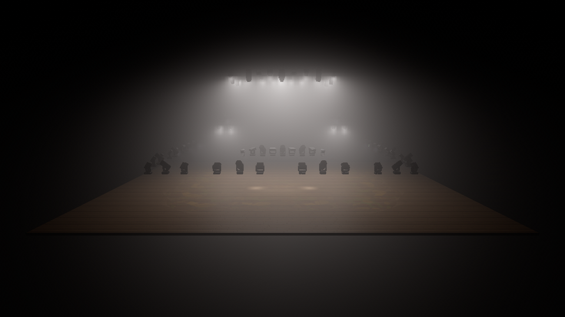 | 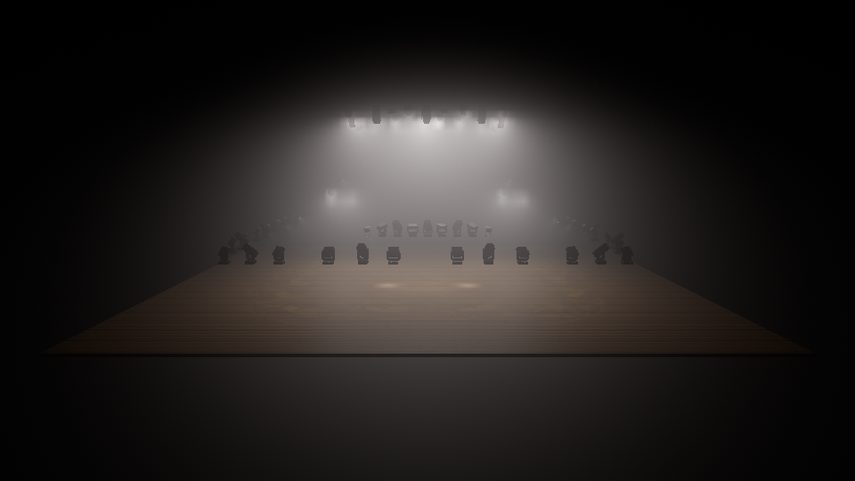 |
* **Noise overlay**: free-field point sources (no reflections, no directivity) unless a noise field is given.
* Single graphics+compute queue; uploads and rendering share it (no async compute/transfer yet).
